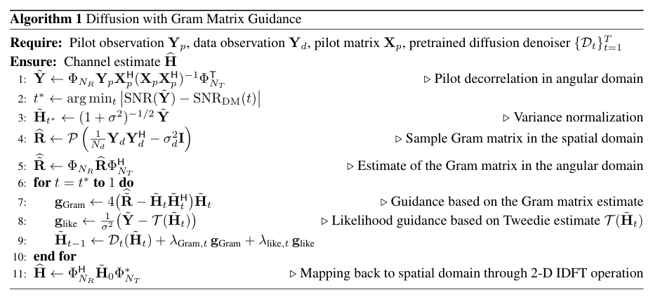
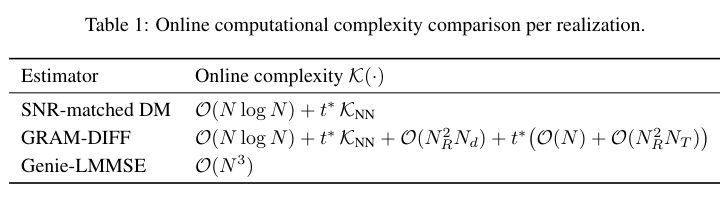

[对应论文条目](/papers/items/5cc5ea3c70722ac1/)

# GRAM-DIFF: Gram Matrix Guided Diffusion for MIMO Channel Estimation

**作者：** Xinyuan Wang; Krishna Narayanan  
**单位：** Department of Electrical and Computer Engineering, Texas A&M University, College Station, TX 77843, U.S.A.  
**来源：** arXiv:2602.15187v1, 2026-02-16  
**原文：** [https://arxiv.org/abs/2602.15187](https://arxiv.org/abs/2602.15187)  
**许可：** [CC BY 4.0](https://creativecommons.org/licenses/by/4.0/)；仅发布译文，不分发 PDF。  
**模型记录：** gpt-6-luna / xhigh

本文件为机器辅助中英文对照译稿。英文原文及成果归属原作者；中文翻译、段落映射与提取错误核查为本阅读文件新增内容，适用原文 CC BY 4.0 许可。

## 页码导航

- [第 1 页](#page-1)
- [第 2 页](#page-2)
- [第 3 页](#page-3)
- [第 4 页](#page-4)
- [第 5 页](#page-5)
- [第 6 页](#page-6)
- [第 7 页](#page-7)
- [第 8 页](#page-8)
- [第 9 页](#page-9)
- [第 10 页](#page-10)
- [第 11 页](#page-11)
- [第 12 页](#page-12)
- [第 13 页](#page-13)
- [第 14 页](#page-14)
- [第 15 页](#page-15)

## 全文原文与中文逐段对照

**Source:** p.1 M001

**Original:**

Xinyuan Wang and Krishna Narayanan
Department of Electrical and Computer Engineering,
Texas A&M University,
College Station, TX 77843, U.S.A
Email: merewxy@tamu.edu, krn@tamu.edu
February 18, 2026

**中文:**

作者与单位信息：Xinyuan Wang 和 Krishna Narayanan，Texas A&M University 电气与计算机工程系，College Station, TX 77843, U.S.A.。电子邮件：merewxy@tamu.edu、krn@tamu.edu。日期：2026 年 2 月 18 日。

### 第 1 页

**Source:** p.1 S001  
**Block:** paragraph

**Original:**

Abstract

**中文:**

**摘要**

**Source:** p.1 S002  
**Block:** paragraph

**Original:**

We propose GRAM-DIFF, a Gram-matrix-guided diffusion framework for semi-blind multiple input multiple output (MIMO) channel estimation. Recent diffusion-based estimators leverage learned generative priors to
improve pilot-based channel estimation [1, 2, 3, 4, 5]; but they do not exploit second-order structural information
estimated from data symbols. In practical systems, the channel Gram matrix can be estimated from received
symbols and it provides realization-level information about channel subspace structure. The proposed method
integrates a pretrained angular-domain diffusion prior with two complementary guidance mechanisms: a novel
Gram-matrix guidance term that enforces second-order consistency during the reverse diffusion process, and
likelihood guidance from pilot observations. Signal-to-noise ratio (SNR)-matched initialization and adaptive
guidance scaling ensure stability and low inference latency. Simulations on 3GPP and QuaDRiGa channel models demonstrate consistent normalized mean-squared error (NMSE) improvements over deterministic diffusion
baselines, achieving 4 to 6 dB SNR gains at an NMSE of 0.1 over the baseline in [1]. The framework exhibits
graceful degradation under coherence-time constraints, smoothly reverting to likelihood-guided diffusion when
data-based Gram estimates become unreliable.

**中文:**

本文提出 GRAM-DIFF，这是一种用于半盲多输入多输出（MIMO）信道估计的 Gram 矩阵引导扩散框架。近期基于扩散的估计器利用学习得到的生成先验改善基于导频的信道估计 [1, 2, 3, 4, 5]，但没有利用从数据符号估计得到的二阶结构信息。在实际系统中，可以根据接收符号估计信道 Gram 矩阵，它能提供与当前信道实现相关的子空间结构信息。所提方法将预训练的角域扩散先验与两种互补的引导机制结合起来：其一是新的 Gram 矩阵引导项，在反向扩散过程中施加二阶一致性；其二是来自导频观测的似然引导。与信噪比（SNR）匹配的初始化和自适应引导尺度保证了算法稳定性及较低的推理时延。在 3GPP 和 QuaDRiGa 信道模型上的仿真表明，相较于确定性扩散基线，所提方法能持续降低归一化均方误差（NMSE）；在 NMSE 为 0.1 时，相对文献 [1] 基线可获得 4–6 dB 的 SNR 增益。当信道相干时间受限时，该框架的性能会平滑退化；若基于数据的 Gram 估计变得不可靠，方法会平滑回退到仅由似然引导的扩散。

**Source:** p.1 S003  
**Block:** heading

**Original:**

1
Introduction

**中文:**

## 1 引言

**Source:** p.1 S004  
**Block:** paragraph

**Original:**

Multiple-input multiple-output (MIMO) channel estimation is a central enabling technology for 5G and emerging 6G wireless systems, directly impacting beamforming, spatial multiplexing, link adaptation, and interference
coordination in massive antenna deployments. As base stations scale to tens or hundreds of antennas, accurate
channel estimation becomes both more critical and more challenging. Two concurrent trends are particularly consequential. First, in massive MIMO regimes, the available transmit power is distributed across an increasingly
large number of spatial dimensions, leading to low per-antenna signal-to-noise ratios. In such regimes, effective estimators must leverage the intrinsic structure of the channel and exploit prior information in a principled
manner, rather than relying solely on pilot observations. Second, massive MIMO systems impose stringent computational constraints and approaches that vectorize the matrix-valued channel and attempt to learn or estimate
high-dimensional statistical models quickly become infeasible. These considerations motivate channel estimation
frameworks that preserve the native matrix structure of the MIMO channel, scale gracefully with array size, and
integrate data-driven learning in a way that respects known physical and statistical sufficiency principles.

**中文:**

多输入多输出（MIMO）信道估计是 5G 及新兴 6G 无线系统的一项核心使能技术，会直接影响大规模天线部署中的波束成形、空间复用、链路自适应和干扰协调。随着基站规模扩展到数十乃至数百根天线，准确的信道估计变得更加关键，也更具挑战性。当前有两种同时发生的趋势尤为重要。第一，在大规模 MIMO 场景中，可用发射功率被分配到不断增多的空间维度上，导致每根天线的信噪比较低。在这种情况下，有效的估计器必须以有原则的方式利用信道的内在结构和先验信息，而不能只依赖导频观测。第二，大规模 MIMO 系统对计算能力有严格要求；将矩阵值信道向量化、再快速学习或估计高维统计模型的方法很快会变得不可行。这些因素促使我们研究能够保留 MIMO 信道原生矩阵结构、随阵列规模平稳扩展，并以尊重已知物理和统计充分性原理的方式融合数据驱动学习的信道估计框架。

**Source:** p.1 S005  
**Block:** paragraph

**Original:**

Classical pilot-based approaches focus on directly estimating the channel matrix H from known training symbols. These methods implicitly treat the channel as the primary object of inference and rely heavily on pilot
overhead to resolve all channel degrees of freedom. Most classical approaches to MIMO channel estimation rely
on explicit statistical models for the channel matrix H. In pilot-based estimation, classical estimators such as the
linear minimum mean-squared error (LMMSE) estimators are optimal only under restrictive assumptions, such as
Gaussian channel distributions with known second-order statistics. In practice, however, the true channel statistics
may be shaped by array geometry, propagation environment, mobility, and hardware impairments, resulting in
distributions that are neither Gaussian nor easily parameterized.

**中文:**

传统的基于导频方法侧重于直接从已知训练符号估计信道矩阵 $\mathbf H$。这类方法将信道本身作为主要推断对象，并高度依赖导频开销来确定信道的全部自由度。大多数传统 MIMO 信道估计方法都依赖对信道矩阵 $\mathbf H$ 的显式统计模型。在基于导频的估计中，线性最小均方误差（LMMSE）等经典估计器只有在较强假设下才是最优的，例如信道服从已知二阶统计量的高斯分布。然而实际信道统计特性可能受到阵列几何、传播环境、移动性和硬件损伤的影响，因此所得分布既非高斯，也不容易参数化。

**Source:** p.1 S006  
**Block:** paragraph

**Original:**

Recent advances in learning-based channel estimation have demonstrated that deep neural networks can outperform classical estimators by implicitly learning complex channel statistics from data. Specifically, diffusion
models have been trained on channel realizations and then H has been estimated only from pilots by treating the
channel estimation problem as an inverse problem [2, 4, 1, 5, 3].

**中文:**

近期基于学习的信道估计研究表明，深度神经网络可以通过从数据中隐式学习复杂的信道统计特性，取得优于经典估计器的表现。具体而言，已有研究在信道实现上训练扩散模型，然后将信道估计视为逆问题，仅根据导频估计 $\mathbf H$ [2, 4, 1, 5, 3]。

### 第 2 页

**Source:** p.2 S007  
**Block:** paragraph

**Original:**

In typical communication systems, pilots are not transmitted in isolation; they are transmitted in conjunction
with data symbols. Even though data symbols are unknown at the receiver, the received signal corresponding
to the data reveals some information about H which can be used to perform semi-blind channel estimation. In
particular, the Gram matrix HHH can be estimated from the received signal. In signal processing, subspace-based
and semi-blind estimation methods that exploit second-order statistics of the received signal to estimate the range
or correlation structure of the channel have been studied extensively [6, 7]. In [8], a semi-blind algorithm based
on decomposing H as H = WQH, estimating W from the received signal and using pilots only to estimate
QH is proposed and it is shown to be highly effective in massive MIMO settings. Indeed, information-theoretic
results show that in the absence of full channel state information, schemes that estimate H based only on may be
suboptimal [9, 10].

**中文:**

在典型通信系统中，导频并非单独发送，而是与数据信号共同传输。尽管接收端不知道数据符号，但与数据符号对应的接收信号仍包含有关 $\mathbf H$ 的信息，可用于半盲信道估计。特别地，可以从接收信号估计 Gram 矩阵 $\mathbf H\mathbf H^{\mathsf H}$。在信号处理领域，利用接收信号二阶统计量估计信道值域或相关结构的子空间方法和半盲估计方法已得到广泛研究 [6, 7]。文献 [8] 提出一种半盲算法，将 $\mathbf H$ 分解为 $\mathbf H=\mathbf W\mathbf Q^{\mathsf H}$，再由接收信号估计 $\mathbf W$、仅用导频估计 $\mathbf Q^{\mathsf H}$；研究表明，该方法在大规模 MIMO 场景中效果显著。信息论结果也表明，在缺乏完整信道状态信息时，仅基于（原文此处表达缺项）估计 $\mathbf H$ 的方案可能并非最优 [9, 10]。

**Source:** p.2 S008  
**Block:** paragraph

**Original:**

However, there have been very few works that combine generative modeling with semi-blind channel estimation. Joint data detection and channel estimation with diffusion models is considered in [3]; however, Gram matrix
information is not used in the estimation process in [3]. A very recent paper [11] considers the use of variational
autoencoders for semi-blind channel estimation, but does not consider diffusion models.

**中文:**

然而，将生成建模与半盲信道估计结合起来的研究仍然很少。文献 [3] 研究了基于扩散模型的联合数据检测与信道估计，但其估计过程没有使用 Gram 矩阵信息。近期文献 [11] 将变分自编码器用于半盲信道估计，但未研究扩散模型。

**Source:** p.2 S009  
**Block:** paragraph

**Original:**

In this paper, we bridge these two lines of research by introducing a Gram-conditioned, diffusion-based channel estimation framework for single-user MIMO systems. As in [1], the diffusion model is trained offline on
representative channel realizations to capture the true, possibly highly-structured, distribution of H. At inference
time, channel estimation is posed as a conditional generation problem, where the diffusion model is conditioned
on both (i) an estimate of the instantaneous Gram matrix HHH obtained from the data portion of the received
signal, and (ii) pilot observations that provide additional, complementary information about the channel.

**中文:**

本文通过为单用户 MIMO 系统引入一种 Gram 条件扩散信道估计框架，连接上述两条研究脉络。与文献 [1] 一样，扩散模型离线在有代表性的信道实现上训练，以捕获真实且可能具有复杂结构的 $\mathbf H$ 分布。推理阶段将信道估计表述为条件生成问题，扩散模型同时以以下两项为条件：(i) 从接收信号的数据部分得到的瞬时 Gram 矩阵 $\mathbf H\mathbf H^{\mathsf H}$ 估计；(ii) 提供额外互补信息的导频观测。

**Source:** p.2 S010  
**Block:** paragraph

**Original:**

Unlike classical Bayesian estimators that rely on analytically convenient priors, or end-to-end neural estimators
that ignore known physical structure, the proposed method uses diffusion models to learn rich, data-driven priors
while explicitly conditioning on physically meaningful information about the channel extracted from the received
signal. To the best of our knowledge, the use of a learned diffusion prior conditioned jointly on pilot observations
and an estimated instantaneous Gram matrix has not been previously explored for MIMO channel estimation.

**中文:**

不同于依赖解析上便利先验的经典贝叶斯估计器，也不同于忽略已知物理结构的端到端神经估计器，本文方法利用扩散模型学习丰富的数据驱动先验，同时显式地以从接收信号中提取、具有物理意义的信道信息为条件。据我们所知，此前尚未有研究针对 MIMO 信道估计，联合使用导频观测和瞬时 Gram 矩阵估计来条件化学习得到的扩散先验。

**Source:** p.2 S011  
**Block:** heading

**Original:**

2
System Model and Problem Formulation

**中文:**

## 2 系统模型与问题表述

**Source:** p.2 S012  
**Block:** paragraph

**Original:**

We consider a multiple-input multiple-output (MIMO) single carrier system with NT transmit antennas and NR
receive antennas. At each time instant, a vector of NT -QAM symbols are transmitted and a vector of NR complex
values are received. We will refer to these as vector symbols to clearly distinguish them from the QAM or complex
received values. In the considered setup, data is transmitted in frames which contain Np pilot vector symbols and
Nd information or data vector symbols. Thus, a frame X is a NT × (Np + Nd) matrix of transmitted QAM
symbols. Let Xp ∈CNT ×Np and Xd ∈CNT ×Nd denote submatrices of X that correspond to the pilot and the
data parts and hence, X = [XpXd]. Let H ∈CNR×NT denote the complex channel matrix, which is the object of
primary interest in this paper. The received matrix Y is related to the transmitted matrix of symbols according to

**中文:**

考虑一个单载波多输入多输出（MIMO）系统，其发射天线数为 $N_T$，接收天线数为 $N_R$。每个时刻发送一个由 $N_T$ 个 QAM 符号组成的向量，并接收一个由 $N_R$ 个复数值组成的向量。为将其与 QAM 符号或接收复数值区分，本文将它们称为“向量符号”。所考虑的系统以帧为单位传输数据，每帧包含 $N_p$ 个导频向量符号和 $N_d$ 个信息（数据）向量符号。因此，发送帧 $\mathbf X$ 是一个维度为 $N_T\times(N_p+N_d)$ 的 QAM 符号矩阵。令 $\mathbf X_p\in\mathbb C^{N_T\times N_p}$ 和 $\mathbf X_d\in\mathbb C^{N_T\times N_d}$ 分别表示对应导频部分和数据部分的子矩阵，故 $\mathbf X=[\mathbf X_p\;\mathbf X_d]$。令 $\mathbf H\in\mathbb C^{N_R\times N_T}$ 表示本文关注的复信道矩阵。接收矩阵 $\mathbf Y$ 与发送符号矩阵的关系为

**Source:** p.2 S013  
**Block:** equation

**Original:**

Y = HX + Z,
(1)

**中文:**

$$\mathbf Y=\mathbf H\mathbf X+\mathbf Z,\tag{1}$$

**Source:** p.2 S014  
**Block:** paragraph

**Original:**

where Z is a matrix of noise samples which are i.i.d complex Gaussian random variables with zero mean and
variance σ2 per component. In this paper, we restrict our attention to the case when H remains constant over the
transmission of the entire frame. The received matrix can be split into two matrices corresponding to the pilots
and data vector symbols as follows

**中文:**

其中 $\mathbf Z$ 是噪声样本矩阵，各元素为独立同分布的复高斯随机变量，每个分量的均值为零、方差为 $\sigma^2$。本文只考虑在整帧传输期间 $\mathbf H$ 保持不变的情况。将接收矩阵按导频和数据向量符号划分，可得

**Source:** p.2 S015  
**Block:** equation

**Original:**

Yp = HXp + Zp,
(2)
Yd = HXd + Zd.
(3)

**中文:**

$$\mathbf Y_p=\mathbf H\mathbf X_p+\mathbf Z_p,\tag{2}$$
$$\mathbf Y_d=\mathbf H\mathbf X_d+\mathbf Z_d.\tag{3}$$

**Source:** p.2 S016  
**Block:** paragraph

**Original:**

We consider the case when H is unknown at the transmitter and the vector of transmitted symbols at any time t is
a vector of i.i.d QAM symbols [11, 3]. We also consider the case of orthogonal pilots where Xp is an orthonormal
matrix and hence, Np = NT . The considered system model accurately models a single carrier system with flat
fading and no time-selectivity; however, this model is also applicable to sub bands of an orthogonal frequency
division multiplexing (OFDM) system with frequency selective fading and no time selectivity and multi-user
settings. Extension to other cases will be considered later.

**中文:**

本文考虑发射端不知道 $\mathbf H$，且每一时刻发送的符号向量由独立同分布 QAM 符号组成的情况 [11, 3]。同时假设导频相互正交，即 $\mathbf X_p$ 是正交归一矩阵，因此 $N_p=N_T$。所考虑的系统模型可准确描述平坦衰落且无时变性的单载波系统；它也适用于具有频率选择性衰落、无时变性的 OFDM 子带以及多用户场景。对其他情况的扩展将留待后续研究。

**Source:** p.2 S017  
**Block:** paragraph

**Original:**

The main problem we address in this paper is the channel estimation problem of estimating H given the
received matrix Y and the pilot matrix Xp. In its baseline form, the proposed estimator operates using the pilot
observations Yp alone and leverages learned structural priors on the channel to produce accurate estimates even at
low per-antenna SNR. Importantly, when additional information becomes available - specifically, when the channel
Gram matrix HHH can be estimated from the data part Yd, the same framework can seamlessly incorporate this

**中文:**

本文要解决的主要问题是：给定接收矩阵 $\mathbf Y$ 和导频矩阵 $\mathbf X_p$，估计信道 $\mathbf H$。在基础形式下，所提估计器仅使用导频观测 $\mathbf Y_p$，并利用学习得到的信道结构先验，即使在每根天线 SNR 较低时也能给出准确估计。重要的是，当有额外信息可用时——具体而言，可从数据部分 $\mathbf Y_d$ 估计信道 Gram 矩阵 $\mathbf H\mathbf H^{\mathsf H}$ 时——同一框架可以无缝融合该侧信息，进一步细化信道估计。

### 第 3 页

**Source:** p.3 S018  
**Block:** paragraph

**Original:**

side information to further refine the channel estimate without the need for training. Thus, the proposed method
gracefully improves with increasing side information, yielding consistent gains when Gram estimates are reliable,
while maintaining strong performance in their absence.

**中文:**

这一侧信息可进一步细化信道估计，而无需额外训练。这样，所提方法能够随着侧信息增加而平稳改善：当 Gram 估计可靠时持续获益，在没有该信息时仍保持较强性能。

**Source:** p.3 S019  
**Block:** paragraph

**Original:**

The presented approach and results are most interesting in the case when the prior distribution of H is complicated. We use a pretrained diffusion model that is trained to generate samples of H and add guidance terms to the
diffusion process to improve the channel estimate. We first briefly discussion some preliminaries and prior work
before stating our novel contribution.

**中文:**

当 $\mathbf H$ 的先验分布较复杂时，本文的方法和结果尤其有意义。我们使用预训练扩散模型生成 $\mathbf H$ 的样本，并向扩散过程加入引导项以改善信道估计。下面先简要介绍预备知识和相关工作，再陈述本文的贡献。

**Source:** p.3 S020  
**Block:** heading

**Original:**

3
Preliminaries and Notation

**中文:**

## 3 预备知识与记号

**Source:** p.3 S021  
**Block:** paragraph

**Original:**

For any NR × NT matrix H, let ˜H denote the two-dimensional Discrete Fourier Transform (DFT) of H given by

**中文:**

对任意 $N_R\times N_T$ 矩阵 $\mathbf H$，令 $\widetilde{\mathbf H}$ 表示其二维离散傅里叶变换（DFT）：

**Source:** p.3 S022  
**Block:** equation

**Original:**

˜H = ΦNRHΦT
NT ,
(4)

**中文:**

$$\widetilde{\mathbf H}=\mathbf\Phi_{N_R}\mathbf H\mathbf\Phi_{N_T}^{\mathsf T}.\tag{4}$$

**Source:** p.3 S023  
**Block:** paragraph

**Original:**

where ΦN is the 1-D DFT matrix of size N×N representing a N-point DFT. We assume that the rows and columns
of ΦN are normalized. Since the columns (and rows) form a set of orthonormal vectors, ΦH
NΦN = ΦNΦH
N = IN.
The channel matrix H in (1) is naturally specified in the spatial domain since Hi,j is the channel coefficient
between the ith receive antenna and the jth transmit antenna. When the transmit and receive antennas are arranged
in a uniform linear array, ˜H represents the channel in the angular domain. It is well known that typical wireless
channels have (sparse) representations in the angular domain that are favorable to learning algorithms. This
property was successfully leveraged in [1] to design diffusion models for channel estimation. We follow their
approach and work with the angular representation in this paper as well.

**中文:**

其中 $\mathbf\Phi_N$ 是表示 $N$ 点 DFT 的 $N\times N$ 一维 DFT 矩阵。假定 $\mathbf\Phi_N$ 的行和列均经过归一化。由于其列（行）构成正交归一向量组，有 $\mathbf\Phi_N^{\mathsf H}\mathbf\Phi_N=\mathbf\Phi_N\mathbf\Phi_N^{\mathsf H}=\mathbf I_N$。式 (1) 中的信道矩阵 $\mathbf H$ 自然定义在空间域，因为 $H_{i,j}$ 是第 $i$ 根接收天线与第 $j$ 根发射天线之间的信道系数。当发射和接收天线按均匀线性阵列排列时，$\widetilde{\mathbf H}$ 表示角域信道。众所周知，典型无线信道在角域具有（稀疏）表示，有利于学习算法。文献 [1] 已利用这一性质设计信道估计扩散模型；本文沿用其方法，也在角域中处理信道。

**Source:** p.3 S024  
**Block:** paragraph

**Original:**

Let R := HHH and ˜R := ˜H ˜HH denote the Gram matrices of H and ˜H, respectively. The two Gram matrices
are related through a similarity transformation given by

**中文:**

令 $\mathbf R:=\mathbf H\mathbf H^{\mathsf H}$、$\widetilde{\mathbf R}:=\widetilde{\mathbf H}\widetilde{\mathbf H}^{\mathsf H}$，分别表示 $\mathbf H$ 和 $\widetilde{\mathbf H}$ 的 Gram 矩阵。两者通过相似变换相关联：

**Source:** p.3 S025  
**Block:** equation

**Original:**

˜R = ˜H ˜HH = ΦNRHΦT
NT (ΦT
NT )HHHΦH
NR
(5)
= ΦNRRΦH
NR.
(6)

**中文:**

$$\widetilde{\mathbf R}=\widetilde{\mathbf H}\widetilde{\mathbf H}^{\mathsf H}=\mathbf\Phi_{N_R}\mathbf H\mathbf\Phi_{N_T}^{\mathsf T}(\mathbf\Phi_{N_T}^{\mathsf T})^{\mathsf H}\mathbf H^{\mathsf H}\mathbf\Phi_{N_R}^{\mathsf H} \tag{5}$$
$$=\mathbf\Phi_{N_R}\mathbf R\mathbf\Phi_{N_R}^{\mathsf H}.\tag{6}$$

**Source:** p.3 S026  
**Block:** paragraph

**Original:**

Throughout the rest of the paper, capital boldface letters represent matrices in the spatial domain and the
corresponding variables with tilde refer to matrices in the angular domain.

**中文:**

本文后续使用粗体大写字母表示空间域矩阵，其上带波浪号的对应变量表示角域矩阵。

**Source:** p.3 S027  
**Block:** heading

**Original:**

4
Related Prior Work

**中文:**

## 4 相关先前工作

**Source:** p.3 S028  
**Block:** paragraph

**Original:**

Score-based and diffusion-based generative models have been introduced for MIMO channel estimation as a
powerful data-driven prior in recent years. In [2] channel estimation is performed via posterior sampling using
score-based generative models, where the posterior gradient is constructed by combining an analytically derived
likelihood term with a learned prior score, and samples are drawn using Langevin dynamics. While flexible,
this approach requires iterative stochastic sampling and a large number of updates. In [4] the likelihood information is incorporated into the reverse diffusion process. Their method improves estimation accuracy but still
relies on reverse sampling with a large number of diffusion steps, leading to high computational complexity. To
reduce inference complexity, [1] proposed a deterministic diffusion-based channel estimator by interpreting the
noisy observation as an intermediate diffusion step matched by SNR. By truncating the reverse diffusion process
and avoiding stochastic resampling, their method achieves low-latency inference and is shown to asymptotically
converge to the conditional mean estimator. Another important contribution of [1] is to demonstrate that by performing the reverse diffusion in the angular domain, a low-complexity convolutional neural network suffices to
denoise the channel observations. More recently, [5] extended diffusion-based channel estimation to general highdimensional linear inverse problems, moving beyond denoising-based formulations by explicitly incorporating
likelihood information into the diffusion process. Although highly general and applicable to various channel models, the approach incurs increased computational cost due to per-step likelihood gradient evaluation and matrix
operations.

**中文:**

近年来，基于 score 和扩散的生成模型已被用于 MIMO 信道估计，作为强大的数据驱动先验。文献 [2] 使用 score-based 生成模型进行后验采样来估计信道：将解析得到的似然项与学习得到的先验 score 相结合，构造后验梯度，再以 Langevin 动力学抽样。该方法灵活，但需要迭代随机采样和大量更新。文献 [4] 将似然信息纳入反向扩散过程，虽然提高了估计精度，但仍需进行大量反向扩散采样步骤，计算复杂度较高。为降低推理复杂度，文献 [1] 提出一种确定性扩散信道估计器，将含噪观测解释为与 SNR 匹配的中间扩散状态。通过截断反向扩散过程并避免随机重采样，该方法实现低时延推理，并被证明渐近收敛到条件均值估计器。文献 [1] 的另一项重要贡献是证明：在角域执行反向扩散时，可以用低复杂度卷积神经网络对信道观测进行去噪。近期，文献 [5] 将扩散信道估计推广到一般高维线性逆问题，通过在扩散过程中显式融入似然信息，摆脱仅基于去噪的形式。该方法适用性强，可用于多种信道模型，但由于每一步都要计算似然梯度并执行矩阵运算，其计算成本也更高。

**Source:** p.3 S029  
**Block:** paragraph

**Original:**

None of the aforementioned papers exploit the fact that the Gram matrix HHH can be estimated accurately
from Yd in some cases. In [8], a whitening based approach is proposed where the channel H is written as
H = WQH and W is estimated from Yd and then a maximum-likelihood estimate of Q is formed from Yp.
They show that significant gains in the mean-squared error can be obtained by this approach especially when
NR > NT . However, they do not consider a Bayesian setting where prior information about the distribution of Q
is obtainable from a dataset.

**中文:**

上述工作均未利用在某些情况下可根据 $\mathbf Y_d$ 准确估计 $\mathbf H\mathbf H^{\mathsf H}$ 这一事实。文献 [8] 提出一种基于白化的方法，将信道写为 $\mathbf H=\mathbf W\mathbf Q^{\mathsf H}$，由 $\mathbf Y_d$ 估计 $\mathbf W$，再依据 $\mathbf Y_p$ 对 $\mathbf Q$ 作最大似然估计。其结果表明，尤其在 $N_R>N_T$ 时，该方法可显著降低均方误差。然而，该工作没有考虑基于贝叶斯框架利用数据集获取 $\mathbf Q$ 分布先验信息。

**Source:** p.3 S030  
**Block:** paragraph

**Original:**

Very recently, in [11], semi-blind MIMO channel estimation using variational auto-encoders that leverage
generative priors has been proposed; however, this paper does not use a diffusion model. In [3], semi-blind
MIMO channel estimation using diffusion models is considered and a diffusion model is learned to sample from
the joint distribution of the channel and the data given the observations; however, the Gram matrix is not used as
guidance in [3].

**中文:**

近期，文献 [11] 提出利用生成先验的变分自编码器进行半盲 MIMO 信道估计，但没有采用扩散模型。文献 [3] 研究了基于扩散模型的半盲 MIMO 信道估计，并学习从观测条件下的信道与数据联合分布中采样的扩散模型；然而，文献 [3] 未将 Gram 矩阵用作引导信息。

### 第 4 页

**Source:** p.4 S031  
**Block:** heading

**Original:**

5
Proposed Algorithm

**中文:**

## 5 所提算法

**Source:** p.4 S032  
**Block:** paragraph

**Original:**

Our proposed algorithm is a posterior sampling algorithm using a pretrained diffusion model trained to sample
˜H in the angular domain in conjunction with appropriate guidance from Yp and an estimate of ˜R. The angular
domain sample ˜H finally is mapped back to the spatial domain via an inverse Fourier transform. We explain the
steps in the algorithm in detail below.

**中文:**

本文算法是一种后验采样方法：利用预训练扩散模型在角域生成 $\widetilde{\mathbf H}$ 的样本，同时结合来自 $\mathbf Y_p$ 和 $\widetilde{\mathbf R}$ 估计值的适当引导。最终将角域样本 $\widetilde{\mathbf H}$ 通过逆傅里叶变换映射回空间域。下面详细说明算法步骤。

**Source:** p.4 S033  
**Block:** heading

**Original:**

5.1
Training

**中文:**

### 5.1 训练

**Source:** p.4 S034  
**Block:** paragraph

**Original:**

We begin with a training dataset H = {H1, H2, . . . , HM} that contains M channel matrices in the spatial domain.
The dataset is transformed to a dataset in the angular domain ˜H = { ˜H1, . . . , ˜HM} by taking the 2-D DFT
of each of the data points (matrices). As shown in [1], using a generative model for ˜H permits the use of simple
convolutional neural networks in each step of the diffusion model (denoising step) for sampling from the posterior.
We use a pretrained diffusion model from [1]. In the next two sections, we describe how the received signal is
processed to obtain guidance.

**中文:**

首先构造训练数据集 $\mathcal H=\{\mathbf H_1,\mathbf H_2,\ldots,\mathbf H_M\}$，其中包含 $M$ 个空间域信道矩阵。对每个数据矩阵作二维 DFT，将其转换为角域数据集 $\widetilde{\mathcal H}=\{\widetilde{\mathbf H}_1,\ldots,\widetilde{\mathbf H}_M\}$。如文献 [1] 所示，对 $\widetilde{\mathbf H}$ 使用生成模型，可以在扩散模型的每一步（去噪步骤）采用简单的卷积神经网络，从后验分布采样。本文使用文献 [1] 中预训练的扩散模型。接下来的两节介绍如何处理接收信号以构造引导信息。

**Source:** p.4 S035  
**Block:** heading

**Original:**

5.2
Pilot-based Preprocessing
Consider the part of the received signal corresponding to the pilots given by
Yp = HXp + Zp,
Zp ∼CN(0, σ2I).
(7)
We right-multiply the received pilot observation by XH
p , which yields
YpXH
p = HXpXH
p + ZpXH
p = H + ZpXH
p .
(8)
Note that we only consider orthogonal pilots and hence, XpXH
p = I. Let ˜Yp and ˜Z denote the 2-D DFT of YpXH
p
and ZpXH
p , respectively i.e., ˜Y ≜ΦNRYpXH
p ΦT
NT and ˜Zp ≜ΦNRZpXH
p ΦT
NT , then we have the simplified form
˜Yp = ˜H + ˜Zp,
˜Zp ∼CN(0, σ2I).
(9)
Note that ˜Zp is obtained from Zp through a sequence of orthonormal transformations and hence, ˜Zp ∼CN(0, σ2I).
These operations remove the dependence on the pilots and convert the original linear observation model in the spatial domain into an additive-noise form in the angular domain, effectively recasting the channel estimation task as
a denoising problem amenable to diffusion-based generative modeling. The signal-to-noise ratio (SNR) associated
with (9) is given by SNR( ˜Yp) =
1
σ2 .
We assume that ˜H is preprocessed such that each component of ˜H is normalized to have unit variance. In this
case, each component of ˜Yp has a variance given by (1 + σ2). Dividing both sides of (9) by (1 + σ2), we get
1
√
1 + σ2 ˜Yp =
1
√
1 + σ2 ˜H +
σ
√
1 + σ2 ˜
Wp,
(10)
where ˜
Wp =
1
σ ˜Zp ∼CN(0, I) is a Gaussian random matrix with standard normal entries. Note that in the
normalized model, the quantity on the LHS has unit variance.

**中文:**

### 5.2 基于导频的预处理

考虑接收信号中对应导频的部分：

$$\mathbf Y_p=\mathbf H\mathbf X_p+\mathbf Z_p,\quad \mathbf Z_p\sim\mathcal{CN}(0,\sigma^2\mathbf I).\tag{7}$$

将导频接收观测右乘 $\mathbf X_p^{\mathsf H}$，得到

$$\mathbf Y_p\mathbf X_p^{\mathsf H}=\mathbf H\mathbf X_p\mathbf X_p^{\mathsf H}+\mathbf Z_p\mathbf X_p^{\mathsf H}=\mathbf H+\mathbf Z_p\mathbf X_p^{\mathsf H}.\tag{8}$$

注意本文仅考虑正交导频，因此 $\mathbf X_p\mathbf X_p^{\mathsf H}=\mathbf I$。令 $\widetilde{\mathbf Y}_p$ 和 $\widetilde{\mathbf Z}_p$ 分别表示 $\mathbf Y_p\mathbf X_p^{\mathsf H}$ 和 $\mathbf Z_p\mathbf X_p^{\mathsf H}$ 的二维 DFT，即 $\widetilde{\mathbf Y}_p\triangleq\mathbf\Phi_{N_R}\mathbf Y_p\mathbf X_p^{\mathsf H}\mathbf\Phi_{N_T}^{\mathsf T}$、$\widetilde{\mathbf Z}_p\triangleq\mathbf\Phi_{N_R}\mathbf Z_p\mathbf X_p^{\mathsf H}\mathbf\Phi_{N_T}^{\mathsf T}$。于是可将观测模型简化为

$$\widetilde{\mathbf Y}_p=\widetilde{\mathbf H}+\widetilde{\mathbf Z}_p,\quad \widetilde{\mathbf Z}_p\sim\mathcal{CN}(0,\sigma^2\mathbf I).\tag{9}$$

$\widetilde{\mathbf Z}_p$ 是对 $\mathbf Z_p$ 进行一系列正交变换后得到的，因此仍满足 $\widetilde{\mathbf Z}_p\sim\mathcal{CN}(0,\sigma^2\mathbf I)$。这些操作消除了模型对导频矩阵的显式依赖，并把空间域原始线性观测模型转化为角域加性噪声模型，从而将信道估计重新表述为适合扩散生成建模的去噪问题。式 (9) 对应的信噪比为 $\operatorname{SNR}(\widetilde{\mathbf Y}_p)=1/\sigma^2$。

假设对 $\widetilde{\mathbf H}$ 进行了预处理，使每个元素具有单位方差。此时 $\widetilde{\mathbf Y}_p$ 的每个元素方差为 $1+\sigma^2$。将式 (9) 两边除以 $\sqrt{1+\sigma^2}$，可得

$$\frac{1}{\sqrt{1+\sigma^2}}\widetilde{\mathbf Y}_p=\frac{1}{\sqrt{1+\sigma^2}}\widetilde{\mathbf H}+\frac{\sigma}{\sqrt{1+\sigma^2}}\widetilde{\mathbf W}_p,\tag{10}$$

其中 $\widetilde{\mathbf W}_p=\widetilde{\mathbf Z}_p/\sigma\sim\mathcal{CN}(0,\mathbf I)$ 是元素服从标准正态分布的高斯随机矩阵。注意，归一化模型左侧的量具有单位方差。

**Source:** p.4 S036  
**Block:** heading

**Original:**

5.3
SNR-adaptive Reverse Process
We consider a variance-preserving diffusion process with a predefined noise schedule {βt}T
t=1, and define
αt = 1 −βt,
¯αt =
tY
s=1
αs.
(11)
Under this formulation, the forward process is given by
˜Ht
=
p
1 −βt ˜Ht−1 +
p
βt εt,
εt ∼N(0, I),
(12)
˜Ht
=
√¯αt ˜H0 +
√
1 −¯αt ηt,
ηt ∼N(0, I),
(13)

**中文:**

### 5.3 SNR 自适应反向过程

考虑预先设定噪声调度 $\{\beta_t\}_{t=1}^{T}$ 的方差保持型扩散过程，并定义

$$\alpha_t=1-\beta_t,\qquad \bar\alpha_t=\prod_{s=1}^{t}\alpha_s.\tag{11}$$

在此设定下，前向过程为

$$\widetilde{\mathbf H}_t=\sqrt{1-\beta_t}\,\widetilde{\mathbf H}_{t-1}+\sqrt{\beta_t}\,\boldsymbol{\epsilon}_t,\quad \boldsymbol{\epsilon}_t\sim\mathcal N(0,\mathbf I),\tag{12}$$
$$\widetilde{\mathbf H}_t=\sqrt{\bar\alpha_t}\,\widetilde{\mathbf H}_0+\sqrt{1-\bar\alpha_t}\,\boldsymbol{\eta}_t,\quad \boldsymbol{\eta}_t\sim\mathcal N(0,\mathbf I).\tag{13}$$

### 第 5 页

**Source:** p.5 S037  
**Block:** paragraph

**Original:**

which holds for any t ∈{1, . . . , T}. Here, εt denotes the independent Gaussian noise injected at each diffusion
step. The forward process also admits an equivalent closed-form reparameterization, where each diffusion state
˜Ht can be expressed using an auxiliary Gaussian variable ηt. This representation is mathematically equivalent to
the step-wise formulation with independent Gaussian noises {εt}T
t=1.
Here, each component of ˜Ht is normalized to have unit variance where each diffusion step corresponds to
a specific noise level and can be interpreted as an SNR step of the generative model. Specifically, the diffusion
forward process admits a closed-form SNR expression:
SNRDM(t) ≜
E


√¯αt ˜H0

E
h

√1 −¯αt ηt
i =
¯αt
1 −¯αt
.
(14)
Given a pilot-assisted channel observation, its effective SNR can be estimated from the additive-noise model
derived in (10). We initialize the diffusion reverse process at the step t∗whose SNR best matches that of the
observation, i.e.,
t∗= arg min
t
SNR

˜Y

−SNRDM(t)
.
(15)
Starting the reverse denoising from t∗, the diffusion model iteratively refines the channel estimate according to
˜Ht−1 = Dt

˜Ht

= √¯αt−1 T ( ˜Ht) +
p
1 −¯αt−1 εθ( ˜Ht, t),
t = t∗, . . . , 1,
(16)
where
T ( ˜Ht) ≜E[ ˜H0 | ˜Ht] =
1
√¯αt

˜Ht −
√
1 −¯αt εθ( ˜Ht, t)

.
(17)
Here, Dt(·) denotes the diffusion-based denoising operator implemented by the pretrained diffusion model, where
εθ( ˜Ht, t) denotes the learned noise predictor. Note that ˜Ht−1 is a deterministic function of ˜Ht and t which
corresponds to the Denoising Diffusion Implicit Models (DDIM) sampler [12], and T ( ˜Ht) denotes the denoised
clean-channel estimate, i.e., the MMSE estimate E[ ˜H0 | ˜Ht] implicitly used in the DDIM reverse update. As
a result, higher-SNR observations require fewer reverse steps, leading to reduced inference latency compared to
initialization from pure Gaussian noise. ˜H0 is our estimate of the channel in the angular domain and the final
estimate of the channel in the spatial domain is the 2-D inverse DFT of ˜H0. Using (16) was introduced in [1] and
this will serve as our baseline.
5.4
Likelihood Guidance
In Section 5.2, pilot symbols were leveraged to simplify the original linear observation model into an additivenoise form, enabling diffusion-based denoising for channel estimation. While the SNR-adaptive reverse process
in Section 5.3 aligns the diffusion initialization with the observation noise level, the observation still provides
instantaneous sample-level information that can be incorporated during the reverse diffusion dynamics.
To this end, we introduce a likelihood guidance term that enforces first-order consistency between the denoised
channel estimate and the pilot-assisted observation. This guidance exploits the additive-noise observation model
to directly incorporate data fidelity into the diffusion-based denoising process.
Since the observation likelihood is defined on the clean channel ˜H0 rather than the noisy diffusion state ˜Ht,
we incorporate data fidelity using the denoised clean-channel estimate T ( ˜Ht) = E[ ˜H0 | ˜Ht] provided by the
diffusion model.
Using this denoised estimate, we approximate the likelihood gradient with respect to the diffusion state as
glike( ˜Ht) ≜∇˜Ht log p( ˜Y | ˜Ht) ≈1
σ2

˜Y −T ( ˜Ht)

,
(18)
where σ2 denotes the observation noise variance. Following common practice in diffusion posterior sampling, the
Jacobian term of T ( ˜Ht) with respect to ˜Ht is neglected for computational efficiency.
While likelihood guidance provides an effective first-order data consistency mechanism, its reliability depends
on the quality of the observation and may degrade in extremely low-SNR regimes. This issue will be addressed in
the joint guidance integration described in the next section.

**中文:**

式 (13) 对任意 $t\in\{1,\ldots,T\}$ 均成立。这里，$\boldsymbol{\epsilon}_t$ 表示每个扩散步骤注入的独立高斯噪声。前向过程也可以等价地写成闭式重参数化形式：每个扩散状态 $\widetilde{\mathbf H}_t$ 可借助辅助高斯变量 $\boldsymbol{\eta}_t$ 表示。该表示在数学上等价于由独立高斯噪声 $\{\boldsymbol{\epsilon}_t\}_{t=1}^{T}$ 驱动的逐步形式。这里将 $\widetilde{\mathbf H}_t$ 的每个分量归一化为单位方差，因此每个扩散步骤对应特定噪声水平，可解释为生成模型的一个 SNR 步骤。具体而言，扩散前向过程对应的闭式 SNR 为

$$\operatorname{SNR}_{\rm DM}(t)\triangleq \frac{\mathbb E[\|\sqrt{\bar\alpha_t}\widetilde{\mathbf H}_0\|^2]}{\mathbb E[\|\sqrt{1-\bar\alpha_t}\boldsymbol{\eta}_t\|^2]}=\frac{\bar\alpha_t}{1-\bar\alpha_t}.\tag{14}$$

给定经导频辅助的信道观测，可根据式 (10) 推导的加性噪声模型估计其有效 SNR。我们把反向扩散过程初始化在 SNR 与观测最匹配的步骤 $t^*$，即

$$t^*=\arg\min_t\left|\operatorname{SNR}(\widetilde{\mathbf Y})-\operatorname{SNR}_{\rm DM}(t)\right|.\tag{15}$$

从 $t^*$ 开始反向去噪，扩散模型按下式迭代细化信道估计：

$$\widetilde{\mathbf H}_{t-1}=D_t(\widetilde{\mathbf H}_t)=\sqrt{\bar\alpha_{t-1}}T(\widetilde{\mathbf H}_t)+\sqrt{1-\bar\alpha_{t-1}}\,\epsilon_\theta(\widetilde{\mathbf H}_t,t),\quad t=t^*,\ldots,1,\tag{16}$$

其中

$$T(\widetilde{\mathbf H}_t)\triangleq\mathbb E[\widetilde{\mathbf H}_0\mid\widetilde{\mathbf H}_t]=\frac{1}{\sqrt{\bar\alpha_t}}\left(\widetilde{\mathbf H}_t-\sqrt{1-\bar\alpha_t}\epsilon_\theta(\widetilde{\mathbf H}_t,t)\right).\tag{17}$$

$D_t(\cdot)$ 表示由预训练扩散模型实现的去噪算子，$\epsilon_\theta(\widetilde{\mathbf H}_t,t)$ 是学习到的噪声预测器。注意，$\widetilde{\mathbf H}_{t-1}$ 是 $\widetilde{\mathbf H}_t$ 和 $t$ 的确定性函数，对应去噪扩散隐式模型（DDIM）采样器 [12]；$T(\widetilde{\mathbf H}_t)$ 表示去噪后的干净信道估计，即 DDIM 反向更新中隐式使用的 MMSE 估计 $\mathbb E[\widetilde{\mathbf H}_0\mid\widetilde{\mathbf H}_t]$。因此，相比从纯高斯噪声初始化，高 SNR 观测所需的反向步骤更少，推理时延也更低。$\widetilde{\mathbf H}_0$ 是角域信道估计，最终空间域估计由其二维逆 DFT 得到。式 (16) 由文献 [1] 提出，本文将其作为基线。

### 5.4 似然引导

在第 5.2 节中，利用导频符号将原始线性观测模型简化为加性噪声形式，从而可以通过扩散去噪来估计信道。第 5.3 节的 SNR 自适应反向过程使扩散初始化与观测噪声水平相匹配，但观测仍包含逐样本的瞬时信息，可在反向扩散动力学中进一步利用。

为此，我们引入似然引导项，使去噪信道估计与导频辅助观测满足一阶一致性。该引导利用加性噪声观测模型，将数据保真项直接融入扩散去噪过程。

观测似然定义在干净信道 $\widetilde{\mathbf H}_0$ 上，而非含噪扩散状态 $\widetilde{\mathbf H}_t$ 上。因此，我们用扩散模型给出的去噪干净信道估计 $T(\widetilde{\mathbf H}_t)=\mathbb E[\widetilde{\mathbf H}_0\mid\widetilde{\mathbf H}_t]$ 融入数据保真信息。基于该去噪估计，近似得到相对于扩散状态的似然梯度：

$$g_{\rm like}(\widetilde{\mathbf H}_t)\triangleq\nabla_{\widetilde{\mathbf H}_t}\log p(\widetilde{\mathbf Y}\mid\widetilde{\mathbf H}_t)\approx\frac{1}{\sigma^2}(\widetilde{\mathbf Y}-T(\widetilde{\mathbf H}_t)).\tag{18}$$

其中 $\sigma^2$ 为观测噪声方差。按照扩散后验采样中的常见做法，为降低计算量，忽略了 $T(\widetilde{\mathbf H}_t)$ 关于 $\widetilde{\mathbf H}_t$ 的雅可比项。

似然引导提供了有效的一阶数据一致性机制，但其可靠性取决于观测质量，在极低 SNR 下可能退化。下一节介绍将其与 Gram 引导联合起来的方案。

### 第 6 页

**Source:** p.6 S038  
**Block:** heading

**Original:**

5.5
Gram Matrix Guided Diffusion
Beyond pilot information, additional second-order statistical structure can be exploited through the channel Gram
matrix which can be estimated from data symbols. To this end, consider the received symbols in the spatial domain
given by
Yd = HXd + Zd.
Forming the sample Gram matrix of Yd yields
1
Nd
YdYH
d = 1
Nd
(HXd + Zd) (HXd + Zd)H
(19)
= 1
Nd
HXdXH
d HH + 1
Nd
ZdZH
d + 1
Nd
HXdZH
d + 1
Nd
ZdXH
d HH.
(20)
The matrix product
1
Nd XdXH
d can be written as
1
Nd
P
i Xd,iXH
d,i where Xd,i is the ith column of the matrix
Xd. From the weak law of large numbers, we can see that
1
Nd XdXH
d
Nd→∞
−−−−−→I since the columns of Xd are
uncorrelated data symbols 1. Assuming sufficiently long data blocks, the cross terms vanish after averaging,
leading to
1
Nd
YdYH
d ≈HHH + σ2
dI.
(21)
Then an estimate of the channel Gram matrix in the spatial domain can be obtained according to
ˆR = \
HHH = P
 1
Nd
YdYH
d −σ2
dI

,
(22)
Where P is a projection operator that is designed to robustify the estimate; for example, by enforcing positive
semidefiniteness of ˆR. We also consider other shrinkage operators explained later. An estimate of the Gram
matrix in the angular domain is then obtained using
ˆ˜R = ΦNR ˆRΦT
NR.
(23)
We incorporate this estimated gram matrix as a guidance term during the reverse diffusion process by penalizing the mismatch between the gram matrix implied by the current diffusion state and the estimated channel
covariance. Specifically, we define the gram matrix-guided objective
f( ˜Ht) = −
˜Ht ˜HH
t −ˆ˜R
F .
(24)
Its gradient yields the gram matrix guidance direction
gGram( ˜Ht) ≜∇˜Htf( ˜Ht) = 4
b˜R −˜Ht ˜HH
t
 ˜Ht.
(25)
Finally, we jointly inject the likelihood-based and Gram-based guidance into the diffusion denoising process
by modifying the reverse update as
˜Ht−1 = Dt( ˜Ht) + λlike,t glike( ˜Ht) + λGram,t gGram( ˜Ht),
t = t∗, . . . , 1,
(26)
where Dt(·) denotes the pretrained diffusion denoiser at step t. The overall procedure is summarized in Table 1.
To match the intrinsic step size of the reverse process, we adopt a diffusion-aware scaling for the likelihood
strength, proportional to the noise schedule βt,
λlike,t ∝βt,
(27)
which serves as a baseline step-size normalization. The effective likelihood influence is further modulated by the
SNR-aware gating mechanism described below.
When likelihood guidance is incorporated into the reverse diffusion dynamics, its reliability may depend on
both the observation SNR and the underlying channel statistics. In particular, for certain channel families, naive
likelihood guidance can become unstable in the very-low SNR regime and introduce excessive sample-level perturbations that degrade the denoising performance. To address this issue, we introduce an SNR-aware gating
mechanism as a robustness safeguard, which modulates the effective strength of likelihood guidance based on the
1We assume appropriate interleaving if there is any error correction coding

**中文:**

### 5.5 Gram 矩阵引导扩散

除导频信息外，还可以利用从数据信号估计得到的信道 Gram 矩阵提取额外的二阶统计结构。考虑空间域接收数据符号：

$$\mathbf Y_d=\mathbf H\mathbf X_d+\mathbf Z_d.$$

对 $\mathbf Y_d$ 构造样本 Gram 矩阵，有

$$\frac{1}{N_d}\mathbf Y_d\mathbf Y_d^{\mathsf H}=\frac{1}{N_d}(\mathbf H\mathbf X_d+\mathbf Z_d)(\mathbf H\mathbf X_d+\mathbf Z_d)^{\mathsf H}\tag{19}$$
$$=\frac{1}{N_d}\mathbf H\mathbf X_d\mathbf X_d^{\mathsf H}\mathbf H^{\mathsf H}+\frac{1}{N_d}\mathbf Z_d\mathbf Z_d^{\mathsf H}+\frac{1}{N_d}\mathbf H\mathbf X_d\mathbf Z_d^{\mathsf H}+\frac{1}{N_d}\mathbf Z_d\mathbf X_d^{\mathsf H}\mathbf H^{\mathsf H}.\tag{20}$$

矩阵乘积 $N_d^{-1}\mathbf X_d\mathbf X_d^{\mathsf H}$ 可写为 $N_d^{-1}\sum_i\mathbf X_{d,i}\mathbf X_{d,i}^{\mathsf H}$，其中 $\mathbf X_{d,i}$ 是 $\mathbf X_d$ 的第 $i$ 列。由弱大数定律可知，由于 $\mathbf X_d$ 的列是互不相关的数据符号，当 $N_d\to\infty$ 时，$N_d^{-1}\mathbf X_d\mathbf X_d^{\mathsf H}\to\mathbf I$。假设数据块足够长，平均后交叉项趋于零，故

$$\frac{1}{N_d}\mathbf Y_d\mathbf Y_d^{\mathsf H}\approx\mathbf H\mathbf H^{\mathsf H}+\sigma_d^2\mathbf I.\tag{21}$$

由此可按下式估计空间域信道 Gram 矩阵：

$$\widehat{\mathbf R}=\widehat{\mathbf H\mathbf H^{\mathsf H}}=\mathcal P\left(\frac{1}{N_d}\mathbf Y_d\mathbf Y_d^{\mathsf H}-\sigma_d^2\mathbf I\right),\tag{22}$$

其中 $\mathcal P$ 是用于提高估计稳健性的投影算子，例如可通过强制 $\widehat{\mathbf R}$ 为半正定矩阵来实现。后文还会介绍其他收缩算子。角域 Gram 矩阵估计为

$$\widehat{\widetilde{\mathbf R}}=\mathbf\Phi_{N_R}\widehat{\mathbf R}\mathbf\Phi_{N_R}^{\mathsf H}.\tag{23}$$

我们在反向扩散过程中加入该估计 Gram 矩阵作为引导项，对当前扩散状态隐含的 Gram 矩阵与估计信道协方差之间的不匹配施加惩罚。具体定义 Gram 矩阵引导目标为

$$f(\widetilde{\mathbf H}_t)=-\|\widetilde{\mathbf H}_t\widetilde{\mathbf H}_t^{\mathsf H}-\widehat{\widetilde{\mathbf R}}\|_F^2.\tag{24}$$

其梯度给出 Gram 矩阵引导方向：

$$g_{\rm Gram}(\widetilde{\mathbf H}_t)\triangleq\nabla_{\widetilde{\mathbf H}_t}f(\widetilde{\mathbf H}_t)=4(\widehat{\widetilde{\mathbf R}}-\widetilde{\mathbf H}_t\widetilde{\mathbf H}_t^{\mathsf H})\widetilde{\mathbf H}_t.\tag{25}$$

最后，通过修改反向更新，将基于似然和 Gram 的引导联合注入扩散去噪过程：

$$\widetilde{\mathbf H}_{t-1}=D_t(\widetilde{\mathbf H}_t)+\lambda_{{\rm like},t}g_{\rm like}(\widetilde{\mathbf H}_t)+\lambda_{{\rm Gram},t}g_{\rm Gram}(\widetilde{\mathbf H}_t),\quad t=t^*,\ldots,1.\tag{26}$$

其中 $D_t(\cdot)$ 是第 $t$ 步预训练扩散去噪器。整体流程总结在算法 1。

为使似然引导与反向过程的内在步长相匹配，我们采用与扩散感知相符的尺度，使似然引导强度正比于噪声调度 $\beta_t$：

$$\lambda_{{\rm like},t}\propto\beta_t.\tag{27}$$

这提供了一种基准步长归一化。似然引导的有效影响还会受到下述 SNR 感知门控机制调节。

当似然引导纳入反向扩散动力学后，其可靠性可能同时取决于观测 SNR 和信道统计特性。对某些信道族，直接使用似然引导会在极低 SNR 时不稳定，产生过强的逐样本扰动并损害去噪性能。为此，我们引入 SNR 感知门控机制作为稳健性保护，根据估计的观测 SNR 调整似然引导的有效强度。该机制适用于朴素似然引导在极低 SNR 下不可靠的信道族（例如 QuaDRiGa LOS），而在似然引导本身稳定的信道中（例如 3GPP）则保持中性。具体为

$$\lambda_{{\rm like},t}=\lambda_{\rm like}\beta_t w(\operatorname{SNR}(\widetilde{\mathbf Y})),

**脚注 1：** 若存在差错控制编码，我们假定采用了适当的交织。

### 第 7 页

**Source:** p.7 A001  
**Block:** algorithm

**Original:**

Algorithm 1 Diffusion with Gram Matrix Guidance
Require: Pilot observation Yp, data observation Yd, pilot matrix Xp, pretrained diffusion denoiser {Dt}T
t=1
Ensure: Channel estimate bH
1: ˜Y ←ΦNRYpXH
p (XpXH
p )−1ΦT
NT
▷Pilot decorrelation in angular domain
2: t∗←arg mint
SNR( ˜Y) −SNRDM(t)
3: ˜Ht∗←(1 + σ2)−1/2 ˜Y
▷Variance normalization
4: bR ←P

1
Nd YdYH
d −σ2
dI

▷Sample Gram matrix in the spatial domain
5: b˜R ←ΦNR bRΦH
NT
▷Estimate of the Gram matrix in the angular domain
6: for t = t∗to 1 do
7:
gGram ←4
 b˜R −˜Ht ˜HH
t
 ˜Ht
▷Guidance based on the Gram matrix estimate
8:
glike ←
1
σ2
 ˜Y −T ( ˜Ht)

▷Likelihood guidance based on Tweedie estimate T ( ˜Ht)
9:
˜Ht−1 ←Dt( ˜Ht) + λGram,t gGram + λlike,t glike
10: end for
11: bH ←ΦH
NR ˜H0Φ∗
NT
▷Mapping back to spatial domain through 2-D IDFT operation

**算法 1 原文版面核对图：**

**中文:**

### 算法 1：带 Gram 矩阵引导的扩散

**输入：** 导频观测 $\mathbf Y_p$、数据观测 $\mathbf Y_d$、导频矩阵 $\mathbf X_p$、预训练扩散去噪器 $\{D_t\}_{t=1}^{T}$。

**输出：** 信道估计 $\widehat{\mathbf H}$。

1. $\widetilde{\mathbf Y}\leftarrow\mathbf\Phi_{N_R}\mathbf Y_p\mathbf X_p^{\mathsf H}(\mathbf X_p\mathbf X_p^{\mathsf H})^{-1}\mathbf\Phi_{N_T}^{\mathsf T}$。在角域对导频去相关。
2. $t^*\leftarrow\arg\min_t|\operatorname{SNR}(\widetilde{\mathbf Y})-\operatorname{SNR}_{\rm DM}(t)|$。
3. $\widetilde{\mathbf H}_{t^*}\leftarrow(1+\sigma^2)^{-1/2}\widetilde{\mathbf Y}$。执行方差归一化。
4. $\widehat{\mathbf R}\leftarrow\mathcal P( N_d^{-1}\mathbf Y_d\mathbf Y_d^{\mathsf H}-\sigma_d^2\mathbf I)$。在空间域估计样本 Gram 矩阵。
5. $\widehat{\widetilde{\mathbf R}}\leftarrow\mathbf\Phi_{N_R}\widehat{\mathbf R}\mathbf\Phi_{N_R}^{\mathsf H}$。估计角域 Gram 矩阵。
6. 对 $t=t^*,t^*-1,\ldots,1$ 执行循环。
7. $g_{\rm Gram}\leftarrow4(\widehat{\widetilde{\mathbf R}}-\widetilde{\mathbf H}_t\widetilde{\mathbf H}_t^{\mathsf H})\widetilde{\mathbf H}_t$。根据 Gram 矩阵估计构造引导。
8. $g_{\rm like}\leftarrow\sigma^{-2}(\widetilde{\mathbf Y}-T(\widetilde{\mathbf H}_t))$。基于 Tweedie 估计 $T(\widetilde{\mathbf H}_t)$ 构造似然引导。
9. $\widetilde{\mathbf H}_{t-1}\leftarrow D_t(\widetilde{\mathbf H}_t)+\lambda_{{\rm Gram},t}g_{\rm Gram}+\lambda_{{\rm like},t}g_{\rm like}$。
10. 结束循环。
11. $\widehat{\mathbf H}\leftarrow\mathbf\Phi_{N_R}^{\mathsf H}\widetilde{\mathbf H}_0\mathbf\Phi_{N_T}^{*}$。通过二维逆 DFT 映射回空间域。

**备注（输入/循环/分支）：** 算法要求提供导频和数据观测、导频矩阵与预训练去噪器；步骤 6 对 $t^*$ 至 1 作逐步反向更新。算法文本中没有条件分支。

**Source:** p.7 S039  
**Block:** paragraph

**Original:**

estimated observation SNR. This gating mechanism is beneficial for channel families where naive likelihood guidance becomes unreliable at very-low SNRs (e.g., QuaDRiGa LOS), while remaining neutral for channels where
likelihood guidance is inherently stable (e.g., 3GPP). We have
λlike,t = λlike βt w

SNR( ˜Y)

,
(28)
where λlike is a scalar, and the gating function w(·) is defined as
w

SNR( ˜Y)

=
1
1 + exp

−SNR( ˜Y)−SNR0
∆
.
(29)
Here, SNR0 controls the transition point at which likelihood guidance becomes effective, and ∆determines the
smoothness of the transition. The gating function depends solely on the observation SNR and is applied uniformly
across reverse diffusion steps, thereby decoupling likelihood reliability from the diffusion time index.

**中文:**

SNR 门控对某些信道族有益：例如 QuaDRiGa LOS 场景中的朴素似然引导在极低 SNR 下会变得不可靠，而 3GPP 中似然引导本身较稳定，故门控保持中性。其表达式为

$$\lambda_{{\rm like},t}=\lambda_{\rm like}\beta_t w(\operatorname{SNR}(\widetilde{\mathbf Y})),\tag{28}$$
$$w(\operatorname{SNR}(\widetilde{\mathbf Y}))=\frac{1}{1+\exp(-[\operatorname{SNR}(\widetilde{\mathbf Y})-\operatorname{SNR}_0]/\Delta)}.\tag{29}$$

$\lambda_{\rm like}$ 为标量，$\operatorname{SNR}_0$ 控制似然引导生效的转折位置，$\Delta$ 控制转折平滑程度。门控只依赖观测 SNR，并在全部反向扩散步骤中一致应用，因此似然可靠性与扩散时间索引相互解耦。

**Source:** p.7 S040  
**Block:** paragraph

**Original:**

In contrast, the gram matrix guidance enforces a global, second-order structural constraint on the channel
estimate. Since it operates at a different level from the stochastic reverse update, its influence does not need to
strictly follow the diffusion step size. In practice, we adopt a sublinear scaling
λGram,t ∝
p
βt,
(30)
which empirically provides effective structural regularization without overwhelming the reverse diffusion dynamics. Importantly, the overall magnitude of Gram guidance is controlled by a global scaling factor embedded in
λGram,t, which provides a mechanism to trade off structural regularization strength against Gram estimation uncertainty. This degree of freedom becomes critical in coherence-time limited regimes and will be exploited in
Sec. 6.6. To ensure numerical stability, the Gram matrix guidance update is further restricted using a norm-based
clipping strategy; see Appendix 7, paragraph Stability of Gram Guidance.

**中文:**

相较之下，Gram 引导对信道估计施加全局二阶结构约束。它与随机反向更新作用于不同层面，因此不必严格随扩散步长变化。实践中采用次线性缩放 $\lambda_{{\rm Gram},t}\propto\sqrt{\beta_t}$（30），在不压制反向扩散动力学的前提下有效进行结构正则化。Gram 引导的整体幅度由嵌入 $\lambda_{{\rm Gram},t}$ 的全局缩放因子控制，可在结构正则强度与 Gram 估计不确定性之间权衡。这一自由度对相干时间受限的情形至关重要，并将在第 6.6 节使用。为确保数值稳定性，Gram 引导更新还采用基于范数的裁剪，详见附录第 7 节有关 Gram 引导稳定性的段落。

**Source:** p.7 S041  
**Block:** heading

**Original:**

6
Simulation Results
6.1
Channel Models, Baselines, and Evaluation Setup
We consider a massive MIMO channel estimation scenario with (Nr, Nt) = (64, 16), consistent with the experimental configuration in [1]. We evaluate the proposed diffusion-based channel estimation framework with
likelihood and Gram matrix guidance on two widely used datasets following [1]: a 3GPP spatial channel model
and the QuaDRiGa channel simulator (v2.4).
Structural differences of the induced channel statistics.
Although both pipelines provide access to groundtruth channel realizations H for evaluation, the induced spatial second-order structure depends on the scenario
and simulator settings. In our experiments, we explicitly analyze the eigenvalue distribution of the realizationlevel Gram matrix HHH. We observe that the 3GPP setting considered here yields a more distributed eigenspectrum (higher spectral entropy), whereas the QuaDRiGa setting yields a more concentrated eigen-spectrum
(lower spectral entropy) with larger variability across realizations. We use this empirical characterization only to
contextualize the trends observed in later results.

**中文:**

## 6 仿真结果

### 6.1 信道模型、基线与评估设置（续）

本文考虑大规模 MIMO 信道估计场景，\((N_R,N_T)=(64,16)\)，与文献 [1] 的实验配置一致。按照文献 [1]，我们在两个常用数据集上评估所提出的带似然引导与 Gram 矩阵引导的扩散信道估计框架：3GPP 空间信道模型，以及 QuaDRiGa 信道仿真器（v2.4）。

**诱导信道统计量的结构差异。** 尽管两条流程都提供用于评估的真实信道实现 \(\mathbf H\)，但其诱导的空间域二阶结构取决于场景和仿真器设置。实验中，我们显式分析每次信道实现对应的 Gram 矩阵 \(\mathbf H\mathbf H^{\mathsf H}\) 的特征值分布。我们观察到，本文使用的 3GPP 设置会产生更分散的特征谱（谱熵较高），而 QuaDRiGa 设置会产生更集中的特征谱（谱熵较低），且不同实现之间的变化更大。我们只使用这一经验表征来帮助理解后续结果中的趋势。

### 第 8 页

**Source:** p.8 S042  
**Block:** paragraph

**Original:**

Estimators and baselines.
We compare the following estimators.

**中文:**

**估计器和基线。** 比较以下估计器：

**Source:** p.8 S043  
**Block:** paragraph

**Original:**

• DM (primary baseline): the SNR-matched deterministic diffusion estimator without explicit guidance; all
guided variants are compared against this baseline.
• DM + Likelihood: diffusion with first-order (sample-level) likelihood guidance.
• DM + Gram: diffusion with second-order Gram guidance only.
• DM + Gram + Likelihood: diffusion with joint first- and second-order guidance. Two Gram modes are
considered: (i) oracle Gram matrix HHH, and (ii) estimated Gram matrix obtained from data symbols.
• Genie-LMMSE (3GPP only): genie-aided linear minimum-mean squared error estimator.

**中文:**

- DM（主要基线）：与 SNR 匹配的确定性扩散估计器，不使用显式引导；所有引导变体均与此基线比较。
- DM + Likelihood：带一阶（逐样本）似然引导的扩散。
- DM + Gram：仅带二阶 Gram 引导的扩散。
- DM + Gram + Likelihood：联合一阶与二阶引导的扩散。考虑两种 Gram 模式：(i) oracle Gram 矩阵 $\mathbf H\mathbf H^{\mathsf H}$；(ii) 从数据符号得到的 Gram 矩阵估计。
- Genie-LMMSE（仅 3GPP）：具有 genie 信息的线性最小均方误差估计器。

**Source:** p.8 S044  
**Block:** paragraph

**Original:**

The 3GPP channel model corresponds to a mixture jointly-Gaussian model where the covariances of the components of the mixture are available. This enables computing a genie-aided bound using a linear minimum-mean
squared error estimator, where the genie reveals the covariance of the component from which the channel realization is drawn. In contrast, for the QuaDRiGa pipeline, channel realizations are generated from a highly complex,
environment-dependent stochastic geometry model. As a result, the underlying channel distribution does not admit a tractable or stationary second-order statistical characterization. Consequently, an oracle covariance required
by Genie-LMMSE is not well-defined in this setting.

**中文:**

3GPP 信道模型对应一个联合高斯混合模型，且已知各混合分量的协方差。因此，可以使用具有 genie 信息的 LMMSE 估计器计算一条基准曲线，其中 genie 会揭示信道实现所属的混合分量协方差。相较之下，QuaDRiGa 流程中的信道实现由高度复杂、依赖环境的随机几何模型生成，因此底层信道分布不具有易处理或平稳的二阶统计刻画。由此，Genie-LMMSE 所需的 oracle 协方差在该设置中没有明确的定义。

**Source:** p.8 S045  
**Block:** paragraph

**Original:**

Evaluation setup.
All methods are evaluated over SNR ∈[−15, 5] dB. Performance is measured by the normalized mean-squared error (NMSE) in the spatial channel domain,

**中文:**

**评估设置。** 所有方法均在 $\operatorname{SNR}\in[-15,5]$ dB 范围内评估。性能指标为空间域信道的归一化均方误差（NMSE）：

**Source:** p.8 S046  
**Block:** equation

**Original:**

NMSEch ≜E
"
∥H −bH∥2
F
∥H∥2
F
#
,
(31)
where bH is obtained by applying the inverse DFT to the final angular-domain estimate produced by the diffusion
model, as described in Algorithm 1. The expectation is taken over channel realizations and noise.

**中文:**

$$\operatorname{NMSE}_{\rm ch}\triangleq\mathbb E\left[\frac{\|\mathbf H-\widehat{\mathbf H}\|_F^2}{\|\mathbf H\|_F^2}\right],\tag{31}$$

**Source:** p.8 S047  
**Block:** paragraph

**Original:**

Unless otherwise specified, we use Nd = 2000 data symbols for estimating the instantaneous Gram matrix
from data observations. As will be shown, once Nd exceeds the stability threshold of the Gram-guided reverse
diffusion dynamics (around a few hundred samples in our 3GPP setting), further increasing Nd has negligible
impact on the end-to-end NMSE.

**中文:**

其中 $\widehat{\mathbf H}$ 是按算法 1 所述，将扩散模型输出的最终角域估计作逆 DFT 得到的。期望针对信道实现和噪声计算。除非另有说明，我们采用 $N_d=2000$ 个数据符号，从数据观测估计瞬时 Gram 矩阵。后文将表明，在 $N_d$ 超过 Gram 引导反向扩散动力学的稳定性阈值（本文 3GPP 设置下约为数百个样本）后，继续增大 $N_d$ 对端到端 NMSE 的影响可以忽略。

**Source:** p.8 S048  
**Block:** heading

**Original:**

6.2
Results on 3GPP

**中文:**

### 6.2 3GPP 场景结果

**Source:** p.8 S049  
**Block:** paragraph

**Original:**

Fig. 1 reports NMSE versus SNR for the 3GPP case. We observe consistent performance differences among the
compared methods. First, the SNR-matched deterministic diffusion estimator provides a strong baseline, which we
attribute to its initialization that aligns the reverse diffusion process with the observation noise level. Using Gram
matrix guidance provides a substantial gain by injecting additional second-order structural information estimated
from data symbols.

**中文:**

图 1 报告了 3GPP 场景的 NMSE-SNR 曲线。各方法之间存在稳定的性能差异。首先，与 SNR 匹配的确定性扩散估计器提供了较强的基线；我们认为，这是因为其初始化使反向扩散过程与观测噪声水平相匹配。加入 Gram 矩阵引导可显著改善性能，因为它从数据符号中注入了额外二阶结构信息。

**Source:** p.8 S050  
**Block:** paragraph

**Original:**

In the 3GPP channel model case, incorporating likelihood guidance alone does not yield a significant gain.
This suggests that, under the considered 3GPP setting, the SNR-matched diffusion prior is already relatively wellaligned with the data, leaving limited room for additional correction from likelihood guidance alone; we revisit
this contrast in the QuaDRiGa results.

**中文:**

在所考虑的 3GPP 信道模型中，仅加入似然引导并未带来显著增益。这表明 SNR 匹配扩散先验在该设置下已与数据较好对齐，因此仅通过似然引导进行额外修正的空间有限；我们将在 QuaDRiGa 结果中重新讨论这一差异。

**Source:** p.8 S051  
**Block:** paragraph

**Original:**

To quantify the gain, DM + Gram + Likelihood yields an SNR advantage of approximately 5–7 dB at representative NMSE operating points (e.g., around NMSE ≈2 × 10−1), compared to the unguided DM baseline.
Equivalently, at a fixed SNR, it reduces NMSE across the entire SNR range, with the most pronounced improvement appearing in the low-to-moderate SNR regime where pilot-only (first-order) constraints are weaker.

**中文:**

为了量化增益，在具有代表性的 NMSE 工作点（例如约 $2\times10^{-1}$）处，相比无引导 DM 基线，DM + Gram + Likelihood 可获得约 5–7 dB 的 SNR 优势。等价地，在固定 SNR 下，该方法在整个 SNR 范围内降低了 NMSE，且低至中等 SNR 区域的改善最显著，因为此时仅由导频提供的一阶约束较弱。

**Source:** p.8 S052  
**Block:** paragraph

**Original:**

We include a Genie-LMMSE curve in Fig. 1 as an oracle reference that conditions on realization-specific
covariance information, and is therefore unattainable for estimators relying only on first-order observations. However, incorporating Gram-matrix guidance enables the diffusion estimator to leverage a realization-level secondorder statistic HHH (or its data-driven estimate), which empirically closes the gap to the Genie-LMMSE reference
and outperforms it over a range of moderate-to-high SNRs in our setup.

**中文:**

图 1 中还给出了 Genie-LMMSE 曲线，作为利用实现特定协方差信息的 oracle 参考；仅依赖一阶观测的估计器无法达到该参考性能。然而，加入 Gram 矩阵引导后，扩散估计器能够利用实现级二阶统计量 $\mathbf H\mathbf H^{\mathsf H}$（或其数据驱动估计），经验上缩小了与 Genie-LMMSE 的差距，并在本文设置的一段中高 SNR 范围内优于后者。

**Source:** p.8 S053  
**Block:** paragraph

**Original:**

We emphasize that Genie-LMMSE and our Gram-guided diffusion condition on different forms of side information – a model-level joint distribution prior versus a realization-level second-order statistic. Since these
information sets are not nested, neither method is guaranteed to uniformly dominate the other; consequently, the
relative ordering may vary across SNR, and in our experiments the Gram-guided diffusion is possible to match or
outperform the Genie-LMMSE reference in the moderate-to-high SNR regime.

**中文:**

需要强调的是，Genie-LMMSE 与本文的 Gram 引导扩散利用了不同形式的侧信息——前者利用模型级联合分布先验，后者利用实现级二阶统计量。由于这两类信息并不等价，其相对排序可能随 SNR 而变化；在本文实验中，Gram 引导扩散在中高 SNR 区域有时可达到或超过 Genie-LMMSE 参考。

### 第 9 页

**Source:** p.9 S054  
**Block:** paragraph

**Original:**

−15
−13
−11
−9
−7
−5
−3
−1
1
3
5
10−1
SNR [dB]
NMSE
DM
DM + Likelihood
DM + Gram
DM + Gram (oracle) + Likelihood
DM + Gram (est) + Likelihood
Genie-LMMSE
Figure 1: 3GPP: NMSE vs. SNR.

**中文:**

**图 1 图例及图注。** 图例包含 DM、DM + Likelihood、DM + Gram、DM + Gram (oracle) + Likelihood、DM + Gram (est) + Likelihood 和 Genie-LMMSE。图注：图 1：3GPP 信道模型下 NMSE 随 SNR 的变化。

**Source:** p.9 S055  
**Block:** paragraph

**Original:**

With Nd = 2000, the curves corresponding to oracle and estimated Gram matrix guidance are nearly indistinguishable in Fig. 1. This indicates that once the Gram matrix estimation error falls below the stability threshold,
the reverse diffusion dynamics become insensitive to residual estimation perturbations, consistent with the threshold behavior discussed in Sec. 6.6. In practice, Nd can be reduced substantially as long as it remains above the
threshold regime—with minimal impact on the end-to-end NMSE.

**中文:**

**3GPP 曲线结果续。** 当 $N_d=2000$ 时，图 1 中 oracle Gram 矩阵引导和估计 Gram 矩阵引导两条曲线几乎无法区分。这表明，一旦 Gram 矩阵估计误差低于稳定性阈值，反向扩散动力学对剩余估计扰动并不敏感，与第 6.6 节讨论的阈值行为一致。只要 $N_d$ 保持在阈值区间以上，实际数据长度可显著缩短，而端到端 NMSE 几乎不受影响。

**Source:** p.9 S056  
**Block:** heading

**Original:**

6.3
Results on QuaDRiGa

**中文:**

### 6.3 QuaDRiGa 场景结果

**Source:** p.9 S057  
**Block:** paragraph

**Original:**

Fig. 2 shows the corresponding results under the QuaDRiGa channel model. Incorporating Gram matrix guidance
provides a substantial improvement over the unguided diffusion baseline. In particular, DM + Gram + Likelihood achieves a comparable 5–7 dB SNR advantage at representative operating points, while the contribution of
likelihood guidance is notably more pronounced than in the 3GPP case.

**中文:**

图 2 展示了 QuaDRiGa 信道模型下的相应结果。加入 Gram 矩阵引导相较于无引导扩散基线取得了显著改善。特别是，DM + Gram + Likelihood 在有代表性的工作点处获得相当于 5–7 dB 的 SNR 优势；与 3GPP 场景相比，似然引导的作用更加明显。

**Source:** p.9 S058  
**Block:** paragraph

**Original:**

The distinct second-order structures observed in Sec. 6.1 provide a useful lens to interpret the results. Under the
considered QuaDRiGa setting, the eigen-spectrum of the realization-level Gram matrix HHH is more concentrated
and exhibits larger variability across realizations. A concentrated spectrum indicates that most channel energy is
captured by a few dominant spatial eigen-modes. As a result, Gram guidance mainly constrains a low-dimensional
energy subspace and the associated energy allocation, while leaving residual ambiguity within that subspace.
Many different channel realizations can share a similar Gram matrix, since there exist transformations that preserve
HHH. Therefore, Gram guidance may reduce ambiguity but it may not fully determine the realization.

**中文:**

第 6.1 节所述的不同二阶结构有助于理解这些结果。在所考虑的 QuaDRiGa 设置下，实现级 Gram 矩阵 $\mathbf H\mathbf H^{\mathsf H}$ 的特征谱更加集中，而且不同实现之间的变化更大。特征谱集中意味着大部分信道能量由少数主导空间特征模捕获。因此，Gram 引导主要约束低维能量子空间及其能量分配，同时在该子空间内仍留有剩余歧义。许多不同的信道实现可以具有相似的 Gram 矩阵，因为存在保持 $\mathbf H\mathbf H^{\mathsf H}$ 不变的变换。因此，Gram 引导可以减少歧义，但未必能唯一确定信道实现。

**Source:** p.9 S059  
**Block:** paragraph

**Original:**

In addition to yielding a noticeable improvement over the unguided diffusion baseline, likelihood guidance
further enhances the performance when combined with Gram matrix guidance by enforcing sample-level data
consistency and selecting realizations that better match the received observation. This effect is most visible at
moderate-to-high SNR, where the observation model becomes more informative.

**中文:**

除显著改善无引导扩散基线外，似然引导与 Gram 矩阵引导结合时还能进一步提升性能，因为它通过施加逐样本数据一致性，选择更符合接收观测的信道实现。在中高 SNR 时，观测模型所包含的信息更丰富，因此该效果最明显。

**Source:** p.9 S060  
**Block:** paragraph

**Original:**

Importantly, the QuaDRiGa results illustrate a practically relevant regime where Gram-matrix guidance can
be leveraged without an explicit parametric statistical model for the channel and without oracle covariance information. The receiver can still form a data-driven estimate of a realization-level second-order statistic from the
received data symbols Yd. This enables the diffusion process to exploit structural information that is difficult to
recover reliably from purely pilot-driven, first-order methods, without requiring additional supervision or access to
ground-truth channels. Consequently, the proposed method remains applicable to realistic measurement pipelines
where only received signals are available.

**中文:**

值得强调的是，QuaDRiGa 结果展示了一种实际相关的工作状态：无需为信道建立显式参数化统计模型，也不需要 oracle 协方差信息，仍可使用 Gram 矩阵引导。接收端可以根据接收到的数据符号 $\mathbf Y_d$，形成实现级二阶统计量的数据驱动估计。这样，扩散过程便能利用仅靠纯导频驱动的一阶方法难以可靠恢复的结构信息，同时无需额外监督或访问真实信道。因此，该方法仍适用于只能获得接收信号的实际测量流程。

**Source:** p.9 S061  
**Block:** paragraph

**Original:**

Finally, with Nd = 2000, the performance is already in the stable regime: further increasing Nd yields
negligible additional NMSE improvement.

**中文:**

最后，当 $N_d=2000$ 时，系统已处于稳定区间；进一步增大 $N_d$ 几乎不会带来额外 NMSE 改善。

### 第 10 页

**Source:** p.10 S062  
**Block:** paragraph

**Original:**

−15
−13
−11
−9
−7
−5
−3
−1
1
3
5
10−1
SNR [dB]
NMSE
DM
DM + Likelihood
DM + GRAM
DM + GRAM (oracle) + Likelihood
DM + GRAM (est) + Likelihood
Figure 2: QuaDRiGa: NMSE vs. SNR.

**中文:**

**图 2 图例及图注。** 图例包含 DM、DM + Likelihood、DM + GRAM、DM + GRAM (oracle) + Likelihood 和 DM + GRAM (est) + Likelihood。图注：图 2：QuaDRiGa 信道模型下 NMSE 随 SNR 的变化。

**Source:** p.10 S063  
**Block:** heading

**Original:**

6.4
Complexity Analysis
We compare the online computational cost of three estimators: (i) the SNR-matched deterministic diffusion baseline, (ii) the proposed Gram-guided diffusion estimator, and (iii) the genie-aidedLMMSE benchmark. Throughout,
the channel in the angular domain is represented as ˜H ∈CNR×NT , with vectorized dimension N ≜NRNT . We
denote computational cost by K(·) to avoid confusion with covariance matrices.
Genie-LMMSE.
The genie-aided LMMSE baseline operates on the vectorized channel of dimension N and
requires solving an N × N linear system or equivalently inverting an N × N matrix per realization. A standard
factorization therefore incurs O(N 3) complexity, i.e.,
KGenie = O(N 3).
(32)
SNR-matched DM.
The DM baseline avoids large matrix inversion. Its online cost consists of: (i) transforming
pilot-based quantities to the angular domain and back, and (ii) evaluating the denoiser for a truncated number of
reverse steps enabled by SNR-matched initialization. Specifically, the reverse process starts from t∗(rather than
running all T steps), so the number of denoiser evaluations scales with t∗, which decreases with increasing SNR.
Let KNN denote the cost of a single denoiser forward pass; since our denoiser architecture is identical to the DM
reference, KNN is unchanged between DM and GRAM-DIFF. The DM complexity is therefore
KDM = O(N log N)
|
{z
}
FFT transforms
+
t∗KNN
| {z }
denoiser evaluations
+ O(N log N)
|
{z
}
IFFT transforms
= O(N log N) + t∗KNN.
(33)
Multiplication by ΦNR and ΦNT correspond to 1-D DFT operations and hence, can be implemented using fast
Fourier transforms. A concrete FLOPs count for KNN under the CNN configuration is provided in the Appendix.
GRAM-DIFF.
Relative to DM, GRAM-DIFF adds two lightweight components: likelihood guidance and Gram
guidance. The likelihood guidance reuses the denoiser output via a denoised estimate such as T ( ˜Ht) and introduces only elementwise operations, contributing O(N) per reverse step. The Gram guidance update involves
matrix multiplications of the form ( b˜R−˜Ht ˜HH
t ) ˜Ht, whose per-step cost scales as O(N 2
RNT ). In addition, GRAMDIFF estimates the Gram term from data symbols, e.g., ˆR ∝YdYH
d , which incurs a one-time cost O(N 2
RNd) for
Yd ∈CNR×Nd. Overall,
KGRAM-DIFF = KDM +
O(N 2
RNd)
|
{z
}
one-time Gram estimation
+t∗
O(N)
| {z }
likelihood guidance
+ O(N 2
RNT )
|
{z
}
Gram guidance

.
(34)

**中文:**

### 6.4 复杂度分析

我们比较三种估计器的在线计算成本：(i) 与 SNR 匹配的确定性扩散基线；(ii) 本文提出的 Gram 引导扩散估计器；(iii) genie 辅助 LMMSE 基准。下文将角域信道表示为 $\widetilde{\mathbf H}\in\mathbb C^{N_R\times N_T}$，其向量化维度记为 $N\triangleq N_RN_T$。为避免与协方差矩阵符号混淆，以 $K(\cdot)$ 表示计算成本。

**Genie-LMMSE。** Genie 辅助 LMMSE 基线对维度为 $N$ 的向量化信道进行处理，每个实现都需要求解一个 $N\times N$ 线性系统，或等价地求逆一个 $N\times N$ 矩阵。因此，标准矩阵分解的复杂度为 $O(N^3)$：

$$K_{\rm Genie}=O(N^3).\tag{32}$$

**SNR 匹配的 DM。** DM 基线避免了大型矩阵求逆。其在线成本包含：(i) 将基于导频的量变换到角域并再变换回来；(ii) 在 SNR 匹配初始化的帮助下，仅对截短后的若干反向步骤执行去噪器计算。具体来说，反向过程从 $t^*$ 开始，而不是执行完整 $T$ 步，因此去噪器评估次数随 $t^*$ 变化；SNR 增大时 $t^*$ 减小。令 $K_{\rm NN}$ 表示一次去噪器前向传播的成本。由于本文的去噪器结构与 DM 参考模型相同，DM 与 GRAM-DIFF 的 $K_{\rm NN}$ 相同。于是 DM 复杂度为

$$K_{\rm DM}=O(N\log N)\;[\text{FFT 变换}]+t^*K_{\rm NN}\;[\text{去噪器计算}]+O(N\log N)\;[\text{逆 FFT 变换}]\tag{33}$$
$$=O(N\log N)+t^*K_{\rm NN}.$$

与 $\mathbf\Phi_{N_R}$ 和 $\mathbf\Phi_{N_T}$ 的乘法对应一维 DFT 运算，因此可使用快速傅里叶变换实现。附录给出了在 CNN 配置下 $K_{\rm NN}$ 的具体浮点运算次数（FLOPs）。

**GRAM-DIFF。** 相比 DM，GRAM-DIFF 新增两个轻量组件：似然引导和 Gram 引导。似然引导复用去噪器输出，例如利用去噪估计 $T(\widetilde{\mathbf H}_t)$，只引入逐元素运算，因此每次反向步骤的成本为 $O(N)$。Gram 引导更新涉及形如 $(\widehat{\widetilde{\mathbf R}}-\widetilde{\mathbf H}_t\widetilde{\mathbf H}_t^{\mathsf H})\widetilde{\mathbf H}_t$ 的矩阵乘法，每步成本为 $O(N_R^2N_T)$。此外，GRAM-DIFF 还需要根据数据信号估计 Gram 项，例如 $\widehat{\mathbf R}\propto\mathbf Y_d\mathbf Y_d^{\mathsf H}$。当 $\mathbf Y_d\in\mathbb C^{N_R\times N_d}$ 时，这会产生一次性成本 $O(N_R^2N_d)$。总体复杂度为

$$K_{\rm GRAM-DIFF}=K_{\rm DM}+O(N_R^2N_d)\;[\text{一次性 Gram 估计}]+t^*\left(O(N)\;[\text{似然引导}]+O(N_R^2N_T)\;[\text{Gram 引导}]\right).\tag{34}$$

### 第 11 页

**Source:** p.11 T001  
**Block:** table

**Original:**

Table 1: Online computational complexity comparison per realization.
Estimator
Online complexity K(·)
SNR-matched DM
O(N log N) + t∗KNN
GRAM-DIFF
O(N log N) + t∗KNN + O(N 2
RNd) + t∗
O(N) + O(N 2
RNT )

Genie-LMMSE
O(N 3)

**表 1 原文版面核对图：**

**中文:**

**表 1：每个实现的在线计算复杂度比较。**

| 估计器 | 在线复杂度 $K(\cdot)$ |
|---|---|
| 与 SNR 匹配的 DM | $O(N\log N)+t^*K_{\rm NN}$ |
| GRAM-DIFF | $O(N\log N)+t^*K_{\rm NN}+O(N_R^2N_d)+t^*(O(N)+O(N_R^2N_T))$ |
| Genie-LMMSE | $O(N^3)$ |

**Source:** p.11 S064  
**Block:** paragraph

**Original:**

Since the added guidance operations do not introduce any O(N 3) term, GRAM-DIFF remains substantially
cheaper than Genie-LMMSE while improving NMSE over the unguided diffusion baseline.

**中文:**

新增引导运算没有引入 $O(N^3)$ 项。因此，相较于 Genie-LMMSE，GRAM-DIFF 的成本仍显著更低，同时又比无引导扩散基线取得更好的 NMSE。

**Source:** p.11 S065  
**Block:** heading

**Original:**

6.5
Remarks
We emphasize that our focus is on a hybrid solution whose performance gracefully degrades with the quality of
estimate of R. We have focused on using ˆR as additional side information and designed a channel estimation
algorithm that defaults to a likelihood-guided DM built upon the SNR-matched DM algorithm in [1] when ˆR is
not available. The computational price to pay for this is that the complexity per denoising step of the proposed
approach depends on NR as O(N 2
R).
If our interest is only in the case when perfect knowledge of R (and hence ˜R) is available at the receiver, we
may be able to decrease the computational complexity by using the following approach (similar in spirit to that in
[8]). The channel matrix ˜H can be decomposed using a singular-value decomposition as
˜H = ˜U ˜Σ ˜VH,
where the columns of ˜U denote the eigenvectors of ˜R and the diagonal elements of ˜Σ denote the eigenvalues of
˜R. We can transform the channel realizations in H to a dataset of realizations of ˜V. We can train a conditional
diffusion model to learn to generate ˜V conditioned on ˜U and ˜Σ. If ˜V is independent of ˜U and ˜Σ, then the
conditioning is not required and our diffusion model can be trained to sample ˜V based on the dataset. During
inference, we can preprocess ˜Y by premultiplying by ˜Σ−1 ˜UH and solving only for ˜V. Since ˜V ∈CNT ×NT , when
NT < NR, this has lower computational complexity per denoising step than the proposed pipeline. However, this
requires a one-time eigenvalue decomposition with complexity O(N 3
R). The noise variance per dimension will
also be different due to the premultiplication by ˜Σ−1. This architecture will be studied in future work.

**中文:**

### 6.5 讨论

需要强调，本文关注的是一种混合方案：其性能可随 $\mathbf R$ 估计质量下降而平稳退化。我们把 $\widehat{\mathbf R}$ 作为额外侧信息，并设计了一个信道估计算法：当无法获得 $\widehat{\mathbf R}$ 时，该算法会回退至文献 [1] 的 SNR 匹配 DM 所构成的似然引导扩散模型。为此付出的计算代价是，所提方法每步去噪的复杂度依赖于 $N_R$，为 $O(N_R^2)$。若只考虑接收端能完美获知 $\mathbf R$（因此也能获知 $\widetilde{\mathbf R}$）的情形，则可采用以下方法降低复杂度，其思想与文献 [8] 类似。将角域信道矩阵作奇异值分解：

$$\widetilde{\mathbf H}=\widetilde{\mathbf U}\widetilde{\boldsymbol\Sigma}\widetilde{\mathbf V}^{\mathsf H}.$$

其中 $\widetilde{\mathbf U}$ 的列是 $\widetilde{\mathbf R}$ 的特征向量，$\widetilde{\boldsymbol\Sigma}$ 的对角元素是 $\widetilde{\mathbf R}$ 的特征值。可以把 $\mathcal H$ 中的信道实现转换为 $\widetilde{\mathbf V}$ 的样本数据集，然后训练条件扩散模型，使其以 $\widetilde{\mathbf U}$ 和 $\widetilde{\boldsymbol\Sigma}$ 为条件生成 $\widetilde{\mathbf V}$。若 $\widetilde{\mathbf V}$ 与 $\widetilde{\mathbf U}$、$\widetilde{\boldsymbol\Sigma}$ 独立，则无需这些条件，可直接用数据集训练扩散模型生成 $\widetilde{\mathbf V}$。推理时，可将 $\widetilde{\mathbf Y}$ 左乘 $\widetilde{\boldsymbol\Sigma}^{-1}\widetilde{\mathbf U}^{\mathsf H}$ 进行预处理，只需求解 $\widetilde{\mathbf V}$。由于 $\widetilde{\mathbf V}\in\mathbb C^{N_T\times N_T}$，当 $N_T<N_R$ 时，每步去噪的复杂度低于本文流程。不过该方案需要一次特征值分解，成本为 $O(N_R^3)$。左乘 $\widetilde{\boldsymbol\Sigma}^{-1}$ 还会改变每维噪声方差。该结构将留待未来研究。

**Source:** p.11 S066  
**Block:** heading

**Original:**

6.6
Coherence-Time Robustness of GRAM-DIFF
Recall that in Algorithm 1 the data block length Nd (i.e., the number of data symbols within one channel coherence
interval) affects the diffusion process through the accuracy of the estimated Gram matrix bR used in the Gram
matrix guidance term. In the preceding sections, we primarily focused on regimes where sufficiently many data
symbols are available such that the Gram estimate is reliable and the guidance strength can be applied without
stability concerns. In practical systems, however, coherence time, latency constraints, and signaling overhead
often limit the number of usable data symbols. This motivates a careful examination of the robustness of Gramguided diffusion in coherence-time limited regimes and the identification of operating conditions under which
performance gains can be maintained.
A key observation of this work is that Gram-guided diffusion can remain effective even under severe sample
limitations by appropriately adjusting the Gram guidance strength. Rather than treating the estimated Gram matrix
as a hard constraint, the algorithm injects Gram information as a soft structural bias whose influence can be continuously controlled. From a system perspective, maintaining robust performance under limited data availability
is therefore more critical than marginal performance gains in regimes where Nd is already large.
Estimation Error Scaling and Stability Interpretation. We quantify the Gram estimation accuracy using the
normalized mean-square error
NMSER ≜E
"
∥bR −R∥2
F
∥R∥2
F
#
.
(35)
For sample Gram matrix estimation, this error approximately follows the scaling law
NMSER = O
C(SNR)
Nd

,
(36)
where C(SNR) is a SNR-dependent coefficient capturing the effective noise level.

**中文:**

### 6.6 GRAM-DIFF 对相干时间的鲁棒性

回顾算法 1，数据块长度 $N_d$（即一个信道相干区间内的数据符号数）会通过 Gram 矩阵引导项所用估计 $\widehat{\mathbf R}$ 的准确度影响扩散过程。前文主要研究有足够多数据符号的情形，此时 Gram 估计可靠，可以在不引发稳定性问题的情况下施加引导强度。然而实际系统中的相干时间、时延约束和信令开销常会限制可用数据符号数量。因此，需要仔细研究相干时间受限条件下 Gram 引导扩散的鲁棒性，并确定哪些工作条件下仍能保持性能增益。

本文的一项关键观察是，即便样本受到严重限制，只要适当调整 Gram 引导强度，Gram 引导扩散仍然有效。该算法并未将估计 Gram 矩阵视为硬约束，而是把 Gram 信息作为影响力可连续调控的软结构偏置注入。就系统设计而言，在数据有限时维持鲁棒性能，比在 $N_d$ 已经较大时获得微小的额外增益更为重要。

**估计误差尺度规律与稳定性解释。** 我们使用归一化均方误差量化 Gram 估计精度：

$$\operatorname{NMSE}_{R}\triangleq\mathbb E\left[\frac{\|\widehat{\mathbf R}-\mathbf R\|_F^2}{\|\mathbf R\|_F^2}\right].\tag{35}$$

对于样本 Gram 矩阵估计，该误差近似遵循以下尺度规律：

$$\operatorname{NMSE}_{R}=O\left(\frac{C(\operatorname{SNR})}{N_d}\right),\tag{36}$$

其中 $C(\operatorname{SNR})$ 是依赖 SNR、用于描述有效噪声水平的系数。

### 第 12 页

**Source:** p.12 S067  
**Block:** paragraph

**Original:**

−15
−13
−11
−9
−7
−5
−3
−1
1
3
5
10−1
SNR [dB]
NMSE
DM baseline
DM + Likelihood
GRAM-DIFF (Nd = 20)
GRAM-DIFF (Nd = 50)
GRAM-DIFF (Nd = 200)
GRAM-DIFF (Nd = 2000)
Figure 3: 3GPP: NMSE versus SNR under coherence-time limited Gram estimation.
When Gram guidance is applied with a fixed aggressive scaling, this estimation error does not translate into
a smooth performance degradation. Instead, we observe a pronounced threshold behavior: below a critical error
level, the reverse diffusion trajectory remains stable and the end-to-end channel NMSE saturates to a performance
plateau, whereas exceeding this threshold causes erroneous Gram guidance to dominate the update direction and
degrade performance.
Importantly, this threshold is not solely determined by the Gram estimation error itself, but also depends
on the effective magnitude of the guidance injection controlled by the Gram guidance scaling in Algorithm 1.
By reducing the guidance strength, the stability region of the reverse diffusion dynamics can be substantially
expanded, allowing the algorithm to tolerate significantly noisier Gram estimates.
Feasible Data Block Length Under Adaptive Guidance. Based on the above observations, practical feasibility is
better interpreted in terms of a controllable operating regime rather than a hard minimum data length requirement.
Specifically, Gram guidance is considered beneficial if
NMSEGRAM−DIFF
ch
(SNR, Nd) < NMSEDM+Lik
ch
(SNR),
∀SNR ∈S,
(37)
where S denotes the target SNR operating range.
When a fixed guidance strength is used without adaptation, this condition induces an apparent lower bound
on Nd, which is approximately Nd ≈200 for the 3GPP scenario considered. However, when the Gram guidance
strength is adjusted to account for increased estimation uncertainty, the feasible operating region expands substantially. In particular, we observe that Gram-guided diffusion remains consistently superior to the likelihood-guided
DM even for very small data block lengths, with values as low as Nd = 20 remaining effective across the considered SNR range.
This behavior demonstrates that coherence-time limitations primarily constrain the allowable guidance strength
rather than imposing a hard lower bound on the number of available data symbols. In the next set of experiments,
we further illustrate this effect by directly comparing the NMSE performance of the proposed method with the
likelihood-guided DM for extremely small values of Nd.
Fig. 3 compares GRAM-DIFF with the diffusion prior baseline and the DM+likelihood reference under
coherence-time limited data block lengths. Even with only Nd = 20 data symbols, Gram-guided diffusion consistently outperforms the baseline across the entire SNR range from −15 to 5 dB, confirming that the proposed
framework remains effective under severe sample limitations.
To quantify the tolerance of the reverse diffusion dynamics to Gram estimation errors, we further include
an intermediate regime with Nd = 200 and a large-sample reference using Nd = 2000. The relatively small
gap between the Nd = 200 and Nd = 2000 curves indicates that the proposed method is robust to moderate
inaccuracies in the estimated Gram matrix bR, and does not rely on highly precise second-order statistics to achieve
most of its performance gain. Instead, Gram guidance primarily acts as a controllable structural bias that stabilizes
the reverse diffusion trajectory, while the remaining benefit of further improving bR diminishes once the dynamics
enter the stable operating regime.

**中文:**

**图 3 图例和图注。** 图例为 DM baseline、DM + Likelihood、GRAM-DIFF（$N_d=20$）、GRAM-DIFF（$N_d=50$）、GRAM-DIFF（$N_d=200$）和 GRAM-DIFF（$N_d=2000$）。图注：图 3：在相干时间受限、Gram 估计样本有限的情况下，3GPP 信道模型中的 NMSE 随 SNR 变化。

若 Gram 引导采用固定且较大的缩放系数，Gram 估计误差不会导致平滑的性能退化。相反，我们观察到显著的阈值现象：误差低于临界水平时，反向扩散轨迹保持稳定，端到端信道 NMSE 稳定在一段性能平台；误差超过该阈值后，错误的 Gram 引导会主导更新方向，导致性能变差。

需要指出，该阈值不仅由 Gram 矩阵估计误差决定，也取决于 Gram 引导缩放所控制的有效引导注入幅度（见算法 1）。降低引导强度可以显著扩大反向扩散动力学的稳定区域，使算法能够容忍噪声更大的 Gram 估计。

**自适应引导下可行的数据块长度。** 基于以上观察，实际可行性更适合表述为可调控的工作区域，而不是一个固定的最小数据长度要求。具体而言，当

$$\operatorname{NMSE}_{\rm ch}^{\rm GRAM-DIFF}(\operatorname{SNR},N_d)<\operatorname{NMSE}_{\rm ch}^{\rm DM+Lik}(\operatorname{SNR}),\quad\forall\operatorname{SNR}\in\mathcal S,\tag{37}$$

时，Gram 引导被认为有益；其中 $\mathcal S$ 表示目标 SNR 工作范围。

在不自适应地采用固定引导强度时，该条件会形成一个表观的 $N_d$ 下界；本文 3GPP 场景中该下界约为 $N_d\approx200$。然而，将 Gram 引导强度调整为能够反映增大的估计不确定性后，可行工作区域会显著扩大。特别地，即使数据块非常短、$N_d=20$，Gram 引导扩散在所考察的整个 SNR 范围内仍持续优于似然引导 DM。

这一现象表明，相干时间受限主要限制了允许的引导强度，而非对可用数据符号数量施加硬性下界。下一组实验将直接比较极小 $N_d$ 情况下，本文方法与似然引导 DM 的 NMSE，以进一步展示这一点。

图 3 比较了相干时间受限时不同数据块长度下的 GRAM-DIFF、扩散先验基线和 DM+likelihood 参考。即使仅有 $N_d=20$ 个数据符号，Gram 引导扩散在整个 $-15$ 至 $5$ dB SNR 范围内仍持续优于基线，表明该框架在样本极少时仍然有效。

为了量化反向扩散动力学对 Gram 估计误差的容忍度，实验还包括 $N_d=200$ 的中间状态及 $N_d=2000$ 的大样本参考。$N_d=200$ 与 $N_d=2000$ 曲线之间的差距较小，表明该方法对估计 Gram 矩阵 $\widehat{\mathbf R}$ 中的中等误差具有鲁棒性；要获得大部分性能增益，并不需要极其精确的二阶统计量。Gram 引导主要充当可调的结构偏置，使反向扩散轨迹稳定；一旦动力学进入稳定工作区，进一步提高 $\widehat{\mathbf R}$ 的精度所带来的额外收益就会减小。

### 第 13 页

**Source:** p.13 S068  
**Block:** heading

**Original:**

Continuous Performance Interpolation and Vanishing-Guidance Limit. An important empirical observation
is that Gram-guided diffusion does not exhibit a hard performance failure threshold with respect to Nd when the
guidance strength is properly scaled. As the data block length decreases and the Gram estimation error increases,
reducing the guidance coefficient λG effectively suppresses the impact of unreliable structural information. In
the extreme sample-limited regime (e.g., Nd = 5), we observe that suitably scaled Gram guidance can still provide consistent performance improvements over the DM+likelihood model, whereas overly aggressive guidance
may introduce biased update directions and degrade performance. Moreover, when λGram is gradually annealed
together with decreasing Nd, the resulting performance curve smoothly converges to that of the diffusion model
with likelihood guidance only. Since the likelihood-guided DM model itself consistently outperforms the diffusion prior baseline, this property guarantees that Gram-guided diffusion does not collapse below the baseline
performance even in extremely sample-limited regimes.

**中文:**

### 连续性能过渡与引导消失极限

一项重要的经验观察是，当 Gram 引导强度适当缩放时，Gram 引导扩散不会随 $N_d$ 变化而出现硬性的性能失效阈值。随着数据块缩短、Gram 估计误差增大，减小引导系数 $\lambda_G$ 可以有效抑制不可靠结构信息的影响。在样本极少的情形（例如 $N_d=5$），合适缩放的 Gram 引导仍可相对 DM+likelihood 模型持续改善性能；而过强引导可能造成更新方向偏置，反而降低性能。此外，若随着 $N_d$ 降低而逐步退火 $\lambda_{\rm Gram}$，所得性能曲线会平滑趋近于仅有似然引导的扩散模型。由于似然引导 DM 本身持续优于扩散先验基线，这一性质保证了即使在样本极少的情况下，Gram 引导扩散也不会退化到基线以下。

**Source:** p.13 S069  
**Block:** heading

**Original:**

7
Appendix
7.1
Implementation Details: Stability of Gram Guidance
When applying gram matrix guidance, the resulting update may exhibit a large magnitude due to the global,
second-order nature of the gram matrix loss. To ensure numerical stability of the reverse diffusion process, we
restrict the per-step gram guidance update using a norm-based clipping strategy. Specifically, let ∆xgram,t denote
the gram matrix guidance update at diffusion step t. We apply the following clipping operation on a per-sample
basis:
∆xgram,t ←∆xgram,t · min

1,
Th
∥∆xgram,t∥2 + ε

,
(38)
where Th is a predefined clipping threshold and ε is a small constant for numerical stability.
This norm-based clipping preserves the direction of the gram matrix guidance update while limiting its overall
magnitude. In practice, we found this strategy to be sufficient for stabilizing the reverse diffusion trajectory across
all tested SNR regimes.
7.2
Additional Results: Coherence-Time Constraints
To complement Fig. 3, we report additional ablation results under extremely short coherence-time regimes with
Nd ∈{5, 10, 20} in Fig. 4. These regimes correspond to highly noisy Gram estimation, where Gram guidance
may become unstable. In contrast, by adapting the Gram guidance strength λGram according to the reliability of
bR, GRAM-DIFF remains operationally effective even when only a handful of data symbols are available.
As shown in Fig. 4, the performance curves for Nd = 5 and Nd = 10 remain close to the Nd = 20 case,
especially in moderate-to-high SNR regimes, while still maintaining a consistent gain over the DM+likelihood
reference. Moreover, as Nd decreases, the benefit contributed by Gram guidance gradually diminishes and the
overall performance smoothly approaches that of the likelihood-guided diffusion sampler, which corroborates the
vanishing-guidance interpretation discussed in Sec. 6.6.

**中文:**

## 7 附录

### 7.1 实现细节：Gram 引导的稳定性

应用 Gram 矩阵引导时，由于 Gram 矩阵损失具有全局二阶性质，所产生的更新可能幅度很大。为确保反向扩散过程的数值稳定性，我们用基于范数的裁剪策略限制每一步的 Gram 引导更新。具体而言，令 $\Delta\mathbf x_{{\rm gram},t}$ 表示扩散第 $t$ 步的 Gram 矩阵引导更新。对每个样本分别执行如下裁剪：

$$\Delta\mathbf x_{{\rm gram},t}\leftarrow\Delta\mathbf x_{{\rm gram},t}\cdot\min\left(1,\frac{T_h}{\|\Delta\mathbf x_{{\rm gram},t}\|_2+\varepsilon}\right).\tag{38}$$

其中 $T_h$ 是预先设定的裁剪阈值，$\varepsilon$ 是用于数值稳定性的小常数。

这种基于范数的裁剪保留了 Gram 矩阵引导更新的方向，同时限制其整体幅度。实践中，我们发现该策略足以在所有测试 SNR 范围内稳定反向扩散轨迹。

### 7.2 补充结果：相干时间约束

为补充图 3，图 4 报告了极短相干时间条件下 $N_d\in\{5,10,20\}$ 的额外消融结果。这些条件对应 Gram 估计噪声很大的情形，此时 Gram 引导可能不稳定。相较之下，GRAM-DIFF 根据 $\widehat{\mathbf R}$ 的可靠性自适应调整 Gram 引导强度 $\lambda_{\rm Gram}$，即使只有少量数据符号，也仍能有效工作。

如图 4 所示，$N_d=5$ 和 $N_d=10$ 的曲线与 $N_d=20$ 的情况接近，尤其是在中高 SNR 区域，同时仍持续优于 DM+likelihood 参考。此外，随着 $N_d$ 降低，Gram 引导带来的收益逐渐减小，整体性能平滑趋近似然引导扩散采样器的性能。这与第 6.6 节讨论的“引导消失”解释相吻合。

### 第 14 页

**Source:** p.14 S070  
**Block:** paragraph

**Original:**

−15
−13
−11
−9
−7
−5
−3
−1
1
3
5
10−1
SNR [dB]
NMSE
DM baseline
DM + Likelihood
GRAM-DIFF (Nd = 20)
GRAM-DIFF (Nd = 10)
GRAM-DIFF (Nd = 5)
Figure 4: NMSE versus SNR under extreme coherence-time constraints (3GPP channel). We compare the diffusion prior baseline (DM), the DM+likelihood reference, and GRAM-DIFF with very small data block lengths
(Nd = 5, 10, 20).

**中文:**

**图 4 图例及图注。** 图例包括 DM baseline、DM + Likelihood 和 GRAM-DIFF（$N_d=20,10,5$）。图注：图 4：3GPP 信道模型在极端相干时间约束下的 NMSE 随 SNR 变化。比较扩散先验基线（DM）、DM+likelihood 参考，以及数据块长度极小（$N_d=5,10,20$）时的 GRAM-DIFF。

**Source:** p.14 S071  
**Block:** heading

**Original:**

References

**中文:**

## 参考文献

**Source:** p.14 S072  
**Block:** paragraph

**Original:**

[1] B. Fesl, M. Baur, F. Strasser, M. Joham, and W. Utschick, “Diffusion-based generative prior for low-
complexity MIMO channel estimation,” IEEE Wireless Communications Letters, vol. 13, no. 12, pp. 3493–
3497, 2024.

**中文:**

[1] B. Fesl, M. Baur, F. Strasser, M. Joham, and W. Utschick, “Diffusion-based generative prior for low-complexity MIMO channel estimation”（用于低复杂度 MIMO 信道估计的基于扩散的生成先验）, *IEEE Wireless Communications Letters*, vol. 13, no. 12, pp. 3493–3497, 2024.

**Source:** p.14 S073  
**Block:** paragraph

**Original:**

[2] M. Arvinte and J. I. Tamir, “MIMO channel estimation using score-based generative models,” IEEE Trans-
actions on Wireless Communications, vol. 22, 2023.

**中文:**

[2] M. Arvinte and J. I. Tamir, “MIMO channel estimation using score-based generative models”（使用基于 score 的生成模型进行 MIMO 信道估计）, *IEEE Transactions on Wireless Communications*, vol. 22, 2023.

**Source:** p.14 S074  
**Block:** paragraph

**Original:**

[3] N. Zilberstein, A. Swami, and S. Segarra, “Joint channel estimation and data detection in massive MIMO
systems based on diffusion models,” in IEEE International Conference on Acoustics, Speech and Signal
Processing (ICASSP), pp. 13291–13295, IEEE, 2024.

**中文:**

[3] N. Zilberstein, A. Swami, and S. Segarra, “Joint channel estimation and data detection in massive MIMO systems based on diffusion models”（基于扩散模型的大规模 MIMO 联合信道估计与数据检测）, in *IEEE International Conference on Acoustics, Speech and Signal Processing (ICASSP)*, pp. 13291–13295, IEEE, 2024.

**Source:** p.14 S075  
**Block:** paragraph

**Original:**

[4] X. Ma, Y. Xin, Y. Ren, D. Burghal, H. Chen, and J. C. Zhang, “Diffusion model based channel estimation,”
in 2024 IEEE International Conference on Communications Workshops (ICC Workshops), 2024.

**中文:**

[4] X. Ma, Y. Xin, Y. Ren, D. Burghal, H. Chen, and J. C. Zhang, “Diffusion model based channel estimation”（基于扩散模型的信道估计）, in *2024 IEEE International Conference on Communications Workshops (ICC Workshops)*, 2024.

**Source:** p.14 S076  
**Block:** paragraph

**Original:**

[5] X. Zhou, L. Liang, J. Zhang, P. Jiang, Y. Li, and S. Jin, “Generative diffusion models for high dimensional
channel estimation,” IEEE Transactions on Wireless Communications, vol. 24, no. 7, pp. 5840–5854, 2025.

**中文:**

[5] X. Zhou, L. Liang, J. Zhang, P. Jiang, Y. Li, and S. Jin, “Generative diffusion models for high dimensional channel estimation”（用于高维信道估计的生成式扩散模型）, *IEEE Transactions on Wireless Communications*, vol. 24, no. 7, pp. 5840–5854, 2025.

**Source:** p.14 S077  
**Block:** paragraph

**Original:**

[6] L. Tong, G. Xu, and T. Kailath, “Blind identification and equalization based on second-order statistics: A
review,” Proceedings of the IEEE, vol. 86, no. 10, pp. 1955–1979, 1998.

**中文:**

[6] L. Tong, G. Xu, and T. Kailath, “Blind identification and equalization based on second-order statistics: a review”（基于二阶统计量的盲辨识与均衡：综述）, *Proceedings of the IEEE*, vol. 86, no. 10, pp. 1955–1979, 1998.

**Source:** p.14 S078  
**Block:** paragraph

**Original:**

[7] A. Medles and D. T. Slock, “Semiblind channel estimation for MIMO spatial multiplexing systems,” in
IEEE 54th Vehicular Technology Conference. VTC Fall 2001. Proceedings (Cat. No. 01CH37211), vol. 2,
pp. 1240–1244, IEEE, 2001.

**中文:**

[7] A. Medles and D. T. Slock, “Semiblind channel estimation for MIMO spatial multiplexing systems”（用于 MIMO 空间复用系统的半盲信道估计）, in *IEEE 54th Vehicular Technology Conference. VTC Fall 2001. Proceedings (Cat. No. 01CH37211)*, vol. 2, pp. 1240–1244, IEEE, 2001.

**Source:** p.14 S079  
**Block:** paragraph

**Original:**

[8] A. K. Jagannatham and B. D. Rao, “Whitening-rotation-based semi-blind MIMO channel estimation,” IEEE
Transactions on Signal Processing, vol. 54, no. 3, pp. 861–869, 2006.

**中文:**

[8] A. K. Jagannatham and B. D. Rao, “Whitening-rotation-based semi-blind MIMO channel estimation”（基于白化-旋转的半盲 MIMO 信道估计）, *IEEE Transactions on Signal Processing*, vol. 54, no. 3, pp. 861–869, 2006.

**Source:** p.14 S080  
**Block:** paragraph

**Original:**

[9] B. Hassibi and B. M. Hochwald, “How much training is needed in multiple-antenna wireless links?,” IEEE
Transactions on Information Theory, vol. 49, no. 4, pp. 951–963, 2003.

**中文:**

[9] B. Hassibi and B. M. Hochwald, “How much training is needed in multiple-antenna wireless links?”（多天线无线链路需要多少训练？）, *IEEE Transactions on Information Theory*, vol. 49, no. 4, pp. 951–963, 2003.

**Source:** p.14 S081  
**Block:** paragraph

**Original:**

[10] K.-H. Ngo, D. Cuevas, R. de Miguel Gil, V. M. Baeza, A. G. Armada, and I. Santamaria, “Noncoherent
MIMO communications: Theoretical foundation, design approaches, and future challenges,” 2025.

**中文:**

[10] K.-H. Ngo, D. Cuevas, R. de Miguel Gil, V. M. Baeza, A. G. Armada, and I. Santamaria, “Noncoherent MIMO communications: Theoretical foundation, design approaches, and future challenges”（非相干 MIMO 通信：理论基础、设计方法与未来挑战）, 2025.

**Source:** p.14 S082  
**Block:** paragraph

**Original:**

[11] F. Weißer, N. Turan, D. Semmler, F. B. Jazia, and W. Utschick, “Semi-blind strategies for MMSE channel

**中文:**

[11] F. Weißer, N. Turan, D. Semmler, F. B. Jazia, and W. Utschick, “Semi-blind strategies for MMSE channel estimation utilizing generative priors”（利用生成先验的 MMSE 信道估计半盲策略）, *arXiv preprint arXiv:2504.17573*, 2025.

### 第 15 页

**Source:** p.15 S083  
**Block:** paragraph

**Original:**

[12] J. Song, C. Meng, and S. Ermon, “Denoising diffusion implicit models,” in International Conference on
Learning Representations (ICLR), 2021.

**中文:**

[12] J. Song, C. Meng, and S. Ermon, “Denoising diffusion implicit models”（去噪扩散隐式模型）, in *International Conference on Learning Representations (ICLR)*, 2021.

## 术语表

| English | 中文 | 备注 |
|---|---|---|
| channel Gram matrix | 信道 Gram 矩阵 | 依维度和定义区分 H^H H 与 HH^H。 |
| semi-blind channel estimation | 半盲信道估计 | 联合利用导频与未知数据符号携带的信息。 |
| angular domain | 角域 | 通过二维 DFT 从空间域变换得到。 |
| likelihood guidance | 似然引导 | 由导频观测似然提供的反向扩散引导。 |
| Gram guidance | Gram 矩阵引导 | 由数据符号估计的实现级二阶结构提供的软引导。 |
| normalized mean-squared error (NMSE) | 归一化均方误差（NMSE） | 保留原文指标缩写。 |

## 阅读提示

插图未全部复制；图注、图例文字、正文解释、算法、表格、公式、数值、引用和附录均保留。
