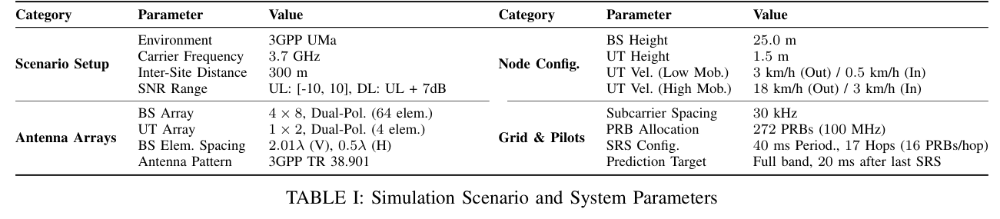
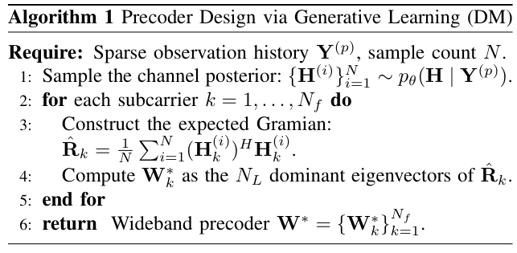
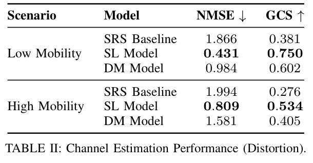

[对应论文条目](/papers/items/c17a299f28542f56/)

# A Perception vs. Distortion Perspective on Score-Based Generative Channel Estimation

**作者：** Marco Skocaj; Lukas Eller; Mate Boban  
**单位：** Advanced Wireless Technology Laboratory, Huawei Heisenberg Research Centre, Munich, Germany  
**来源：** [arXiv:2606.16815v1](https://arxiv.org/abs/2606.16815v1), 2026-06-15  
**许可：** [CC BY-NC-ND 4.0](https://creativecommons.org/licenses/by-nc-nd/4.0/)；原文许可未授予公开发布中文译稿的依据，本译稿按用户 2026-11-05 明确要求发布，原文许可与著作权归属保持不变。  
**翻译方式：** 机器辅助中英对照翻译（gpt-6-luna / xhigh，2026-11-05）；保留公式、表格、算法、附录与参考文献，插图按规则省略。  
**模型记录：** gpt-6-luna / xhigh

## 页码导航

- [第 1 页](#page-1)
- [第 2 页](#page-2)
- [第 3 页](#page-3)
- [第 4 页](#page-4)
- [第 5 页](#page-5)
- [第 6 页](#page-6)
- [第 7 页](#page-7)
- [第 8 页](#page-8)
- [第 9 页](#page-9)
- [第 10 页](#page-10)
- [第 11 页](#page-11)
- [第 12 页](#page-12)
- [第 13 页](#page-13)

## 全文原文与中文逐段对照

### 第 1 页

**Source:** p.1 M000

**Original:**

A Perception vs. Distortion Perspective on Score-Based Generative Channel Estimation

**中文:**

从感知—失真视角看基于分数的生成式信道估计

**Source:** p.1 M001

**Original:**

Marco Skocaj*, Lukas Eller*, Mate Boban. *Marco Skocaj and Lukas Eller contributed equally to this work. All authors are with the Advanced Wireless Technology Laboratory, Huawei Heisenberg Research Centre, Munich, Germany. Emails: name.surname@huawei.com.

**中文:**

作者：Marco Skocaj、Lukas Eller、Mate Boban。*Marco Skocaj 与 Lukas Eller 对本文贡献相同。所有作者均来自德国慕尼黑 Huawei Heisenberg Research Centre 高级无线技术实验室。电子邮箱：name.surname@huawei.com。

**Source:** p.1 S001

**Original:**

Abstract—Driven by their remarkable success in computer vision and inverse problem solving, score-based models are increasingly applied to wireless communications, where they show promise across a range of physical-layer tasks. However, despite this growing interest, the current literature often lacks a rigorous analysis of when score-matching offer a tangible advantage over traditional discriminative learning. This paper aims to address this gap through the use-case of channel estimation, a fundamental inverse problem in wireless systems. We present a theoretically grounded interpretation of score-based channel estimation through the lens of the perception–distortion tradeoff, identifying the conditions where score matching excels as well as its key limitations. In particular, by modeling downstream wireless tasks (e.g., capacity maximization) as functionals of the channel estimation process, we quantify the excess risk incurred by standard distortion-minimization approaches. Extensive numerical results show that under high predictive uncertainty, the large excess risk gap can be offset by score-based estimation, enabling near Bayesian-optimal precoding via the learned posterior, whereas in the low predictive uncertainty regime, discriminative distortion-minimization approaches are preferable due to lower complexity and more efficient use of model capacity.

**中文:**

**摘要——**得益于在计算机视觉和逆问题求解中的卓越表现，基于分数的模型正越来越多地应用于无线通信，并在多种物理层任务中展现潜力。然而，尽管研究热度不断上升，现有文献往往缺乏严谨分析，尚未说明分数匹配何时相较传统判别式学习具有实际优势。本文以信道估计这一无线系统中的基础逆问题为例，尝试弥补这一空白。我们从感知—失真权衡角度，对基于分数的信道估计给出有理论依据的解释，并指出分数匹配发挥优势的条件及其主要局限。具体而言，我们将容量最大化等下游无线任务建模为信道估计过程的函数泛函，量化标准失真最小化方法所产生的超额风险。大量数值结果表明，在预测不确定性较高时，分数式估计能够弥补较大的超额风险差距，并借助学得的后验分布实现接近贝叶斯最优的预编码；而在预测不确定性较低时，判别式失真最小化方法复杂度更低、模型容量利用更有效，因此更可取。

**Source:** p.1 S002

**Original:**

Index Terms—Channel Estimation, Diffusion Models, MIMO, Perception-Distortion Tradeoff, Score-based Generative Models.

**中文:**

**索引词——**信道估计；扩散模型；MIMO；感知—失真权衡；基于分数的生成模型。

**Source:** p.1 S003

**Original:**

I. INTRODUCTION

**中文:**

## I. 引言

**Source:** p.1 S004

**Original:**

Diffusion Models (DMs) [1], [2] — or more generally scorebased generative models (SGMs) [3] — recently emerged as a dominant class of generative models, achieving state-of-theart performance across a wide range of computer vision tasks and, more broadly, in solving ill-posed inverse problems. Their success stems from a combination of expressive modeling capacity, remarkable robustness to noise and model mismatch, and the ability to incorporate complex priors through learned data distributions. These properties have naturally motivated their rapid adoption in wireless communications, where inverse problems are pervasive and channel estimation remains a central — and arguably the most critical — task.

**中文:**

扩散模型（DM）[1], [2]，或更广义地说，基于分数的生成模型（SGM）[3]，近来已成为一类重要的生成模型，在多种计算机视觉任务中取得了先进表现，并广泛用于求解病态逆问题。它们的成功来自多方面因素：强大的表达能力、对噪声和模型失配的显著鲁棒性，以及利用学得的数据分布融入复杂先验的能力。这些特点自然推动了它们在无线通信中的快速应用；逆问题在无线领域十分普遍，而信道估计仍是其中的核心任务，甚至可以说是最关键的任务。

**Source:** p.1 S005

**Original:**

In the context of channel estimation, SGMs offer several appealing advantages over classical and discriminative learningbased estimators. By learning an implicit prior over channel realizations, DMs can regularize severely underdetermined estimation problems, exhibit robustness to noise and model mismatch, and operate effectively in regimes characterized by limited pilot resources or low signal-to-noise ratio (SNR). These properties have led a growing body of work to position generative channel estimation as a superior alternative to classical and discriminative learning-based estimators [4]– [12], often reporting substantial empirical gains in distortionbased metrics (e.g., mean squared error (MSE)).

**中文:**

在信道估计中，相较经典方法和判别式学习估计器，SGM 具有若干吸引人的优点。通过学习信道实现的隐式先验，DM 能够正则化严重欠定的估计问题，对噪声和模型失配表现出鲁棒性，并在导频资源有限或信噪比（SNR）较低的条件下有效工作。基于这些特性，越来越多研究将生成式信道估计视为经典方法和判别式学习估计器的优越替代方案 [4]–[12]，并报告其在均方误差（MSE）等失真指标上取得了显著经验增益。

**Source:** p.1 S006

**Original:**

While the existing literature provides valuable insights, we argue that this prevailing focus on distortion minimization, overlooks the primary strength of generative score-based approaches: their capacity to produce highly plausible samples from learned conditional posterior distributions. Unlike standard discriminative estimators that collapse to the Conditional Mean Estimator (CME), generative models maintain full distributional awareness. As conceptually illustrated in Fig. 1, the iterative denoising process prevents the model from outputting physically implausible, averaged hypotheses. While the distinction between perceptual fidelity and distortion minimization is widely understood in computer vision through the perception-distortion tradeoff [13], we aim to shed light on its significance within the wireless domain. This distinction’s practical importance becomes clear when considering the effect of channel estimation on downstream communication tasks. Indeed, in wireless systems, the ultimate goal is seldom the accurate reconstruction of the channel itself. Instead, the focus is on optimizing channel-dependent functionals [14], such as achievable rates, outage probabilities, or MIMO capacity. As expanded upon in the following sections, the discrepancy between distortion minimization and functional optimization is fundamentally explained by the Jensen gap [15]: except in the special case of linear task functionals, the two objectives do not coincide. SGMs, by providing access to well-matched posterior samples, are therefore suited to this problem, as they enable direct evaluation or optimization of task-relevant functionals in ways that point estimators inherently cannot.

**中文:**

现有研究提供了有价值的见解，但我们认为，当前对失真最小化的关注忽略了基于分数的生成方法的主要优势：它们能够从学得的条件后验分布中生成高度可信的样本。与收敛到条件均值估计器（CME）的标准判别式估计器不同，生成模型保留了对完整分布的感知。正如图 1 的概念示意，迭代去噪过程可避免模型输出物理上不可信的平均化假设。尽管计算机视觉领域已通过感知—失真权衡广泛认识到感知保真度与失真最小化的区别 [13]，本文希望阐明这一差异在无线领域的意义。考虑信道估计对下游通信任务的影响时，这一区别的实际重要性便显现出来。在无线系统中，最终目标很少是精确重建信道本身；人们更关心优化依赖于信道的函数泛函 [14]，例如可达速率、中断概率或 MIMO 容量。后文将进一步说明，失真最小化与函数泛函优化之间的差异，根本上可由 Jensen 间隙 [15] 解释：除非任务函数泛函是线性的，否则这两个目标并不一致。SGM 能够提供与目标匹配的后验样本，因此适合此类问题；它们可以直接评估或优化任务相关函数泛函，而点估计器本身无法做到这一点。

**Source:** p.1 S007

**Original:**

In this work, we argue that the widespread characterization of SGMs as optimal direct estimators is both conceptually and practically limiting. Instead, we advocate for a reframing of their role as generative engines for channel-aware decisionmaking, prioritizing downstream task utility over traditional distortion-based metrics.

**中文:**

本文认为，将 SGM 广泛描述为最优的直接估计器，在概念和实践层面都存在局限。我们主张重新定位其角色：将其视为面向信道的决策生成引擎，优先优化下游任务效用，而非传统的失真指标。

**Source:** p.1 S008

**Original:**

II. RELATED WORK & CONTRIBUTION

**中文:**

## II. 相关工作与贡献

**Source:** p.1 S009

**Original:**

A. Related Work

**中文:**

### A. 相关工作

**Source:** p.1 S010

**Original:**

In computer vision, DMs [1], [2] and SGMs [3] have emerged as the state-of-the-art solution for generative tasks, replacing the long-standing dominance of Generative Adversarial Networks (GANs) in image synthesis [16]. Their superiority stems from improved training stability and a lack of mode

**中文:**

在计算机视觉领域，DM [1], [2] 和 SGM [3] 已成为生成任务的先进方法，取代了生成对抗网络（GAN）长期以来在图像合成中的主导地位 [16]。它们的优势源于训练稳定性更高，而且不会发生模式崩塌；因此能够有效捕获复杂的高维数据分布 [17]。

### 第 2 页

**Source:** p.2 S011

**Original:**

(a) Comparison between Generative AI and Discriminative Learning frameworks. (b) Diffusion process. Fig. 1: SGMs provide samples from the posterior distribution through iterative refinement in the denoising process.

**中文:**

**图 1：** SGM 通过去噪过程中的迭代细化，从后验分布中提供样本。（a）生成式 AI 与判别式学习框架对比；（b）扩散过程。

**Source:** p.2 S012

**Original:**

collapse, allowing them to effectively capture complex, highdimensional data distributions [17]. Driven by this success, SGMs have been rapidly integrated into the wireless domain, proving effective across a range of applications as categorized in recent surveys [8], [18]–[20]. In the physical layer, these models have demonstrated their potential in channel modeling, estimation, and extrapolation [7], [9], [21], as well as signal detection [10], [22]. DMs have also been shown to facilitate high-fidelity synthetic data generation for radio map estimation [23]–[25] and digital twin construction [12], [26]. Beyond estimation and synthesis, they support network management tasks — for instance, by enabling trajectory sampling for reinforcement learning [27] or acting as powerful network optimizers through inverse problem-solving [28]. Furthermore, DMs have been explored as wireless foundation models [18]. This paradigm is particularly effective for MultipleInput-Multiple-Output (MIMO) channel estimation, as pretrained generative priors can be integrated with analytical likelihood functions for received pilot signals. Recent studies have demonstrated that such approaches achieve competitive reconstruction performance compared to both classical and other machine learning (ML)-based methods [4], [7], [9]. Notably, since the generative prior is measurement-agnostic, these frameworks are inherently robust to sensing environment changes [4], [29]. This modularity allows the analytical likelihood to be exchanged at test-time to match specific hardware or pilot configurations without retraining the model.

**中文:**

受这一成功推动，SGM 已迅速进入无线领域，并在近期综述 [8], [18]–[20] 所归纳的多种应用中展现效果。在物理层，这类模型已用于信道建模、估计和外推 [7], [9], [21]，以及信号检测 [10], [22]。DM 还被用于生成高保真合成数据，以支持无线电地图估计 [23]–[25] 和数字孪生构建 [12], [26]。除估计和合成外，它们也支持网络管理任务，例如为强化学习提供轨迹采样 [27]，或通过求解逆问题充当强大的网络优化器 [28]。此外，DM 还被探索作为无线基础模型 [18]。这一范式尤其适用于多输入多输出（MIMO）信道估计，因为可以将预训练生成先验与接收导频信号的解析似然函数结合。近期研究表明，此类方法的重建性能可与经典方法及其他机器学习（ML）方法竞争 [4], [7], [9]。特别是，由于生成先验与测量方式无关，这些框架对感知环境变化具有内在鲁棒性 [4], [29]。这种模块化特性使得测试时可以替换解析似然，以匹配特定硬件或导频配置，而无需重新训练模型。

**Source:** p.2 S013

**Original:**

Despite these promising results, a notable trend in the current literature is the reliance on distortion measures — specifically MSE — as the primary evaluation metric for wireless DMs [4]–[12]. Studying distortion minimization properties for SGMs is motivated by their inherent advantages in generalization, robustness, and “plug-and-play” versatility [30]. However, we would argue that training via score-matching is inherently inefficient for distortion minimization, because the model must learn to denoise at every intermediate step of the forward process. As a consequence, significant model capacity is consumed by these intermediate steps, which do not necessarily improve the model’s ability to perform the direct denoising task. Instead, it is understood that SGMs can flexibly traverse the Pareto frontier of the perception-distortion tradeoff — sacrificing distortion for perceptual quality [31]. Notably, this has been also addressed in other wireless research, as in the denoinsing use case in [32], which identifies the noise injected during the reverse process as a critical lever, allowing the DM to prioritize either probabilistic accuracy or MSE optimality. While variance scaling is one approach, several studies have shown that the number of inference steps acts as a primary lever for this balance. As shown in [33], perceptual quality — and thus distributional fidelity — typically improves with additional steps, often at the cost of increased distortion. This inverse relationship likely explains why improved MSE in wireless tasks is frequently reported for models with reduced steps [12] or single-step predictors [11]. However, in this edge case, a single-step inference score-based model becomes functionally equivalent to a discriminative one-step denoiser [11]. This equivalence necessitates a direct comparison between the MSE performance of diffusion-based models and identical backbones trained in a discriminative setting — a baseline that remains underexplored in prior work.

**中文:**

尽管已有令人鼓舞的结果，当前文献有一个显著倾向：主要依赖失真度量——尤其是 MSE——来评价无线 DM [4]–[12]。SGM 的失真最小化特性之所以受到研究，是因为它们具有泛化、鲁棒和“即插即用”的灵活性 [30]。然而我们认为，用分数匹配训练来最小化失真在本质上效率不高，因为模型必须学习前向过程中每个中间步骤的去噪。结果是，模型容量大量用于这些中间步骤，而这些步骤未必能提高模型直接去噪的能力。相反，已有认识指出，SGM 可以灵活地沿感知—失真权衡的帕累托前沿移动 [31]——以更高感知质量换取更大的失真。无线领域的其他研究也讨论了这一点，例如文献 [32] 的去噪任务指出，反向过程中注入的噪声是关键调节手段，可让 DM 在概率准确性与 MSE 最优性之间选择。方差缩放是一种调节方式，而多项研究表明，推理步数也是影响这种平衡的主要因素。文献 [33] 表明，感知质量以及分布保真度通常会随步数增加而改善，但往往以失真增加为代价。这种反向关系或可解释无线任务中为何常报告减少步数 [12] 或使用单步预测器 [11] 能改善 MSE。然而在这一极端情况下，单步推理的基于分数模型在功能上等价于判别式单步去噪器 [11]。这意味着必须直接比较扩散模型与采用相同骨干、以判别式方式训练的模型之 MSE 性能，而这一基线在既有研究中尚未得到充分考察。

**Source:** p.2 S014

**Original:**

Moving away from distortion metrics toward full distributional awareness more effectively highlights the unique strengths of generative AI in the wireless domain — specifically for uncertainty-aware optimization where point-estimates prove insufficient. For instance, recent work demonstrates how diffusion models can be integrated into stochastic optimization frameworks to account for channel uncertainties [34]. Similarly, in beamforming and precoding, utilizing the full distribution via variational autoencoders (VAEs) enables robust strategies that outperform traditional methods under imperfect CSI [35]. Even classical approaches like Gaussian mixture models (GMMs) have shown that maintaining a probabilistic view of the channel is essential in challenging regimes, such as channel estimation with sparse pilots [36].

**中文:**

从失真指标转向完整的分布感知，更能凸显生成式 AI 在无线领域的独特优势，尤其适用于不确定性感知优化，因为点估计不足以胜任此类任务。例如，近期研究展示了如何将扩散模型整合到随机优化框架中，以考虑信道不确定性 [34]。类似地，在波束成形与预编码中，通过变分自编码器（VAE）利用完整分布，可以在 CSI 不完美时构建优于传统方法的鲁棒策略 [35]。即便是高斯混合模型（GMM）等经典方法，也表明在困难条件（如稀疏导频信道估计）下保留信道的概率视角至关重要 [36]。

**Source:** p.2 S015

**Original:**

B. Contribution

**中文:**

### B. 本文贡献

**Source:** p.2 S016

**Original:**

Our contributions can be summarized as follows: i) We provide a theoretically grounded interpretation of score-based channel estimation through the lens of the perception–distortion tradeoff. In doing so, we address a critical gap in the literature by identifying both the regimes where

**中文:**

本文的贡献概括如下：i）我们从感知—失真权衡的角度，对基于分数的信道估计给出有理论依据的解释。通过识别分数匹配发挥优势的条件及其根本局限，我们弥补了现有文献中的一个重要空白。

### 第 3 页

**Source:** p.3 S017

**Original:**

score matching excels and its fundamental limitations. Furthermore, we characterize the performance gap between generative score-matching and discriminative models when optimizing downstream task functionals, demonstrating that the resulting excess risk arises naturally from Jensen’s inequality.

**中文:**

进一步地，我们刻画了生成式分数匹配模型与判别式模型在优化下游任务函数泛函时的性能差距，并说明由此产生的超额风险自然源自 Jensen 不等式。

**Source:** p.3 S018

**Original:**

ii) Through extensive numerical experiments using MIMO precoding as a representative downstream task, we show how score-based estimation can outperform discriminative models in terms of achievable spectral efficiency (SE), enabling approximate Bayesian-optimal precoding via the learned posterior distribution. Furthermore, we show how such approach can almost entirely match the performance of ad-hoc trained End-to-End (E2E) models on the MIMO capacity loss as an empirical upper bound not affected by excess risk.

**中文:**

ii）我们以 MIMO 预编码作为代表性下游任务开展大量数值实验，展示基于分数的估计如何在可达频谱效率（SE）方面超过判别式模型，并通过学得的后验分布实现近似贝叶斯最优预编码。进一步地，我们表明，相对于作为不受超额风险影响的经验上界的专门端到端（E2E）模型，这种方法在 MIMO 容量损失性能上几乎可以完全达到其水平。

**Source:** p.3 S019

**Original:**

iii) Finally, we draw a connection between the excess risk incurred by discriminative models and mutual information (MI). Using classifier free guidance (CFG)’s guidance scale parameter λ as a MI proxy, we show that the achievable spectral efficiency gap with score-matching is amplified in low-information regimes, where CMEs suffer structural collapse. On the other hand, we show that in the high mutualinformation regime, discriminative distortion-minimization approaches is typically preferable due to lower complexity and more efficient use of model capacity.

**中文:**

iii）最后，我们建立了判别式模型所承担的超额风险与互信息（MI）之间的联系。将无分类器引导（CFG）的引导尺度参数 \(\lambda\) 用作 MI 代理指标，我们表明，在低信息量条件下，分数匹配带来的可达 SE 差距会扩大，而 CME 会出现结构崩塌。另一方面，在互信息较高时，判别式失真最小化方法通常更可取，因为其复杂度较低，且模型容量利用更高效。

**Source:** p.3 S020

**Original:**

The remainder of this paper is organized as follows: Sections III and IV provide the theoretical foundations of scorebased generative models and the perception-distortion tradeoff. Section V details the application of these concepts to MIMO channel estimation, before our proposed algorithmic solutions and experimental results are presented in Section VII. Final conclusions are drawn in Section VIII.

**中文:**

本文其余部分安排如下：第 III、IV 节介绍基于分数的生成模型与感知—失真权衡的理论基础；第 V 节将这些概念用于 MIMO 信道估计；随后在第 VII 节介绍算法方案和实验结果；最后在第 VIII 节总结全文。

**Source:** p.3 S021

**Original:**

III. PRELIMINARIES

**中文:**

## III. 预备知识

**Source:** p.3 S022

**Original:**

With the aim of making the paper self-contained, we review the theoretical background of DMs, focusing specifically on Denoising Diffusion Probabilistic Models (DDPMs) and how they can be formally interpreted through the lens of SGMs.

**中文:**

为使本文自成一体，我们回顾 DM 的理论背景，重点介绍去噪扩散概率模型（DDPM），以及如何从形式上将其解释为 SGM。

**Source:** p.3 S023

**Original:**

A. Denoising Diffusion Probabilistic Models

**中文:**

### A. 去噪扩散概率模型

**Source:** p.3 S024

**Original:**

DDPMs [2] are a class of generative latent variable models that learn a data distribution q(x0) by reversing a gradual noise-injection process. The framework is defined by two primary Markov chain processes: the forward diffusion process and the reverse generative process.

**中文:**

DDPM [2] 是一类生成式潜变量模型，通过逆转逐步注入噪声的过程来学习数据分布 \(q(x_0)\)。该框架由两个主要的马尔可夫链过程定义：前向扩散过程和反向生成过程。

**Source:** p.3 S025

**Original:**

1) Forward Diffusion Process: The forward process, denoted by q, progressively transforms a data sample x_0 ∼ q(x_0) into latent variables x_1, …, x_T by adding Gaussian noise according to a predefined variance schedule β_1, …, β_T:  q(x_t|x_{t-1}) = 𝒩(x_t; √(1−β_t)x_{t−1}, β_t I). (1)

**中文:**

**1）前向扩散过程：**前向过程记为 \(q\)，它按照预先设定的方差调度 \(\beta_1,\ldots,\beta_T\) 逐步向数据样本 \(x_0\sim q(x_0)\) 添加高斯噪声，将其变换为潜变量 \(x_1,\ldots,x_T\)：

$$q(x_t\mid x_{t-1})=\mathcal N\!\left(x_t;\sqrt{1-\beta_t}x_{t-1},\beta_t I\right).\tag{1}$$

**Source:** p.3 S026

**Original:**

Defining α_t=1−β_t and ᾱ_t=∏_{s=1}^t α_s, a key property is that x_t can be sampled directly from x_0 at any timestep: q(x_t|x_0)=𝒩(x_t;√ᾱ_t x_0,(1−ᾱ_t)I). (2)

**中文:**

定义 \(\alpha_t=1-\beta_t\) 和 \(\bar\alpha_t=\prod_{s=1}^{t}\alpha_s\)。这一形式的一个关键性质是，可以在任意时间步 \(t\) 直接由原始数据 \(x_0\) 采样得到 \(x_t\)。给定 \(x_0\) 时，\(x_t\) 的条件分布为：

$$q(x_t\mid x_0)=\mathcal N\!\left(x_t;\sqrt{\bar\alpha_t}x_0,(1-\bar\alpha_t)I\right).\tag{2}$$

**Source:** p.3 S027

**Original:**

Using the reparameterization trick: x_t = √ᾱ_t x_0 + √(1−ᾱ_t) ε, ε∼𝒩(0,I). (3)

**中文:**

利用重参数化技巧，可写为：

$$x_t=\sqrt{\bar\alpha_t}x_0+\sqrt{1-\bar\alpha_t}\,\epsilon,\qquad \epsilon\sim\mathcal N(0,I).\tag{3}$$

**Source:** p.3 S028

**Original:**

As T →∞, the final latent variable xT converges to an isotropic Gaussian distribution.

**中文:**

当 \(T\to\infty\) 时，最终潜变量 \(x_T\) 收敛到各向同性高斯分布。

**Source:** p.3 S029

**Original:**

2) Reverse Generative Process: The generative model learns p_θ(x_{t−1}|x_t)=𝒩(x_{t−1}; μ_θ(x_t,t),Σ_θ(x_t,t)). The covariance is typically fixed as Σ_θ(x_t,t)=β̃_t I, where β̃_t=(1−ᾱ_{t−1})/(1−ᾱ_t)β_t. Rather than predicting the mean directly, the model predicts the added noise ε_θ, giving μ_θ(x_t,t)=1/√α_t [x_t−β_t/√(1−ᾱ_t) ε_θ(x_t,t)]. (4),(5)

**中文:**

**2）反向生成过程：**生成模型学习反向转移 \(p_\theta(x_{t-1}\mid x_t)\)，以便从噪声恢复数据。该反向过程也建模为高斯转移：

$$p_\theta(x_{t-1}\mid x_t)=\mathcal N\!\left(x_{t-1};\mu_\theta(x_t,t),\Sigma_\theta(x_t,t)\right).\tag{4}$$

神经网络负责估计均值 \(\mu_\theta\)，而协方差通常设为固定常数 \(\Sigma_\theta(x_t,t)=\tilde\beta_t I\)，其中 \(\tilde\beta_t=\frac{1-\bar\alpha_{t-1}}{1-\bar\alpha_t}\beta_t\)。模型不直接预测均值，而是预测时间步 \(t\) 加入的噪声 \(\epsilon\)。在这种参数化下：

$$\mu_\theta(x_t,t)=\frac{1}{\sqrt{\alpha_t}}\left(x_t-\frac{\beta_t}{\sqrt{1-\bar\alpha_t}}\epsilon_\theta(x_t,t)\right).\tag{5}$$

**Source:** p.3 S030

**Original:**

3) Training Objective and Parameterization: θ minimizes a simplified variational upper bound, typically L_DM(θ)=E_{t,x_0,ε}[||ε−ε_θ(x_t,t)||²]. (6)

**中文:**

**3）训练目标与参数化：**通过最小化变分上界的一个简化形式来优化参数 \(\theta\)，该形式通常写成噪声空间中的均方误差：

$$L_{\rm DM}(\theta)=\mathbb E_{t,x_0,\epsilon}\left[\left\|\epsilon-\epsilon_\theta(x_t,t)\right\|^2\right].\tag{6}$$

**Source:** p.3 S031

**Original:**

t is sampled uniformly from {1,…,T}. The noise-prediction objective is mathematically equivalent to predicting clean x_0, estimated by x̂_0=1/√ᾱ_t (x_t−√(1−ᾱ_t)ε_θ(x_t,t)). (7)

**中文:**

其中 \(t\) 从集合 \(\{1,\ldots,T\}\) 中均匀采样。标准 DDPM 目标是预测噪声 \(\epsilon\)，但在数学上等价于预测原始干净数据 \(x_0\)。根据式（3）的前向扩散关系，可以由预测噪声估计干净信号：

$$\hat x_0=\frac{1}{\sqrt{\bar\alpha_t}}\left(x_t-\sqrt{1-\bar\alpha_t}\,\epsilon_\theta(x_t,t)\right).\tag{7}$$

**Source:** p.3 S032

**Original:**

Conversely, the network can be designed to predict the clean signal x0 directly, from which the corresponding noise can be algebraically derived. As expanded upon in the next section, this objective allows the model to learn the score of the data distribution, enabling the generation of high-fidelity samples from pure Gaussian noise during inference.

**中文:**

反过来，网络也可以直接预测干净信号 \(x_0\)，再通过代数运算求出对应噪声。下一节将进一步说明，这一目标使模型能够学习数据分布的 score，从而在推理阶段由纯高斯噪声生成高保真样本。

**Source:** p.3 S033

**Original:**

B. Score-based Generative Models

**中文:**

### B. 基于分数的生成模型

**Source:** p.3 S034

**Original:**

SGMs learn the score function of the noise-corrupted distribution at each time step: s_θ(x_t,t)≈∇_{x_t}log q(x_t). (8) It is the gradient of the log-density of x_t; samples follow a reverse-time SDE or Langevin dynamics. DDPMs are discrete-time approximations of reverse SDEs, and their noise-prediction objective equals a weighted denoising score-matching loss.

**中文:**

SGM [37] 采用与扩散方法互补的视角：它不显式建模反向时间条件分布，而是在每个时间步学习受噪数据分布的 score 函数：

$$s_\theta(x_t,t)\approx\nabla_{x_t}\log q(x_t).\tag{8}$$

也就是说，score 是 \(x_t\) 对数密度的梯度。给定 score 的估计值后，可以通过积分反向时间随机微分方程（SDE）或执行 Langevin 动力学来生成样本。Song 等人 [3] 随后指出，DDPM 可解释为此类反向时间 SDE 的离散时间近似，从而将扩散模型确立为离散化的基于分数生成模型。在高斯噪声调度下，DDPM 的噪声预测目标恰好等价于加权去噪分数匹配损失，形式化了去噪估计与 score matching 之间的联系。

### 第 4 页

**Source:** p.4 S035

**Original:**

estimation originally identified by Vincent [38]. In the DDPM parameterization [2], this relationship takes the explicit form: ∇_{x_t} log p(x_t) = −ε_θ(x_t,t)/√(1−ᾱ_t). (9)

**中文:**

这一关系最初由 Vincent [38] 提出。在 DDPM 参数化 [2] 下，其显式形式为：

$$\nabla_{x_t}\log p(x_t)=-\frac{\epsilon_\theta(x_t,t)}{\sqrt{1-\bar\alpha_t}}.\tag{9}$$

**Source:** p.4 S036

**Original:**

C. Conditional Diffusion Sampling

**中文:**

### C. 条件扩散采样

**Source:** p.4 S037

**Original:**

Conditional generation aims to sample from the posterior p(xt|y), where y represents a conditioning signal such as a class label, text prompt or in the context of wireless channel estimation, pilot observations. According to Bayes’ rule, the gradient of the log-posterior (i.e., the score) decomposes into:

**中文:**

条件生成旨在从后验 \(p(x_t\mid y)\) 中采样，其中 \(y\) 表示条件信号，例如类别标签、文本提示，或在无线信道估计中的导频观测。根据贝叶斯法则，后验对数梯度（即 score）可分解为：

**Source:** p.4 S038

**Original:**

∇_{x_t} log p(x_t|y) = ∇_{x_t} log p(x_t) + ∇_{x_t} log p(y|x_t). (10)

**中文:**

$$\nabla_{x_t}\log p(x_t\mid y)=\nabla_{x_t}\log p(x_t)+\nabla_{x_t}\log p(y\mid x_t).\tag{10}$$

**Source:** p.4 S039

**Original:**

In classifier guidance, an external noisy classifier p(y|x_t) supplies the guidance gradient. With an explicit measurement model, a closed-form guidance term can also be derived from direct observations [4]. Substituting ∇_{x_t} log p(x_t) from (9), the guided noise estimate is ε̂ = ε_θ(x_t,t) − w√(1−ᾱ_t)∇_{x_t}log p(y|x_t). (11)

**中文:**

在分类器引导中，外部噪声分类器 \(p(y\mid x_t)\) 提供引导梯度。若存在显式测量模型，也可以根据直接观测推导闭式引导项 [4]。将式（9）中的 \(\nabla_{x_t}\log p(x_t)\) 代入后，带引导尺度 \(w\) 的噪声估计为：

$$\hat\epsilon=\epsilon_\theta(x_t,t)-w\sqrt{1-\bar\alpha_t}\nabla_{x_t}\log p(y\mid x_t).\tag{11}$$

**Source:** p.4 S040

**Original:**

The negative sign moves the update toward higher classifier confidence. Classifier-free guidance (CFG) avoids an external model by jointly training conditional and unconditional objectives; y is periodically replaced by a null token ∅. At inference: ε̂=ε_θ(x_t,t,∅)+λ(ε_θ(x_t,t,y)−ε_θ(x_t,t,∅)). (12)

**中文:**

负号确保更新朝分类器置信度较高的区域移动。另一种方法是无分类器引导（CFG）：它联合训练条件和无条件目标，因此不需要外部模型。训练时会周期性地将 \(y\) 替换为空标记 \(\emptyset\)（例如零向量），表示无条件状态。推理时，模型从无条件基线外推：

$$\hat\epsilon=\epsilon_\theta(x_t,t,\emptyset)+\lambda\left(\epsilon_\theta(x_t,t,y)-\epsilon_\theta(x_t,t,\emptyset)\right).\tag{12}$$

**Source:** p.4 S041

**Original:**

This implicitly approximates the classifier gradient and serves as the input for the standard DDPM reverse step.

**中文:**

这一形式隐式近似分类器梯度，并作为标准 DDPM 反向步骤的输入。

**Source:** p.4 S042

**Original:**

IV. MSE OPTIMALITY AND THE PERCEPTION-DISTORTION TRADEOFF

**中文:**

## IV. MSE 最优性与感知—失真权衡

**Source:** p.4 S043

**Original:**

In this section, we study the statistical properties of SGMs through a Bayesian lens and contrast them with discriminative learning under the perception–distortion tradeoff. We show that while the CME is optimal for MSE, it is generally suboptimal for nonlinear downstream functionals, with the resulting excess risk arising from Jensen’s inequality.

**中文:**

本节从贝叶斯视角研究 SGM 的统计性质，并在感知—失真权衡框架下将其与判别式学习进行对比。我们将说明，CME 虽然是 MSE 意义下的最优估计器，但对于非线性下游函数泛函通常并非最优；由此产生的超额风险源自 Jensen 不等式。

**Source:** p.4 S044

**Original:**

A. Conditional Mean Estimation vs. Posterior Sampling

**中文:**

### A. 条件均值估计与后验采样

**Source:** p.4 S045

**Original:**

Under an MSE distortion measure, the optimal estimator, also known as the minimum mean-squared-error (MMSE) estimator, is the CME: x̂_CME=E[x|y]=∫_X x p(x|y) dx. (13)

**中文:**

估计理论中一个众所周知的结果是，在 MSE 失真度量下，最优估计器——亦称最小均方误差（MMSE）估计器——就是 CME [39]：

$$\hat{x}_{\rm CME}=\mathbb E[x\mid y]=\int_{\mathcal X}x\,p(x\mid y)\,dx.\tag{13}$$

**Source:** p.4 S046

**Original:**

A supervised-learning model f_θ is trained by empirical risk minimization (ERM) with MSE loss: min_θ E_{(x,y)∼D(x,y)}[||x−f_θ(y)||²]. (14)

**中文:**

在判别式设定中，监督学习（SL）模型 \(f_\theta\) 通过均方误差损失下的经验风险最小化（ERM）进行训练，以获得 CME 的有限样本近似：

$$\min_\theta\;\mathbb E_{(x,y)\sim\mathcal D(x,y)}\left[\|x-f_\theta(y)\|^2\right].\tag{14}$$

**Source:** p.4 S047

**Original:**

where D(x, y) denotes the empirical training distribution. While ERM aims for the CME, factors such as finite data and limited model capacity mean that fθ only approximates the optimal estimator, reaching it only in the asymptotic limit under consistent ERM with sufficiently expressive models, as characterized by the universal approximation theorem [40].

**中文:**

其中 \(\mathcal D(x,y)\) 表示经验训练分布。ERM 的目标是达到 CME，但受有限数据和模型容量限制，\(f_\theta\) 只能逼近最优估计器。只有在 ERM 一致、模型表达能力足够强的渐近条件下，它才能达到该估计器；这与通用逼近定理 [40] 所刻画的情形一致。

**Source:** p.4 S048

**Original:**

An SGM learns the prior p(x), conditional p(x|y), or both, then draws x′∼p_θ(x|y). A single posterior sample has higher MSE than the CME; its expected error decomposes as E[||x−x′||²]=E[||x−x̂_CME||²]+E[||x′−x̂_CME||²] (MMSE + Sampling Variance). (15)

**中文:**

相比之下，SGM 会学习数据先验 \(p(x)\)、条件分布 \(p(x\mid y)\)，或二者兼学（如 CFG）。观测到条件信号 \(y\) 后，推理就是从 \(p_\theta(x\mid y)\) 中随机采样 \(x\prime\)。由于 \(\hat x_{\rm CME}\) 是 MSE 唯一的最小化解，SGM 的任何单个样本 \(x\prime\) 都会产生更大的 MSE。样本总误差可分解为 MMSE 与采样方差之和：

$$\mathbb E[\|x-x\prime\|^2]=\mathbb E[\|x-\hat x_{\rm CME}\|^2]+\mathbb E[\|x\prime-\hat x_{\rm CME}\|^2].\tag{15}$$

第一项是 MMSE，第二项是采样方差。

**Source:** p.4 S049

**Original:**

The second term represents the inherent tradeoff between distributional fidelity and point-wise accuracy. While this sampling variance facilitates the generation of plausible channel realizations, it prevents a single sample from matching the MSE of the CME.

**中文:**

第二项体现了分布保真度与逐点准确性之间固有的权衡。该采样方差有助于生成可信的信道实现，但也使单个样本无法达到 CME 的 MSE。

**Source:** p.4 S050

**Original:**

Although one posterior sample is not MSE-optimal, Monte Carlo averaging can recover the approximate CME: x̂_CME≈(1/N)∑_{i=1}^N x^{(i)}, x^{(i)}∼p_θ(x|y). (16)

**中文:**

尽管单个后验样本不是 MSE 最优解，SGM 原则上可以通过对学得后验样本作蒙特卡洛平均来恢复 CME 的近似值：

$$\hat x_{\rm CME}\approx\frac{1}{N}\sum_{i=1}^{N}x^{(i)},\qquad x^{(i)}\sim p_\theta(x\mid y).\tag{16}$$

**Source:** p.4 S051

**Original:**

As N →∞, this average converges to Epθ(x|y)[x]. Therefore, generative models inherently generalize standard regression, as the minimum-risk point estimate can be derived directly from the full posterior. Beyond Monte Carlo averaging, efficient sampling strategies can force an SGM to yield MSE-optimal estimates for pure denoising tasks. Whether through modified reverse trajectories [32] or single-step inference [11], these approaches share a common mechanism: they systematically remove stochasticity from the generation process. By effectively collapsing the diverse posterior into a single conditional mean, these methods achieve minimal distortion precisely by sacrificing the model’s generative properties. This dynamic is a direct manifestation of the perception–distortion tradeoff [13], which formalizes the fundamental incompatibility between distortion-optimal estimation (e.g., MMSE) and perceptually faithful reconstruction (e.g., maximizing log-likelihood).

**中文:**

当 \(N\to\infty\) 时，该平均值收敛到 \(\mathbb E_{p_\theta(x\mid y)}[x]\)。因此，生成模型在本质上包含标准回归：可直接从完整后验导出最小风险点估计。除了蒙特卡洛平均，某些高效采样策略也能让 SGM 在纯去噪任务中得到 MSE 最优估计。无论是修改反向轨迹 [32] 还是采用单步推理 [11]，这些方法都系统性地消除生成过程中的随机性。它们通过将多样化后验压缩为单一条件均值来获得最小失真，但代价是牺牲模型的生成特性。这正体现了感知—失真权衡 [13]：失真最优估计（例如 MMSE）与感知保真重建（例如最大化对数似然）之间存在根本不相容性。

**Source:** p.4 S052

**Original:**

B. Functional Suboptimality & Excess Risk

**中文:**

### B. 函数泛函次优性与超额风险

**Source:** p.4 S053

**Original:**

Let us define x ∈X as a target variable (e.g., the channel state), y ∈Y as the observable data (e.g., received pilots), and ˆx = f(y) as the estimation of x given y. Let us further define w = g(ˆx) as a task-specific action (e.g., precoding matrix selection) contingent upon the estimate. In many wireless systems, ˆx is treated as an intermediate latent representation used to solve for the final action w, supporting diverse downstream tasks. The system performance is expressed as a functional T (x, w), representing the utility achieved when

**中文:**

令 \(x\in\mathcal X\) 表示目标变量（如信道状态），令 \(y\in\mathcal Y\) 表示观测数据（如接收导频），并令 \(\hat x=f(y)\) 表示根据 \(y\) 对 \(x\) 的估计。进一步设 \(w=g(\hat x)\) 为依赖于该估计的任务特定动作（如预编码矩阵选择）。在许多无线系统中，\(\hat x\) 是用于求解最终动作 \(w\) 的中间潜变量，可支持多种下游任务。系统性能由函数泛函 \(T(x,w)\) 表示，它刻画在真实状态 \(x\) 下施加动作 \(w\) 时所取得的效用。

### 第 5 页

**Source:** p.5 S054

**Original:**

Fig. 2: Distortion-optimal estimation leads to excess risk for downstream tasks, resolvable through posterior marginalization.

**中文:**

**图 2：**失真最优估计会使下游任务产生超额风险，而对后验分布进行边缘化可以消除该风险。

**Source:** p.5 S055

**Original:**

The action w is applied to the true state x. The Bayes risk is R(f,g)=E_{p(x,y)}[−T(x,g(f(y)))]. (17)

**中文:**

动作 \(w\) 作用于真实状态 \(x\)。我们将贝叶斯风险定义为联合分布下的期望损失：

$$R(f,g)=\mathbb E_{p(x,y)}\left[-T\left(x,g(f(y))\right)\right].\tag{17}$$

**Source:** p.5 S056

**Original:**

For observation y, the task-optimal action maximizes posterior expected utility: w⋆(y)=arg max_w E_{p(x|y)}[T(x,w)]. (18)

**中文:**

给定观测 \(y\) 后，任务最优动作通过最大化后验期望效用得到：

$$w^{\star}(y)=\arg\max_w\;\mathbb E_{p(x\mid y)}[T(x,w)].\tag{18}$$

**Source:** p.5 S057

**Original:**

The discriminative approach uses the CME x̂=E[x|y] and selects w_CME=g(x̂), optimal only for the mean state. Unless T is affine in x, Jensen’s inequality gives T(E[x|y],w)≠E_{x|y}[T(x,w)]. (19)

**中文:**

在实践中，标准判别式方法使用 CME \(\hat x=\mathbb E[x\mid y]\)，并选择针对该均值状态最优的动作 \(w_{\rm CME}=g(\hat x)\)。但除非 \(T\) 关于 \(x\) 是仿射函数，否则该方法并非最优。由于真实性能由真实 \(x\) 决定，Jensen 不等式 [15] 揭示了平均状态的效用与状态效用的平均值之间存在系统差距：

$$T(\mathbb E[x\mid y],w)\ne\mathbb E_{x\mid y}[T(x,w)].\tag{19}$$

**Source:** p.5 S058

**Original:**

The discrepancy creates excess risk. The Bayesian-optimal decision marginalizes the unknown channel over p(x|y): w⋆=arg max_w ∫_X T(x,w)p(x|y)dx. (20)

**中文:**

这一差异会导致超额风险。依赖 CME 得到的动作 \(w_{\rm CME}\) 针对代表性点而非真实分布进行优化，因此与真正最优解 \(w^\star\) 相比，其期望性能会产生 \(\Delta\ge0\) 的损失。端到端（E2E）框架可通过学习直接映射 \(w=g_\theta(y)\) 来消除这一差距，但通常会牺牲模块化和通用性。避免超额风险的贝叶斯最优决策，是对未知信道的后验分布 \(p(x\mid y)\) 进行边缘化：

$$w^{\star}=\arg\max_w\int_{\mathcal X}T(x,w)p(x\mid y)\,dx.\tag{20}$$

**Source:** p.5 S059

**Original:**

SGMs approximate the posterior expected-utility integral by Monte Carlo: w⋆≈arg max_w (1/N)∑_{i=1}^N T(x^{(i)},w), x^{(i)}∼p_θ(x|y). (21)

**中文:**

SGM 提供了应对这一积分难以处理问题的有效机制。通过从后验中高效采样，可用蒙特卡洛积分近似目标函数：

$$w^{\star}\approx\arg\max_w\;\frac{1}{N}\sum_{i=1}^{N}T(x^{(i)},w),\qquad x^{(i)}\sim p_\theta(x\mid y).\tag{21}$$

**Source:** p.5 S060

**Original:**

As demonstrated in Appendix A, maximizing the posterior expected utility via a generative model is mathematically equivalent to the optimal solution of a fully E2E framework. Consequently, provided the downstream optimization over w is solvable, the generative approach theoretically closes the performance gap to E2E systems, as illustrated in Fig. 2. This yields a profound architectural advantage: SGMs function as general-purpose channel estimators that preserve the modularity of classical communication pipelines while simultaneously unlocking the potential of task-specific, E2E learning. This theoretical equivalence is further validated numerically in Section VII, where we demonstrate that the proposed generative approach successfully closes the performance gap between classical modular architectures and fully E2E-trained systems.

**中文:**

附录 A 将证明，借助生成模型最大化后验期望效用，在数学上等价于完全 E2E 框架的最优解。因此，只要下游关于 \(w\) 的优化问题可解，生成式方法在理论上就能弥合与 E2E 系统之间的性能差距，图 2 对此作了示意。这带来显著的架构优势：SGM 既可作为通用信道估计器，保留经典通信处理流程的模块化，同时又能支持任务特定的 E2E 学习潜力。该理论等价关系将在第 VII 节通过数值实验进一步验证。

**Source:** p.5 S061

**Original:**

V. PROBLEM FORMULATION

**中文:**

## V. 问题表述

**Source:** p.5 S062

**Original:**

We extend the principles established in Section IV to the task of MIMO precoding. Our analysis focuses specifically on a 5G New Radio (NR) Time Division Duplex (TDD) system, examining Downlink (DL) precoding based on Uplink (UL) Sounding Reference Signal (SRS) measurements — a use-case of particular interest within 3GPP R20/21, e.g., [41].

**中文:**

我们将第 IV 节提出的原则扩展到 MIMO 预编码任务。本文重点研究 5G 新空口（NR）时分双工（TDD）系统中基于上行（UL）探测参考信号（SRS）测量进行下行（DL）预编码的问题；这是 3GPP R20/21 中尤其受关注的应用场景，例如文献 [41]。

**Source:** p.5 S063

**Original:**

A. MIMO Channel Estimation

**中文:**

### A. MIMO 信道估计

**Source:** p.5 S064

**Original:**

We consider a point-to-point MIMO system with Ntx transmit and Nrx receive antennas, transmitting over Nf frequency subcarriers. To capture the temporal evolution of the channel, we observe the system over a sequence of Nt discrete past time steps, {t1, t2, . . . , tNt}. Under practical 5G NR configurations, SRS transmissions employ an interleaved comb structure in the frequency domain and hop across different sub-bands.

**中文:**

考虑一个点对点 MIMO 系统，含 \(N_{tx}\) 个发射天线和 \(N_{rx}\) 个接收天线，并在 \(N_f\) 个频率子载波上传输。为刻画信道的时间演化，我们观察 \(N_t\) 个离散历史时刻 \(\{t_1,t_2,\ldots,t_{N_t}\}\) 上的系统。在实际 5G NR 配置中，SRS 传输在频域采用交织梳状结构，并在不同子带间跳频。

**Source:** p.5 S065

**Original:**

At each time t_m, N_p pilot symbols are transmitted only over P_m⊂{1,…,N_f}. The received pilot tensor Y_m^(p)∈C^{N_rx×N_p×|P_m|} is modeled as Y_m^(p)=A_P^(m)(H_m)+N_m, m=1,…,N_t. (22)

**中文:**

因此，在每个时刻 \(t_m\)，仅在特定子载波集合 \(P_m\subset\{1,\ldots,N_f\}\) 上发送 \(N_p\) 个导频符号。基站在 \(t_m\) 时刻接收到的 UL 导频信号张量记为 \(Y_m^{(p)}\in\mathbb C^{N_{rx}\times N_p\times |P_m|}\)，其模型为：

$$Y_m^{(p)}=\mathcal A_P^{(m)}(H_m)+N_m,\qquad m=1,\ldots,N_t.\tag{22}$$

**Source:** p.5 S066

**Original:**

where Hm ∈CNrx×Ntx×Nf is the unknown true channel tensor at the past time tm (with the UL channel being its transpose due to TDD reciprocity), and Pm ∈CNtx×Np×|Pm| is the pilot matrix. The tensor Nm ∈CNrx×Np×|Pm| contains additive white Gaussian noise with i.i.d. entries ni,j,k ∼CN(0, η2), and A(m) P denotes the time-specific linear pilot observation mapping, defined such that A(m) P (Hm):,:,k = Hm,:,:,kPm,:,:,k for k ∈Pm. Based on the history of sparse, sequentially hopped observations, the ultimate goal is to predict the full wideband channel to perform DL precoding at the current transmission time t ≥tNt. To align our physical model with the generative framework in Section IV, we define the observation history y and the ground-truth target state x as:

**中文:**

其中，\(H_m\in\mathbb C^{N_{rx}\times N_{tx}\times N_f}\) 是过去时刻 \(t_m\) 的未知真实信道张量（由于 TDD 互易性，UL 信道为其转置），\(P_m\in\mathbb C^{N_{tx}\times N_p\times |P_m|}\) 为导频矩阵。张量 \(N_m\in\mathbb C^{N_{rx}\times N_p\times |P_m|}\) 包含加性白高斯噪声，其元素独立同分布，\(n_{i,j,k}\sim\mathcal{CN}(0,\eta^2)\)。\(\mathcal A_P^{(m)}\) 表示依赖时刻的线性导频观测映射，定义为对所有 \(k\in P_m\)，\(\mathcal A_P^{(m)}(H_m)_{:,:,k}=H_{m,:,:,k}P_{m,:,:,k}\)。基于稀疏且按顺序跳频的历史观测，最终目标是在当前传输时刻 \(t\ge t_{N_t}\) 预测完整宽带信道，以完成 DL 预编码。为使物理模型与第 IV 节的生成框架一致，我们将观测历史 \(y\) 与真实目标状态 \(x\) 定义为：

**Source:** p.5 S067

**Original:**

y ↔ Y^(p) ≜ (Y_1^(p),Y_2^(p),…,Y_{N_t}^(p)),   x ↔ H ≜ H_t ∈ C^{N_rx×N_tx×N_f}. (23)

**中文:**

$$y\leftrightarrow Y^{(p)}\triangleq\left(Y_1^{(p)},Y_2^{(p)},\ldots,Y_{N_t}^{(p)}\right),\qquad x\leftrightarrow H\triangleq H_t\in\mathbb C^{N_{rx}\times N_{tx}\times N_f}.\tag{23}$$

### 第 6 页

**Source:** p.6 T001

**Original:**

TABLE I: Simulation Scenario and System Parameters. Columns: Category, Parameter, Value. Scenario Setup—Environment: 3GPP UMa; Carrier Frequency: 3.7 GHz; Inter-Site Distance: 300 m; SNR Range: UL: [−10, 10], DL: UL + 7 dB. Node Config.—BS Height: 25.0 m; UT Height: 1.5 m; UT Vel. (Low Mob.): 3 km/h (Out) / 0.5 km/h (In); UT Vel. (High Mob.): 18 km/h (Out) / 3 km/h (In). Antenna Arrays—BS Array: 4 × 8, Dual-Pol. (64 elem.); UT Array: 1 × 2, Dual-Pol. (4 elem.); BS Elem. Spacing: 2.01λ (V), 0.5λ (H); Antenna Pattern: 3GPP TR 38.901. Grid & Pilots—Subcarrier Spacing: 30 kHz; PRB Allocation: 272 PRBs (100 MHz); SRS Config.: 40 ms Period., 17 Hops (16 PRBs/hop); Prediction Target: Full band, 20 ms after last SRS.

**中文:**

**表 I：仿真场景与系统参数。**

| 类别 | 参数 | 数值 | 类别 | 参数 | 数值 |
|---|---|---|---|---|---|
| 场景设置 | 环境 | 3GPP UMa | 节点配置 | 基站高度 | 25.0 m |
| 场景设置 | 载波频率 | 3.7 GHz | 节点配置 | UT 高度 | 1.5 m |
| 场景设置 | 站间距 | 300 m | 节点配置 | UT 速度（低速移动） | 3 km/h（室外）/0.5 km/h（室内） |
| 场景设置 | SNR 范围 | UL: [−10, 10]；DL: UL + 7 dB | 节点配置 | UT 速度（高速移动） | 18 km/h（室外）/3 km/h（室内） |
| 天线阵列 | 基站阵列 | 4 × 8，双极化（64 个阵元） | 栅格与导频 | 子载波间隔 | 30 kHz |
| 天线阵列 | UT 阵列 | 1 × 2，双极化（4 个阵元） | 栅格与导频 | PRB 配置 | 272 PRB（100 MHz） |
| 天线阵列 | 基站阵元间距 | 2.01λ（垂直），0.5λ（水平） | 栅格与导频 | SRS 配置 | 周期 40 ms，17 次跳频（每跳 16 PRB） |
| 天线阵列 | 天线方向图 | 3GPP TR 38.901 | 栅格与导频 | 预测目标 | 全频带；最后一次 SRS 后 20 ms |

**版面核对：** 

**Source:** p.6 S068

**Original:**

B. Precoding as the Downstream Task

**中文:**

### B. 作为下游任务的预编码

**Source:** p.6 S069

**Original:**

To evaluate the downstream impact of the channel estimation strategy, we consider wideband DL spatial multiplexing. At the current transmission time, the Base Station (BS) uses the predicted channel to map data streams onto its Ntx antennas. For a specific subcarrier k, let Hk ∈CNrx×Ntx denote the k-th subcarrier slice of our true target channel tensor H. The received DL data signal at the UE is modeled as:

**中文:**

为评估信道估计策略对下游任务的影响，我们考虑宽带下行（DL）空间复用。在当前传输时刻，基站（BS）使用预测信道将数据流映射到 \(N_{tx}\) 根天线上。对某个子载波 \(k\)，令 \(H_k\in\mathbb C^{N_{rx}\times N_{tx}}\) 表示真实目标信道张量在第 \(k\) 个子载波上的切片。用户设备（UE）接收的下行数据信号模型为：

**Source:** p.6 S070

**Original:**

Y_k^(s) = H_k W_k S_k + N_k,   k=1,…,N_f. (24)

**中文:**

$$Y_k^{(s)}=H_kW_kS_k+N_k,\qquad k=1,\ldots,N_f.\tag{24}$$

**Source:** p.6 S071

**Original:**

where Wk ∈CNtx×NL is the precoding matrix, Sk contains the transmitted data symbols, and Nk is the DL additive noise. The ultimate objective of the BS is to design the wideband precoder W = {Wk}Nf k=1 to maximize the achievable MIMO sum-capacity:

**中文:**

其中 \(W_k\in\mathbb C^{N_{tx}\times N_L}\) 是预编码矩阵，\(S_k\) 包含发送的数据符号，\(N_k\) 是 DL 加性噪声。基站的最终目标是设计宽带预编码器 \(W=\{W_k\}_{k=1}^{N_f}\)，以最大化可达 MIMO 总容量：

**Source:** p.6 S072

**Original:**

T(H,W) ≜ Σ_{k=1}^{N_f} log_2 det(I_{N_rx} + (1/η²) H_k W_k W_k^H H_k^H). (25)

**中文:**

$$T(H,W)\triangleq\sum_{k=1}^{N_f}\log_2\det\left(I_{N_{rx}}+\frac{1}{\eta^2}H_kW_kW_k^{\mathsf H}H_k^{\mathsf H}\right).\tag{25}$$

**Source:** p.6 S073

**Original:**

(25) where power allocation is absorbed into Wk under a sumpower constraint. With perfect Channel State Information (CSI), the optimal precoder is Wk = Vk, obtained from the Singular Value Decomposition (SVD) Hk = UkΣkVH k . However, inferring H from sparse, outdated UL observations Y(p) introduces uncertainty, which can not be resolved through the CME estimate, but requires proper marginalization of the capacity functional over the posterior p(H | Y(p)):

**中文:**

在总功率约束下，功率分配包含在 \(W_k\) 中。若信道状态信息（CSI）完美已知，最优预编码器为 \(W_k=V_k\)，其中 \(V_k\) 来自信道的奇异值分解 \(H_k=U_k\Sigma_kV_k^{\mathsf H}\)。然而，从稀疏且过时的 UL 观测 \(Y^{(p)}\) 推断 \(H\) 会引入不确定性，这不能通过 CME 估计解决，而需要对后验 \(p(H\mid Y^{(p)})\) 下的容量函数泛函作适当边缘化：

**Source:** p.6 S074

**Original:**

W⋆ = arg max_W ∫ T(H,W) p(H|Y^(p)) dH. (26)

**中文:**

$$W^{\star}=\arg\max_W\int T(H,W)p(H\mid Y^{(p)})\,dH.\tag{26}$$

**Source:** p.6 S075

**Original:**

VI. ALGORTIHMS

**中文:**

## VI. 算法

**Source:** p.6 S076

**Original:**

Since (26) is analytically intractable, we approximate the optimal precoding matrix using Monte Carlo integration based on the learned posterior from the DM.

**中文:**

由于式（26）难以解析求解，我们基于 DM 学得的后验分布，通过蒙特卡洛积分近似最优预编码矩阵。

**Source:** p.6 S077

**Original:**

W⋆ ≈ arg max_W (1/N) Σ_{i=1}^N T(H^(i),W),   H^(i) ∼ p_θ(H|Y^(p)). (27)

**中文:**

$$W^{\star}\approx\arg\max_W\frac{1}{N}\sum_{i=1}^{N}T(H^{(i)},W),\qquad H^{(i)}\sim p_\theta(H\mid Y^{(p)}).\tag{27}$$

**Source:** p.6 S078

**Original:**

(27) The optimization problem in (27) can be cast as a manifoldconstrained optimization, where each feasible W ∈CNtx×NL has orthonormal columns. Consequently, the optimal solution lies on the complex Stiefel manifold [42], and standard Riemannian optimization techniques, such as the conjugate gradient method can be employed to solve it.

**中文:**

式（27）的优化问题可表述为流形约束优化：每个可行的 \(W\in\mathbb C^{N_{tx}\times N_L}\) 都具有正交列。因此，最优解位于复 Stiefel 流形 [42] 上，可采用共轭梯度等标准黎曼优化方法求解。

**Source:** p.6 A001

**Original:**

Algorithm 1. Precoder Design via Generative Learning (DM). Require: Sparse observation history Y^(p), sample count N. 1: Sample the channel posterior: {H^(i)}_{i=1}^N ∼ p_θ(H|Y^(p)). 2: for each subcarrier k=1,…,N_f do 3: Construct the expected Gramian: R̂_k=(1/N)Σ_{i=1}^N(H_k^(i))^H H_k^(i). 4: Compute W*_k as the N_L dominant eigenvectors of R̂_k. 5: end for. 6: return Wideband precoder W*={W*_k}_{k=1}^{N_f}.

**中文:**

**算法 1：基于生成学习的预编码器设计（DM）**

**输入：**稀疏观测历史 \(Y^{(p)}\)，样本数 \(N\)。

1. 从信道后验中采样：\(\{H^{(i)}\}_{i=1}^{N}\sim p_\theta(H\mid Y^{(p)})\)。
2. 对每个子载波 \(k=1,\ldots,N_f\) 执行：
3. 构造期望 Gram 矩阵：\(\widehat R_k=\frac{1}{N}\sum_{i=1}^{N}(H_k^{(i)})^{\mathsf H}H_k^{(i)}\)。
4. 将 \(\widehat R_k\) 的 \(N_L\) 个主特征向量作为 \(W_k^\star\)。
5. 结束循环。
6. **返回：**宽带预编码器 \(W^\star=\{W_k^\star\}_{k=1}^{N_f}\)。

**算法版面核对：** 

**Source:** p.6 S079

**Original:**

Fig. 3: Time-frequency allocation of SRS pilots and target channel.

**中文:**

**图 3：**SRS 导频与目标信道的时频资源分配。

**Source:** p.6 S080

**Original:**

However, for the DM-based precoding approach, we consider the solution to the related MIMO objective of maximizing the received energy:

**中文:**

但对于基于 DM 的预编码方法，我们考虑相关的 MIMO 接收能量最大化目标：

**Source:** p.6 S081

**Original:**

T̃(H,W) ≜ Σ_{k=1}^{N_f} ||H_kW_k||_F² = Σ_{k=1}^{N_f} tr(W_k^H H_k^H H_k W_k). (28)

**中文:**

$$\widetilde T(H,W)\triangleq\sum_{k=1}^{N_f}\|H_kW_k\|_F^2=\sum_{k=1}^{N_f}\operatorname{tr}\left(W_k^{\mathsf H}H_k^{\mathsf H}H_kW_k\right).\tag{28}$$

**Source:** p.6 S082

**Original:**

(28) This objective is preferred because: (i) it affords a closedform solution for the Bayesian precoder, (ii) it offers lower implementation complexity compared to the conjugate gradient method, and (iii) it empirically produces precoding matrices that yield nearly identical achievable SE to the original capacity task (25). By the linearity of the expectation and trace operators, the optimal Bayesian precoder for a given subcarrier k is then given by the NL dominant eigenvectors of the expected posterior Gramian defined as Rk = EH|Y(p)[HH k Hk] — see Appendix C for details. This yields Algorithm 1, where the DM constructs the expected Gramian Rk through Monte Carlo approximation, drawing a set of samples from the posterior.

**中文:**

选择该目标有以下原因：（i）贝叶斯预编码器存在闭式解；（ii）与共轭梯度法相比，实现复杂度更低；（iii）经验上，其产生的预编码矩阵在可达 SE 上与原容量目标（25）几乎相同。利用期望运算与迹运算的线性性质，给定子载波 \(k\) 时，最优贝叶斯预编码器由期望后验 Gram 矩阵 \(R_k=\mathbb E_{H\mid Y^{(p)}}[H_k^{\mathsf H}H_k]\) 的 \(N_L\) 个主特征向量构成（详见附录 C）。由此得到算法 1：DM 通过从后验中抽取一组样本，使用蒙特卡洛近似构造期望 Gram 矩阵。

### 第 7 页

**Source:** p.7 S083

**Original:**

Fig. 4: Used backbone model for DM and SL mode.

**中文:**

**图 4：**DM 与 SL 模式采用的骨干模型。

**Source:** p.7 T002

**Original:**

TABLE II: Channel Estimation Performance (Distortion). Columns: Scenario, Model, NMSE ↓, GCS ↑. Low Mobility: SRS Baseline 1.866, 0.381; SL Model 0.431, 0.750; DM Model 0.984, 0.602. High Mobility: SRS Baseline 1.994, 0.276; SL Model 0.809, 0.534; DM Model 1.581, 0.405.

**中文:**

**表 II：信道估计性能（失真）。**

| 场景 | 模型 | NMSE ↓ | GCS ↑ |
|---|---|---:|---:|
| 低速移动 | SRS 基线 | 1.866 | 0.381 |
| 低速移动 | SL 模型 | **0.431** | **0.750** |
| 低速移动 | DM 模型 | 0.984 | 0.602 |
| 高速移动 | SRS 基线 | 1.994 | 0.276 |
| 高速移动 | SL 模型 | **0.809** | **0.534** |
| 高速移动 | DM 模型 | 1.581 | 0.405 |

**Source:** p.7 S084

**Original:**

VII. EXPERIMENTS

**中文:**

## VII. 实验

**Source:** p.7 S085

**Original:**

To comprehensively evaluate the utility of generative DMs against discriminative baselines, we conduct a series of experiments designed to assess MSE performance, characterize the perception-distortion tradeoff, and quantify the incurred excess risk of discriminative solutions in MIMO precoding.

**中文:**

为全面评估生成式 DM 相较判别式基线的效用，我们开展一系列实验，考察 MSE 性能、感知—失真权衡，并量化 MIMO 预编码中判别式方案所产生的超额风险。

**Source:** p.7 S086

**Original:**

Our simulations adopt the system parameter configurations detailed in Table I and are implemented using the Sionna open source library [43]. Specifically, we consider two reference scenario of increasing difficulty: i) low mobility (3 / 0.5 km/h) and ii) high mobility (18 / 3 km/h). In both settings, the BS conducts wideband UL channel estimation based on a sequence of Nt = 17 SRS hops with a 40 ms periodicity, as illustrated in Fig. 3. The predictive challenge is defined by a fixed temporal gap of 20 ms between the final SRS observation and the target wideband channel H. Assuming UL-DL channel reciprocity, the predicted channel is directly utilized for the subsequent DL precoding task. This setup represents a realistic channel aging scenario, currently considered in several 3GPP study items (e.g., [41]) where the BS is forced to perform downstream optimization based on severely outdated measurements.

**中文:**

仿真采用表 I 所列系统参数，并基于开源 Sionna 库 [43] 实现。我们考虑两个难度递增的参考场景：（i）低速移动（室外 3 km/h / 室内 0.5 km/h）；（ii）高速移动（室外 18 km/h / 室内 3 km/h）。在两种设置中，基站均基于 \(N_t=17\) 次 SRS 跳频进行宽带 UL 信道估计，跳频周期为 40 ms，如图 3 所示。预测任务定义为：最后一次 SRS 观测与目标宽带信道 \(H\) 之间有固定 20 ms 时延。假设 UL-DL 信道互易，预测信道直接用于后续 DL 预编码。这代表了现实的信道老化场景；当前多个 3GPP 研究项目（如 [41]）正考虑这类场景，此时基站被迫依据严重过时的测量结果执行下游优化。

**Source:** p.7 S087

**Original:**

For a controlled comparison, both the discriminative SL model and the generative DM share the identical Transformer backbone sketched in Fig. 4, which employs an encoder to process the history of sparse observations into a latent context. In the discriminative SL model — trained via MSE to approximate the CME — the decoder generates a single point-estimate using a query sequence consisting purely of target positional encodings. Conversely, during DM inference, the encoder remains fixed while the decoder runs in an iterative loop where the input combines target positional encodings with the current intermediate denoised state. This iterative refinement allows the generative model to recover the structural details of the channel that are inherently lost in the averaging process of the discriminative SL model trained via MSE. We refer the interested reader to Appendix B for a detailed description of the model architecture and training procedure.

**中文:**

为进行受控比较，判别式 SL 模型与生成式 DM 使用图 4 所示的同一 Transformer 骨干。编码器将稀疏观测历史处理为潜在上下文。在通过 MSE 逼近 CME 的判别式 SL 模型中，解码器使用仅包含目标位置编码的查询序列，生成单个点估计。相反，在 DM 推理期间，编码器保持固定，解码器则在迭代循环中运行，其输入将目标位置编码与当前中间去噪状态结合。通过这种迭代细化，生成模型可以恢复信道的结构细节；这些细节会在用 MSE 训练的判别式 SL 模型的平均过程中丢失。模型架构和训练流程的详细说明见附录 B。

**Source:** p.7 S088

**Original:**

A. Empirical Perception vs. Distortion Analysis

**中文:**

### A. 感知—失真权衡的经验分析

**Source:** p.7 S089

**Original:**

First, we conduct a set of experiments to characterize the implications of the perception-distortion tradeoff in the context of wireless channel estimation.

**中文:**

首先，我们开展一系列实验，考察感知—失真权衡在无线信道估计中的影响。

**Source:** p.7 S090

**Original:**

Table II presents the normalized mean squared error (NMSE) and Generalized Cosine Similarity (GCS) metrics for the evaluated models1. Notably, despite sharing the exact same neural network backbone, the discriminative SL model consistently and substantially outperforms the posterior samples generated by the DM across both mobility regimes2. While this substantial performance gap might initially seem counterintuitive given the strong focus on DM MSE capabilities in the literature (as discussed in Section II-A), it is a perfect physical manifestation of the perception-distortion tradeoff. By training via ERM, the discriminative model is strictly encouraged to minimize distortion. Conversely, the DM learns the true underlying data distribution, inherently prioritizing perceptual quality (i.e., physical channel realism) over absolute point-wise accuracy during inference.

**中文:**

表 II 给出了所评估模型的归一化均方误差（NMSE）与广义余弦相似度（GCS）指标。值得注意的是，尽管神经网络骨干完全相同，判别式 SL 模型在两种移动场景下的表现均持续且显著优于 DM 生成的后验样本。鉴于文献常强调 DM 的 MSE 能力（见第 II-A 节），这一巨大差距乍看可能违反直觉，但它正是感知—失真权衡在物理系统中的体现。通过 ERM 训练，判别式模型被明确推动去最小化失真。相比之下，DM 学习真实数据分布，因此在推理时天然优先追求感知质量（即物理信道真实性），而非绝对的逐点准确性。

**Source:** p.7 S091

**Original:**

This phenomenon is visually evident in the illustrative channel predictions shown in Fig. 5, which compares the ground-truth channels against the DM and the discriminative SL model estimates. In the low mobility scenario (Fig. 5a–c), both models produce seemingly accurate estimates. However, closer inspection reveals distinct structural differences. The DM successfully captures fine-grained, high-frequency physical details — particularly noticeable in the left half of Fig. 5b. In contrast, the discriminative SL model visibly smooths out these variations. While the generative approach actively maps its estimate to the manifold of physically realistic channels, the discriminative model defaults to a safer, blurred CME. The divergence between the two paradigms is particularly pronounced in the significantly more challenging high mobility scenario (Fig. 5d–f). Under severe uncertainty — which manifests specifically for the resource blocks more affected by channel aging — the discriminative model predictably falls back to the statistical mean. This results in heavily washed-out predictions that approach zero (visualized as dark, featureless regions in Fig. 5f). The DM, however, avoids collapsing to the mean, successfully generating a complete, structurally coherent channel (Fig. 5e) that maintains the physical textures of the ground truth. Despite the DM’s clear

**中文:**

图 5 所示信道预测实例直观展示了这一现象，该图对比真实信道与 DM、判别式 SL 模型的估计结果。在低速移动场景（图 5a–c）中，两种模型都生成了表面上准确的估计；但仔细观察可发现结构差异。DM 成功捕捉细粒度高频物理细节，图 5b 左半部分尤为明显。相较之下，判别式 SL 模型明显平滑了这些变化。生成式方法会主动将估计映射到物理可信信道构成的流形上，而判别式模型则倾向于更稳妥、更加模糊的 CME。在难度高得多的高速移动场景（图 5d–f）中，二者差异尤其明显。严重不确定性主要影响那些受信道老化影响更大的资源块，此时判别式模型按预期退回统计均值，导致预测结果严重褪色并趋近于零（图 5f 中呈现为暗色、缺乏特征的区域）。然而，DM 避免了向均值塌缩，成功生成完整且结构连贯的信道（图 5e），并保留了真实信道的物理纹理。尽管 DM 的确

**Source:** p.7 FN001

**Original:**

Footnote 1: NMSE is defined as ||H−Ĥ||_F²/||H||_F², while GCS is computed as |⟨H,Ĥ⟩|/(||H||_F ||Ĥ||_F), measuring alignment independent of scaling.

**中文:**

**注 1：**\(\operatorname{NMSE}=\|H-\hat H\|_F^2/\|H\|_F^2\)；\(\operatorname{GCS}=|\langle H,\hat H\rangle|/(\|H\|_F\|\hat H\|_F)\)，用于衡量与尺度无关的方向对齐程度。

**Source:** p.7 FN002

**Original:**

Footnote 2: Table II also includes the SRS baseline, obtained by collecting the wideband estimate from observations Y^(p) without processing.

**中文:**

**注 2：**表 II 还包括 SRS 基线，该基线直接从观测 \(Y^{(p)}\) 收集宽带估计结果，不作任何处理。

### 第 8 页

**Source:** p.8 F002

**Original:**

Fig. 5: The perception-distortion tradeoff visualized in the context of channel estimation. (a) Ground Truth - Low Mobility; (b) DM Estimate, NMSE=0.41, CS=0.80; (c) SL Estimate, NMSE=0.20, CS=0.90; (d) Ground Truth - High Mobility; (e) DM Estimate, NMSE=1.96, CS=0.50; (f) SL Estimate, NMSE=0.79, CS=0.71.

**中文:**

**图 5：**以信道估计为例展示感知—失真权衡。（a）真实信道——低速移动；（b）DM 估计，NMSE=0.41，CS=0.80；（c）SL 估计，NMSE=0.20，CS=0.90；（d）真实信道——高速移动；（e）DM 估计，NMSE=1.96，CS=0.50；（f）SL 估计，NMSE=0.79，CS=0.71。

**Source:** p.8 S092

**Original:**

superiority in generating plausible channels, these fine-grained structural variations are statistically difficult to predict with exact point-wise precision. A minor phase or spatial shift in a highly detailed prediction incurs a MSE penalty compared to a safe, conservative mean prediction. This illustrates why a properly trained, physically realistic DM should inherently exhibit higher distortion compared to a discriminative baseline specifically trained via MSE.

**中文:**

明显更擅长生成可信信道，但但这些细粒度结构变化在统计上难以精确预测到逐点一致。高度细节化的预测只要存在轻微相位或空间偏移，就会比稳妥保守的均值预测产生更高 MSE。这说明，经过恰当训练且符合物理规律的 DM，相较于专门以 MSE 训练的判别式基线，理应具有更高的失真。

**Source:** p.8 S093

**Original:**

Despite this suboptimality of generative models in terms of absolute distortion, recent literature frequently reports competitive NMSE performance using DMs (see Section II-A). This apparent contradiction can be explained by examining the internal dynamics of the inference process. As also identified by [32], a trained DM implicitly embeds an MSE-optimal estimator within its reverse trajectory. Specifically, at the very first step of the reverse process (t = T), the model receives pure Gaussian noise that carries zero information about the target channel3. Consequently, the network is forced to predict the underlying clean channel based entirely on the conditioning Y(p), effectively acting as a CME. This explains why reducing (or totally suppressing) sampling variance, taking fewer steps, or extracting early ˆx0 predictions yields solid MSE performance, albeit at the deliberate sacrifice of the perceptual quality the DM is inherently designed to achieve. To empirically evaluate this, we analyze the inference trajectories of our trained DM across the diffusion steps of the reverse process. As shown in Fig. 6, we first examine standard stochastic sampling, which follows the learned transition kernel, and contrast it with a deterministic variant [32]. The deterministic approach4 suppresses stochasticity by propagating only the conditional mean µθ(Ht, t), serving as a mechanism to evaluate the estimate when forced to minimize exploration of the posterior distribution. For both variants, we track the iterative state Ht and the predicted “jump-toclean” start ˆH0. The resulting trajectories in Fig. 6 provide an empirical characterization of the trade-off between distortion and structural integrity. In the stochastic case (red lines), we observe a severe deterioration in NMSE and GCS as the inference approaches the final step (t →0). This occurs because the model “commits” to a specific, physically plausible channel realization. While this iterative refinement restores

**中文:**

尽管生成模型在绝对失真上并非最优，近期文献仍频繁报告 DM 取得有竞争力的 NMSE 性能（见第 II-A 节）。要解释这一表面矛盾，可以考察推理过程的内部动态。正如文献 [32] 指出的，训练好的 DM 在其反向轨迹中隐式包含一个 MSE 最优估计器。具体而言，在反向过程的第一步（\(t=T\)），模型接收的是不含目标信道任何信息的纯高斯噪声。因此，网络只能完全依据条件 \(Y^{(p)}\) 来预测底层干净信道，实际上相当于 CME。这解释了为什么减少或完全抑制采样方差、减少步数，或提前提取 \(\hat x_0\) 预测，能够获得良好的 MSE 表现，但会有意牺牲 DM 本来旨在实现的感知质量。为进行经验评估，我们分析了训练后 DM 在反向扩散各步的推理轨迹。如图 6 所示，我们先考察遵循学得转移核的标准随机采样，并将其与确定性变体 [32] 对比。该确定性方法只传播条件均值 \(\mu_\theta(H_t,t)\)，以此抑制随机性，用来评估强制减少后验探索时的估计结果。对两种变体，我们均追踪迭代状态 \(H_t\) 和预测的“跳转至干净样本”起点 \(\hat H_0\)。图 6 中的轨迹对失真与结构完整性之间的权衡作了经验刻画。在随机采样情形（红线）中，随着推理逼近最终步骤（\(t\to0\)），NMSE 和 GCS 明显恶化。这是因为模型逐渐“选定”某个物理可信的信道实现。尽管这种迭代细化能够恢复

**Source:** p.8 FN003

**Original:**

Footnote 3: At t=T, the jump-to-clean prediction x̂_0=1/√ᾱ_T (x_T−√(1−ᾱ_T) ε_θ(x_T,T,Y^(p))) relies on x_T∼N(0,I). Because the noise input is uninformative, objective (6) forces ε_θ to minimize MSE solely based on conditioning Y^(p).

**中文:**

**注 3：**在 \(t=T\) 时，“跳转至干净样本”的预测 \(\hat x_0=\frac{1}{\sqrt{\bar\alpha_T}}\left(x_T-\sqrt{1-\bar\alpha_T}\,\epsilon_\theta(x_T,T,Y^{(p)})\right)\) 依赖于 \(x_T\sim\mathcal N(0,I)\)。由于噪声输入不含信息，目标函数（6）迫使 \(\epsilon_\theta\) 仅依据条件 \(Y^{(p)}\) 来最小化 MSE。

**Source:** p.8 FN004

**Original:**

4Fesl et al. [32] formally utilized this deterministic approach for asymptotic denoising, we employ it here as an analytical tool to characterize the strict limits of iterative distortion performance.

**中文:**

**注 4：**Fesl 等人 [32] 从理论上使用了这一确定性方法进行渐近去噪；本文将其用作分析工具，以刻画迭代失真性能的严格边界。

### 第 9 页

**Source:** p.9 F003

**Original:**

Fig. 6: Inference trajectories of the DM over the reverse diffusion process. (a) NMSE trajectory for low mobility scenario; (b) NMSE trajectory for high mobility scenario; (c) Cosine Similarity trajectory for low mobility scenario; (d) Cosine Similarity trajectory for high mobility scenario. Stochastic Sampling (Red): Structural refinement inherently increases distortion, illustrating the perception-distortion tradeoff. Deterministic Sampling (Blue): Propagating only the mean limits this degradation, but peak performance remains strictly inferior to the SL baseline (black).

**中文:**

**图 6：**DM 在反向扩散过程中的推理轨迹。（a）低速移动场景的 NMSE 轨迹；（b）高速移动场景的 NMSE 轨迹；（c）低速移动场景的余弦相似度轨迹；（d）高速移动场景的余弦相似度轨迹。随机采样（红色）：结构细化会自然增加失真，体现了感知—失真权衡。确定性采样（蓝色）：只传播均值可限制这种恶化，但其最佳性能仍严格低于 SL 基线（黑色）。

**Source:** p.9 S094

**Original:**

sharp structural details (improving perception), it inevitably introduces spatial and phase “hallucinations” relative to the exact ground truth, causing a sharp penalty in distortion. In the deterministic variant (blue lines), the trajectories predictably remain much closer to the statistical mean. Still, the absolute best distortion for this variant is achieved at the very earliest stages of inference (high t), where the DM objective effectively acts as the aforementioned discriminative MSE predictor. However, even the best performance achieved by the DM remains inferior to that of the discriminative baseline (dash-dotted line). This performance ceiling highlights a fundamental capacity gap: whereas the discriminative SL model dedicates its entire parameter budget strictly to direct distortion minimization, the DM must distribute its capacity to learn the complex transition score across the entire noise schedule. Furthermore, we observe a subsequent decline in the deterministic trajectory over time, which we attribute to the negative impact of accumulated error propagation across the iterative steps. Ultimately, these trajectory dynamics confirm that the computational overhead of iterative diffusion is not intended to minimize MSE. Rather, it is designed to navigate the posterior manifold toward physically plausible realizations that a point-estimator cannot represent. Consequently, when designing wireless systems, generative approaches must be carefully benchmarked against classical discriminative models to ensure that the tradeoff between statistical accuracy and distributional fidelity aligns with the specific downstream task.

**中文:**

清晰的结构细节（提升感知质量）的同时，相对于真实信道也不可避免地引入空间和相位上的“幻觉”，从而显著增大失真。确定性变体（蓝线）的轨迹则如预期般更接近统计均值。不过，该变体能达到的最佳失真出现在推理最早阶段（较大的 \(t\)），此时 DM 目标实际上相当于前文所述的判别式 MSE 预测器。即便如此，DM 的最佳表现仍逊于判别式基线（点划线）。这一性能上限揭示了模型容量的根本差距：判别式 SL 模型将全部参数预算用于直接最小化失真，而 DM 必须在整个噪声调度范围内分配模型容量，学习复杂的转移 score。此外，确定性轨迹后续随时间推移出现性能下降，我们将其归因于迭代步骤间累积误差传播的负面影响。总体而言，这些轨迹动态证实，迭代扩散的计算开销并非用于最小化 MSE，而是用于沿后验流形移动，生成点估计器无法表示的物理可信信道实现。因此，在设计无线系统时，必须将生成式方法与经典判别式模型仔细比较，确保统计准确性与分布保真度之间的权衡符合具体下游任务。

**Source:** p.9 S095

**Original:**

B. Characterizing Jensen Gap for Precoding

**中文:**

### B. 预编码的 Jensen 间隙刻画

**Source:** p.9 S096

**Original:**

Despite SGMs’ inherent suboptimality in point-wise distortion, their true utility emerges when considering non-linear downstream tasks of the estimation process such as the DL precoding introduced Section V-B. In this section, we evaluate the DM-based precoding strategy described in Algorithm 1 against a conventional baseline that involves SVD-based precoding derived from the discriminative SL channel estimate ˆH = E[H | Y(p)]. To observe the effect of Monte Carlo marginalization, we test the DM using ensemble sizes of N = 1 (a single random posterior draw) and N = 50 samples.

**中文:**

尽管 SGM 在逐点失真方面存在内在次优性，但在考虑信道估计的非线性下游任务（例如第 V-B 节所述的 DL 预编码）时，其真正效用才会显现。本节将算法 1 中基于 DM 的预编码策略与传统基线进行比较：该基线根据判别式 SL 信道估计 \(\hat H=\mathbb E[H\mid Y^{(p)}]\) 进行 SVD 预编码。为观察蒙特卡洛边缘化的作用，我们分别使用 \(N=1\)（单个随机后验样本）和 \(N=50\) 个样本的 DM 集成。

### 第 10 页

**Source:** p.9–10 cross-page continuation; p.9 final sentence completed on p.10 [H010]

**Original:**

To systematically evaluate the capability of the DM to offset the excess risk for DL precoding, we further compare our generative method against a fully E2E trained model⁵, acting as an empirical upper bound.

**中文:**

为系统评估 DM 抵消 DL 预编码超额风险的能力，我们进一步将所提出的生成式方法与一个完全端到端（E2E）训练的模型⁵进行比较，并将其作为经验上界。

**Source:** p.10 Fig. 7 caption and printed plot labels [H011]

**Original:**

Fig. 7: Downlink SE performance under different mobility regimes. (a) Low Mobility: Under low structural uncertainty, the conditional posterior is tightly concentrated, rendering the Jensen gap negligible. (b) High Mobility: Under severe uncertainty, the deterministic SL point-estimate falls victim to the Jensen gap. Fully marginalizing over the posterior via the DM ensemble (N = 50) closes this gap, matching the E2E upper bound without sacrificing modularity.

Printed plot labels: Perfect CSI; End2End Precoding; DM, Ensemble (N=50); DM, Ensemble (N=1); SL Baseline; SRS Baseline. Horizontal axis: SNR, [dB]. Vertical axis: Spectral Efficiency, [bit/s/Hz]. Panels: (a) Low mobility; (b) High mobility.

**中文:**

**图 7：** 不同移动性场景下的下行 SE 性能。（a）低移动性：结构不确定性较低时，条件后验高度集中，Jensen 间隙可忽略。（b）高移动性：不确定性严重时，确定性的 SL 点估计受到 Jensen 间隙影响。通过 DM 集成（\(N=50\)）对后验进行完整边缘化，可弥合该间隙，在保持模块化的同时达到 E2E 上界。

**图中标签：** Perfect CSI（完美 CSI）；End2End Precoding（端到端预编码）；DM, Ensemble（\(N=50\)）；DM, Ensemble（\(N=1\)）；SL Baseline；SRS Baseline。横轴：SNR（dB）；纵轴：频谱效率（bit/s/Hz）。分图：（a）低移动性；（b）高移动性。

*图像本体按要求省略；独立图注及可读图中标签、坐标轴保留。*

**Source:** p.10 downlink spectral-efficiency evaluation setup [H012]

**Original:**

All variants are evaluated on their achievable MIMO spectral efficiency, assuming equal power allocation across \(N_{TX}=4\) spatial layers. The resulting SE performance is characterized in Table III, with detailed curves over the SNR provided in Fig. 7.

**中文:**

所有变体均以可达 MIMO 频谱效率进行评估，并假设 \(N_{TX}=4\) 个空间层之间等功率分配。所得 SE 性能见表 III；图 7 给出了随 SNR 变化的详细曲线。

**Source:** p.10 Table III caption and all data rows [H013]

**Original:**

TABLE III: Downlink SE. The gap (\(\Delta\)) is calculated relative to the empirical upper bound established by the E2E model.

| Scenario | Model | SE [bps/Hz] \(\uparrow\) | \(\Delta\) to E2E \(\uparrow\) |
|---|---|---:|---:|
| Low Mobility | Perfect CSI | 21.556 | — |
| Low Mobility | End-to-End Model | 18.078 | ref. |
| Low Mobility | SRS Baseline | 13.786 | — |
| Low Mobility | SL Model | 17.968 | \(-0.61\%\) |
| Low Mobility | DM Model (\(T=50\)) | 17.713 | \(-2.02\%\) |
| Low Mobility | DM Model (\(T=1\)) | 16.696 | \(-7.65\%\) |
| High Mobility | Perfect CSI | 21.268 | — |
| High Mobility | End-to-End Model | 16.583 | ref. |
| High Mobility | SRS Baseline | 12.044 | — |
| High Mobility | SL Model | 15.100 | \(-8.95\%\) |
| High Mobility | DM Model (\(T=50\)) | 16.442 | \(-0.85\%\) |
| High Mobility | DM Model (\(T=1\)) | 14.949 | \(-9.85\%\) |

**中文:**

**表 III：** 下行 SE。差距（\(\Delta\)）是相对于 E2E 模型建立的经验上界计算的。

| 场景 | 模型 | SE [bps/Hz] \(\uparrow\) | 相对 E2E 的 \(\Delta\) \(\uparrow\) |
|---|---|---:|---:|
| 低移动性 | 完美 CSI | 21.556 | — |
| 低移动性 | 端到端模型 | 18.078 | 参考值 |
| 低移动性 | SRS 基线 | 13.786 | — |
| 低移动性 | SL 模型 | 17.968 | \(-0.61\%\) |
| 低移动性 | DM 模型（\(T=50\)） | 17.713 | \(-2.02\%\) |
| 低移动性 | DM 模型（\(T=1\)） | 16.696 | \(-7.65\%\) |
| 高移动性 | 完美 CSI | 21.268 | — |
| 高移动性 | 端到端模型 | 16.583 | 参考值 |
| 高移动性 | SRS 基线 | 12.044 | — |
| 高移动性 | SL 模型 | 15.100 | \(-8.95\%\) |
| 高移动性 | DM 模型（\(T=50\)） | 16.442 | \(-0.85\%\) |
| 高移动性 | DM 模型（\(T=1\)） | 14.949 | \(-9.85\%\) |

**Source:** p.10 discussion of Table III and Fig. 7 [H014]

**Original:**

For the low mobility scenario in Fig. 7a, channel aging is minimal, meaning predictive uncertainty is low and the conditional posterior remains tightly concentrated around its mean. Consequently, the excess risk is practically negligible. The discriminative SL baseline achieves virtually identical SE to the E2E and DM models, demonstrating that a standard CME is entirely sufficient for optimal precoding when uncertainty is strictly bounded⁶. However, the limitations of deterministic estimation are exposed in the high mobility scenario in Fig. 7b. Under severe channel aging, the posterior distribution widens significantly. As dictated by Jensen’s inequality, plugging the washed-out conditional mean of the SL baseline directly into the non-linear capacity functional noticeably penalizes the achievable rate. As detailed in Table III, this creates an 8.95% performance penalty relative to the empirical E2E upper bound. To illustrate the necessity of proper posterior marginalization, we include the performance of a single generative draw (\(N=1\)). While this single physically realistic sample avoids the structural smoothing of the CME, it fails to capture the full statistical volume of the posterior uncertainty, remaining clearly insufficient to reach the optimal bound (yielding a 9.85% deficit). Crucially, it is only by evaluating the expected posterior Gramian via the larger ensemble (\(N=50\)) that the generative approach closes the Jensen gap. By fully marginalizing over the uncertainty, the DM strictly matches the performance trajectory of the specialized E2E baseline — shrinking the performance gap to a mere 0.85%. This validates that generative models can achieve global E2E optimality while preserving the modularity and interpretability of classical communication pipelines.

**中文:**

对于图 7a 的低移动性场景，信道老化很小，预测不确定性较低，条件后验仍紧密集中在其均值附近。因此，超额风险实际上可以忽略。判别式 SL 基线的 SE 与 E2E 和 DM 模型几乎相同，说明当不确定性严格受限时，标准 CME 已足以实现最优预编码⁶。然而，图 7b 的高移动性场景揭示了确定性估计的局限。在严重信道老化下，后验分布显著变宽。根据 Jensen 不等式，将 SL 基线被“冲淡”的条件均值直接代入非线性容量泛函，会明显降低可达速率。如表 III 所示，相对于经验 E2E 上界，这会造成 8.95% 的性能损失。为说明正确进行后验边缘化的必要性，我们还评估了单个生成样本（\(N=1\)）的性能。虽然这一物理上可信的单样本避免了 CME 的结构平滑，但它未能捕获后验不确定性的完整统计范围，显然不足以达到最优上界（差距为 9.85%）。关键在于，只有通过较大的集成（\(N=50\)）评估期望后验 Gramian，生成式方法才能弥合 Jensen 间隙。对不确定性进行完整边缘化后，DM 严格匹配专用 E2E 基线的性能轨迹——将性能差距缩小至仅 0.85%。这验证了生成模型能够实现全局 E2E 最优性，同时保留经典通信处理流程的模块化与可解释性。

**Source:** p.10 footnote 5 [H015]

**Original:**

⁵ The E2E baseline employs a task-aware objective, extracting the precoder \(W\) from a latent estimate \(\hat H\) via a differentiable eigen-decomposition of its Gramian. It is trained end-to-end to maximize the same energy functional as the DM, \(\max \sum_k \|H_kW_k\|_F^2\), naturally enforcing \(W_k^H W_k=I_{N_L}\).

**中文:**

⁵ E2E 基线采用任务感知目标，通过对潜在估计 \(\hat H\) 的 Gramian 进行可微特征分解来提取预编码矩阵 \(W\)。该模型以端到端方式训练，最大化与 DM 相同的能量泛函 \(\max \sum_k \|H_kW_k\|_F^2\)，从而自然满足 \(W_k^H W_k=I_{N_L}\)。

**Source:** p.10 footnote 6 [H016]

**Original:**

⁶ Note that with 0.61% the SL model achieves a smaller gap than the DM with 2.02%. We relate this to the capacity gap discussed in Section VII-A.

**中文:**

⁶ 注意，SL 模型的差距为 0.61%，小于 DM 的 2.02%。我们将此归因于第 VII-A 节讨论的容量差距。

**Source:** p.10 Section C heading [H017]

**Original:**

C. Link Between Mutual Information and Generative Gain

**中文:**

C. 互信息与生成式方法收益之间的联系

**Source:** p.10 mutual-information introduction [H018]

**Original:**

The contrasting performance between the low and high mobility regimes in Table III suggests a broader statistical trend: the utility of the generative approach — and the severity of the Jensen gap — appears fundamentally linked to the uncertainty of the estimation problem and the informativeness of the pilot observations regarding the true channel.

**中文:**

表 III 中低移动性与高移动性场景的性能差异提示了一种更普遍的统计规律：生成式方法的效用以及 Jensen 间隙的严重程度，似乎从根本上与估计问题的不确定性、以及导频观测对于真实信道所包含的信息量有关。

**Source:** p.10 mutual-information definition, equations (29)–(30) [H019]

**Original:**

This notion can be formalized through the concept of mutual information (MI), which is defined as the expected Kullback–Leibler (KL) divergence between the posterior and the prior and satisfies the entropy reduction identity:

$$I(H;Y^{(p)})=\mathbb E_{Y^{(p)}}\left[D_{\mathrm{KL}}\left(p(H\mid Y^{(p)})\|p(H)\right)\right] \tag{29}$$

$$=\mathcal H(H)-\mathbb E_{Y^{(p)}}\left[\mathcal H(H\mid Y^{(p)})\right]. \tag{30}$$

**中文:**

这一观点可通过互信息（MI）形式化。互信息定义为后验与先验之间 Kullback–Leibler（KL）散度的期望，并满足熵减恒等式：

$$I(H;Y^{(p)})=\mathbb E_{Y^{(p)}}\left[D_{\mathrm{KL}}\left(p(H\mid Y^{(p)})\|p(H)\right)\right] \tag{29}$$

$$=\mathcal H(H)-\mathbb E_{Y^{(p)}}\left[\mathcal H(H\mid Y^{(p)})\right]. \tag{30}$$

### 第 11 页

**Source:** p.11 mutual-information interpretation [H020]

**Original:**

which demonstrates that conditioning on \(Y^{(p)}\) reduces the entropy \(\mathcal H\) of the channel on average. This lens clarifies our empirical results. Under high MI (e.g., low mobility), the posterior concentrates, and the CME remains a structurally accurate channel estimate. However, as mobility increases and information drops, the posterior broadens. In such low-information regimes — approaching the zero-information limit of pilot-free precoding — deterministic estimators must average over diverging hypotheses to minimize MSE. This smoothing distorts the spatial structure of the channel, leading to a significant reduction in spectral efficiency.

**中文:**

这表明，以 \(Y^{(p)}\) 为条件会使信道熵 \(\mathcal H\) 的平均值降低。这个视角有助于解释我们的经验结果。当 MI 较高（例如低移动性）时，后验集中，CME 仍能在结构上准确地估计信道。然而，随着移动性增加、信息量下降，后验会变宽。在这类低信息场景中——逐渐接近无导频预编码的零信息极限——确定性估计器必须对彼此差异很大的假设取平均，以最小化 MSE。这种平滑会扭曲信道的空间结构，导致频谱效率显著下降。

**Source:** p.11 classifier-free guidance as information control [H021]

**Original:**

Interestingly, DMs provide a way to artificially control the precision of the information flow during inference. This lets us study such relationship without being tied to the actual physical mobility of the channel. This is achieved through CFG, where the guidance scale \(\lambda\in[0,1]\) serves as a controllable dial for the conditioning signal. As described in (12), setting \(\lambda=1\) recovers standard conditional sampling, exploiting all available MI. Conversely, setting \(\lambda=0\) completely severs the conditioning, effectively simulating the extreme zero-information limit (\(I(H;Y^{(p)})=0\)) by forcing the model to sample strictly from the unconditional prior \(p(H)\).

**中文:**

有趣的是，DM 提供了一种在推理过程中人为控制信息流精度的方法，因此我们可以在不受信道实际物理移动性限制的情况下研究这种关系。具体而言，可通过 CFG（无分类器引导）实现这一点：引导尺度 \(\lambda\in[0,1]\) 充当控制条件信号的可调旋钮。如式 (12) 所述，设 \(\lambda=1\) 可恢复标准条件采样并利用全部可用 MI；相反，设 \(\lambda=0\) 会完全切断条件信息，迫使模型严格从无条件先验 \(p(H)\) 采样，从而有效模拟极端零信息极限（\(I(H;Y^{(p)})=0\)）。

**Source:** p.11 Fig. 8 caption and printed plot labels [H022]

**Original:**

Fig. 8: The Jensen gap evaluated over a mutual information proxy (CFG \(\lambda\)) for the low mobility case. As the conditioning becomes less informative (\(\lambda<1\)), the deterministic estimate collapses, massively widening the performance gap compared to the properly marginalized DM ensemble.

Printed plot labels: DM, Ensemble (N=50); DM, Deterministic (Iterative); Blind Precoding Baseline. Horizontal axis: Classifier Free Guidance \(\lambda\in[0,1]\) \(\propto\) Mutual Information. Vertical axis: Spectral Efficiency [bit/s/Hz].

**中文:**

**图 8：** 在低移动性场景中，沿互信息代理量（CFG \(\lambda\)）考察 Jensen 间隙。随着条件信号所含信息减少（\(\lambda<1\)），确定性估计发生塌缩，与正确进行边缘化的 DM 集成相比，性能差距大幅扩大。

**图中标签：** DM 集成（\(N=50\)）；DM 确定性（迭代）；盲预编码基线。横轴：无分类器引导尺度 \(\lambda\in[0,1]\)，与互信息成正比；纵轴：频谱效率（bit/s/Hz）。

*图像本体按要求省略；独立图注、图中标签及坐标轴保留。*

**Source:** p.11 Fig. 8 information-continuum results [H023]

**Original:**

Fig. 8 tracks the resulting SE across this information continuum, comparing the properly marginalized DM ensemble (\(N=50\)) against a purely deterministic DM estimate⁷. At full information (\(\lambda=1\)), the performance gap between the two approaches is relatively small⁸. However, as \(\lambda\) decreases — simulating a progressively less informative conditioning signal — the smoothing of the conditional mean rapidly degrades the deterministic estimate. Its performance plummets significantly earlier than the Bayesian precoder, causing the Jensen gap to expand drastically in the mid-to-low information regime. By contrast, the generative DM sustains higher SE by preserving structural diversity through proper statistical sampling. As \(\lambda\to0\), the gap inherently narrows. At this extreme unconditional limit, both models converge toward the theoretical minimum dictated by the baseline spatial entropy \(\mathcal H(H)\) of the UMa dataset, aligning with the pilotless precoding case — given by uniform power allocation across all antennas, with zero directional information. Ultimately, this parameter sweep confirms our core hypothesis: the computational overhead of generative marginalization yields its highest dividends outside of high-information environments, where deterministic point-estimators inherently suffer structural collapse.

**中文:**

图 8 展示了 SE 沿这一信息连续区间的变化，并比较经过正确边缘化的 DM 集成（\(N=50\)）与纯确定性 DM 估计⁷。在信息最充分时（\(\lambda=1\)），两种方法的性能差距相对较小⁸。然而，随着 \(\lambda\) 减小——模拟条件信号逐渐变得信息较少——条件均值的平滑会迅速降低确定性估计的性能。它的性能远早于贝叶斯预编码器便开始大幅下降，导致中低信息区间的 Jensen 间隙急剧扩大。相较之下，生成式 DM 通过适当的统计采样保留结构多样性，从而维持较高的 SE。随着 \(\lambda\to0\)，该间隙自然缩小。在这个极端的无条件极限下，两种模型都趋近于由 UMa 数据集基准空间熵 \(\mathcal H(H)\) 决定的理论最小值，这与无导频预编码情形一致——所有天线采用均匀功率分配，且没有方向信息。最终，该参数扫描证实了我们的核心假设：生成式边缘化的计算开销在高信息环境之外最有价值，因为在这些环境中，确定性点估计器会不可避免地发生结构塌缩。

**Source:** p.11 footnote 7 [H024]

**Original:**

⁷ Via CFG, the modified noise estimate is given by \(\hat\epsilon=\epsilon_\theta(H_t,t,\emptyset)+\lambda\left(\epsilon_\theta(H_t,t,Y^{(p)})-\epsilon_\theta(H_t,t,\emptyset)\right)\). Analogous to the evaluation in Section IV, we again build the deterministic estimator by propagating only the mean

**中文:**

⁷ 通过 CFG，修正后的噪声估计为 \(\hat\epsilon=\epsilon_\theta(H_t,t,\emptyset)+\lambda\left(\epsilon_\theta(H_t,t,Y^{(p)})-\epsilon_\theta(H_t,t,\emptyset)\right)\)。与第 IV 节的评估类似，我们再次通过仅传播均值来构造确定性估计器

**Source:** p.11 footnote 8 [H025]

**Original:**

⁸ Note that a baseline gap at \(\lambda=1\) remains here because the deterministic DM exhibits a slightly worse NMSE than a dedicated discriminative model trained via MSE loss, due to the model capacity and error propagation effects discussed in Section VII-A.

**中文:**

⁸ 注意，当 \(\lambda=1\) 时，这里仍存在基线差距，因为由于第 VII-A 节讨论的模型容量和误差传播效应，确定性 DM 的 NMSE 略差于专门使用 MSE 损失训练的判别式模型。

**Source:** p.11 Section VIII heading [H026]

**Original:**

VIII. CONCLUSION

**中文:**

VIII. 结论

**Source:** p.11 conclusion; paragraph spans the two columns of p.11 [H027]

**Original:**

In this work, we have reframed the role of DMs in wireless communications, moving beyond the pursuit of MSE optimality. Our results demonstrate that while generative models are inherently penalized by the perception-distortion tradeoff in terms of point-wise accuracy, their true value lies in their ability to resolve structural uncertainty. By providing access to the full channel posterior, DMs serve as general-purpose engines for channel-aware decision-making, capable of optimizing non-linear functionals that are mathematically out of reach for deterministic estimators. Crucially, our findings show that generative marginalization bridges the gap between the global optimality of E2E learning and the practical necessity of modular communication pipelines. This “train once, estimate many” paradigm allows for the deployment of a single generative channel estimation module that can be used for various downstream tasks such as SRS-based precoding — without the rigid task-dependency of E2E models. While the current computational overhead of iterative diffusion remains a challenge for real-time chip implementation, this work validates the generative framework as a powerful new alternative to traditional estimation. To translate these generative gains into next-generation hardware, future work must prioritize efficiency improvements such as distilled sampling. Furthermore, extending this framework to several downstream tasks like decoding, equalization, and detection will be key, requiring new optimization strategies specifically tailored to these diverse downstream objectives.

**中文:**

本文重新审视了 DM 在无线通信中的作用，不再将 MSE 最优性作为唯一目标。结果表明，生成模型虽然在逐点准确性方面会受到感知—失真权衡的固有限制，但其真正价值在于解决结构不确定性。通过提供完整信道后验，DM 可作为通用的信道感知决策引擎，优化确定性估计器在数学上无法处理的非线性泛函。关键的是，我们的研究发现，生成式边缘化弥合了 E2E 学习的全局最优性与模块化通信处理流程实际需求之间的差距。“训练一次，多次估计”范式使单个生成式信道估计模块能够用于多种下游任务，例如基于 SRS 的预编码，而无需像 E2E 模型那样与某个具体任务刚性绑定。虽然当前迭代扩散的计算开销仍是实时芯片实现的一项挑战，但本文验证了生成式框架可作为传统估计方法的有力新选择。为了将生成式方法的收益转化为下一代硬件能力，未来工作必须优先提升效率，例如采用蒸馏采样。此外，将该框架扩展到解码、均衡和检测等多种下游任务也至关重要，并需要针对这些不同下游目标设计新的优化策略。

**Source:** p.11 Appendix A heading [H028]

**Original:**

APPENDIX A — END-TO-END LEARNING VS. POSTERIOR MARGINALIZATION

**中文:**

附录 A——端到端学习与后验边缘化

**Source:** p.11 Appendix A opening and equation (31) [H029]

**Original:**

An E2E model directly maximizes the global task functional \(\mathcal T(x,w)\). By the law of total expectation, and under the assumption of unlimited model capacity, this global objective decomposes exactly into the expected posterior utility:

$$\max_{w=g(y;\theta)}\mathbb E_{x,y}[\mathcal T(x,w)] = \mathbb E_y\left[\max_w\mathbb E_{x\mid y}[\mathcal T(x,w)]\right] = \int_{\mathcal Y}\left(\max_w\int_{\mathcal X}\mathcal T(x,w)p(x\mid y)\,dx\right)p(y)\,dy. \tag{31}$$

The underbraced inner term is labelled “Posterior Expected Utility” in the source.

**中文:**

E2E 模型直接最大化全局任务泛函 \(\mathcal T(x,w)\)。根据全期望定律，并假设模型容量无限，该全局目标可精确分解为后验期望效用：

$$\max_{w=g(y;\theta)}\mathbb E_{x,y}[\mathcal T(x,w)] = \mathbb E_y\left[\max_w\mathbb E_{x\mid y}[\mathcal T(x,w)]\right] = \int_{\mathcal Y}\left(\max_w\int_{\mathcal X}\mathcal T(x,w)p(x\mid y)\,dx\right)p(y)\,dy. \tag{31}$$

原文在公式中以大括号标注了“后验期望效用”（Posterior Expected Utility）。

### 第 12 页

**Source:** p.12 Appendix A interpretation of equation (31) [H030]

**Original:**

This reveals that an E2E network implicitly solves for the posterior expected utility at every observation \(y\), yet its learned mapping remains rigidly bound to the specific choice of \(\mathcal T\).

**中文:**

这表明，E2E 网络会针对每个观测 \(y\) 隐式求解后验期望效用，但其学得映射仍被严格绑定于特定的 \(\mathcal T\) 选择。

**Source:** p.12 Appendix A posterior-marginalization decision rule and equation (32) [H031]

**Original:**

In contrast, the generative approach explicitly decouples estimation from optimization. By learning the target distribution \(p(x\mid y;\theta^*)\approx p(x\mid y)\) independently of the downstream objective, the model acts as a general-purpose estimator. During inference, the optimal action \(w^*(y)\) for any arbitrary task is found by explicitly evaluating the identical inner objective:

$$w^*(y)=\arg\max_w\int_{\mathcal X}\mathcal T(x,w)p(x\mid y;\theta^*)\,dx. \tag{32}$$

**中文:**

相较之下，生成式方法明确地将估计与优化解耦。通过独立于下游目标学习目标分布 \(p(x\mid y;\theta^*)\approx p(x\mid y)\)，模型可作为通用估计器。在推理阶段，对于任意任务，都可以显式计算相同的内层目标，从而找到最优动作 \(w^*(y)\)：

$$w^*(y)=\arg\max_w\int_{\mathcal X}\mathcal T(x,w)p(x\mid y;\theta^*)\,dx. \tag{32}$$

**Source:** p.12 Appendix A conclusion [H032]

**Original:**

Therefore, provided the true posterior is accurately learned and the downstream optimization over \(w\) is tractable, posterior marginalization theoretically achieves the exact global optimality of E2E training while strictly preserving the modularity of classical communication pipelines.

**中文:**

因此，只要真实后验得到准确学习，且关于 \(w\) 的下游优化可处理，后验边缘化在理论上即可达到 E2E 训练的精确全局最优性，同时严格保留经典通信处理流程的模块化。

**Source:** p.12 Appendix B heading [H033]

**Original:**

APPENDIX B — MODEL ARCHITECTURE AND TRAINING PROCEDURE

**中文:**

附录 B——模型架构与训练过程

**Source:** p.12 Appendix B model description [H034]

**Original:**

Both the DM and the discriminative model share an identical PyTorch transformer encoder/decoder structure, which closely follows the original architecture proposed in [44]. As detailed in Table IV, the tokens are formed by patching the input channel into real-valued 128-dimensional tensors, which are then linearly projected into a 512-dimensional embedding. The discriminative baseline is trained via ERM with an MSE loss, while the DM minimizes a score-matching objective with a cosine noise schedule to approximate the full posterior distribution.

**中文:**

DM 与判别式模型采用相同的 PyTorch Transformer 编码器/解码器结构，该结构与文献 [44] 提出的原始架构基本一致。如表 IV 所示，输入信道先经 patch 化，形成实值 128 维张量，再通过线性投影映射至 512 维嵌入。判别式基线使用 ERM 和 MSE 损失训练；DM 则使用余弦噪声调度下的 score-matching 目标，以近似完整后验分布。

**Source:** p.12 Table IV caption and full architecture/training table [H035]

**Original:**

TABLE IV: Model Architecture and Training Parameters.

| Module | Configuration |
|---|---|
| Shared Transformer Backbone | |
| Input Patching | 128 (64 × 2 real/imag. BS antennas) |
| Embedding | Linear Projection \(\mathbb R^{128}\to\mathbb R^{512}\) |
| Positional Encoding | Learnable additive encoding |
| Transformer Encoder | 3 Layers, \(n_{head}=8\), \(d_{ff}=1024\) |
| Transformer Decoder | 3 Layers, \(n_{head}=8\), \(d_{ff}=1024\) |
| Attention / Dropout | Multi-Head (Self/Cross) / 0.1 |
| Output Head | Linear Projection \(\mathbb R^{512}\to\mathbb R^{128}\) |
| Discriminative Baseline (SL) | |
| Learning Framework | ERM |
| Loss Function | MSE |
| Generative Model (DM) | |
| Objective | Score Matching (predicting \(H_0\)) |
| Noise Schedule | Cosine Schedule (\(T=1000\) steps) |
| Inference | Iterative Denoising (fixed encoder) |
| Training & Dataset Details | |
| Optimizer / Learning Rate | Adam / \(10^{-4}\) |
| Training Dataset Size | 100k Samples |
| Test Dataset Size | 5k Samples |

**中文:**

**表 IV：** 模型架构与训练参数。

| 模块 | 配置 |
|---|---|
| 共享 Transformer 主干 | |
| 输入分块 | 128（基站天线实部/虚部各 64，共 64 × 2） |
| 嵌入 | 线性投影 \(\mathbb R^{128}\to\mathbb R^{512}\) |
| 位置编码 | 可学习的加性编码 |
| Transformer 编码器 | 3 层，\(n_{head}=8\)，\(d_{ff}=1024\) |
| Transformer 解码器 | 3 层，\(n_{head}=8\)，\(d_{ff}=1024\) |
| 注意力 / Dropout | 多头注意力（自注意力/交叉注意力）/ 0.1 |
| 输出头 | 线性投影 \(\mathbb R^{512}\to\mathbb R^{128}\) |
| 判别式基线（SL） | |
| 学习框架 | ERM |
| 损失函数 | MSE |
| 生成模型（DM） | |
| 目标 | Score Matching（预测 \(H_0\)） |
| 噪声调度 | 余弦调度（\(T=1000\) 步） |
| 推理 | 迭代去噪（固定编码器） |
| 训练与数据集细节 | |
| 优化器 / 学习率 | Adam / \(10^{-4}\) |
| 训练集大小 | 100k 样本 |
| 测试集大小 | 5k 样本 |

**Source:** p.12 Appendix C heading [H036]

**Original:**

APPENDIX C — OPTIMAL PRECODING FOR EXPECTED RECEIVED ENERGY

**中文:**

附录 C——期望接收能量的最优预编码

**Source:** p.12 Appendix C setup and expected received-energy objective [H037]

**Original:**

Let \(W_k\in\mathbb C^{N_{tx}\times N_L}\) denote the precoding matrix for subcarrier \(k\), constrained to the Stiefel manifold such that \(W_k^H W_k=I_{N_L}\). To maximize the expected received energy under the posterior channel distribution \(p(H\mid Y^{(p)})\), we formulate the problem as the maximization of \(\mathbb E[\|H_kW_k\|_F^2]\). Using the definition of the Frobenius norm, we can commute the expectation and trace operators as follows:

**中文:**

令 \(W_k\in\mathbb C^{N_{tx}\times N_L}\) 表示子载波 \(k\) 的预编码矩阵，并将其约束在 Stiefel 流形上，满足 \(W_k^H W_k=I_{N_L}\)。为最大化后验信道分布 \(p(H\mid Y^{(p)})\) 下的期望接收能量，我们将问题表述为最大化 \(\mathbb E[\|H_kW_k\|_F^2]\)。根据 Frobenius 范数的定义，可交换期望与迹运算如下：

**Source:** p.12 Appendix C expectation/trace derivation, equation (33) [H038]

**Original:**

$$\mathbb E_{H\mid Y^{(p)}}\left[\|H_kW_k\|_F^2\right]
=\mathbb E_{H\mid Y^{(p)}}\left[\operatorname{tr}\left(W_k^H H_k^H H_kW_k\right)\right]
=\operatorname{tr}\left(W_k^H\mathbb E_{H\mid Y^{(p)}}\left[H_k^H H_k\right]W_k\right)
=\operatorname{tr}\left(W_k^H R_k W_k\right). \tag{33}$$

**中文:**

$$\mathbb E_{H\mid Y^{(p)}}\left[\|H_kW_k\|_F^2\right]
=\mathbb E_{H\mid Y^{(p)}}\left[\operatorname{tr}\left(W_k^H H_k^H H_kW_k\right)\right]
=\operatorname{tr}\left(W_k^H\mathbb E_{H\mid Y^{(p)}}\left[H_k^H H_k\right]W_k\right)
=\operatorname{tr}\left(W_k^H R_k W_k\right). \tag{33}$$

**Source:** p.12 Appendix C posterior Gramian and constrained optimization, equation (34) [H039]

**Original:**

where \(R_k\triangleq\mathbb E_{H\mid Y^{(p)}}[H_k^H H_k]\) is the expected posterior Gramian. The optimization problem thus simplifies to:

$$\max_{W_k}\operatorname{tr}(W_k^H R_kW_k)\quad\text{subject to}\quad W_k^H W_k=I_{N_L}. \tag{34}$$

**中文:**

其中 \(R_k\triangleq\mathbb E_{H\mid Y^{(p)}}[H_k^H H_k]\) 是期望后验 Gramian。因此，优化问题可简化为：

$$\max_{W_k}\operatorname{tr}(W_k^H R_kW_k)\quad\text{subject to}\quad W_k^H W_k=I_{N_L}. \tag{34}$$

**Source:** p.12 Appendix C solution and single-sample equivalence [H040]

**Original:**

Maximizing the trace of a projected Hermitian matrix under orthonormal constraints is a standard result in matrix analysis [45, Sec. 4.3]. It is well established that the maximum is achieved when the column space of \(W_k\) is spanned by the principal eigenvectors of \(R_k\). Consequently, the optimal Bayesian precoder \(W_k^*\) is constructed directly from the \(N_L\) dominant eigenvectors. Notably, in the case of a single posterior sample, where the expectation simplifies to the instantaneous channel estimate, this solution is mathematically equivalent to the standard SVD-based precoder.

**中文:**

在正交约束下最大化投影 Hermitian 矩阵的迹，是矩阵分析中的标准结论 [45，第 4.3 节]。已知当 \(W_k\) 的列空间由 \(R_k\) 的主特征向量张成时，目标达到最大。因此，最优贝叶斯预编码器 \(W_k^*\) 可直接由 \(N_L\) 个主导特征向量构造。值得注意的是，当只有一个后验样本、期望简化为瞬时信道估计时，该解在数学上等价于标准的基于 SVD 的预编码器。

**Source:** p.12 References heading [H041]

**Original:**

REFERENCES

**中文:**

参考文献

**Source:** p.12 Reference [1] [H042]

**Original:**

[1] J. Sohl-Dickstein, E. Weiss, N. Maheswaranathan, and S. Ganguli, “Deep unsupervised learning using nonequilibrium thermodynamics,” in Proceedings of the 32nd International Conference on Machine Learning, ser. Proceedings of Machine Learning Research, F. Bach and D. Blei, Eds., vol. 37. Lille, France: PMLR, 07–09 Jul 2015, pp. 2256–2265. [Online]. Available: https://proceedings.mlr.press/v37/sohl-dickstein15.html

**中文:**

[1] J. Sohl-Dickstein, E. Weiss, N. Maheswaranathan, and S. Ganguli, “利用非平衡热力学进行深度无监督学习,” in Proceedings of the 32nd International Conference on Machine Learning, ser. Proceedings of Machine Learning Research, F. Bach and D. Blei, Eds., vol. 37. Lille, France: PMLR, 07–09 Jul 2015, pp. 2256–2265. [Online]. Available: https://proceedings.mlr.press/v37/sohl-dickstein15.html

**Source:** p.12 Reference [2] [H043]

**Original:**

[2] J. Ho, A. Jain, and P. Abbeel, “Denoising diffusion probabilistic models,” Advances in Neural Information Processing Systems, vol. 33, pp. 6840–6851, 2020.

**中文:**

[2] J. Ho, A. Jain, and P. Abbeel, “去噪扩散概率模型,” Advances in Neural Information Processing Systems, vol. 33, pp. 6840–6851, 2020.

**Source:** p.12 Reference [3] [H044]

**Original:**

[3] Y. Song, J. Sohl-Dickstein, D. P. Kingma, A. Kumar, S. Ermon, and B. Poole, “Score-based generative modeling through stochastic differential equations,” arXiv preprint arXiv:2011.13456, 2020.

**中文:**

[3] Y. Song, J. Sohl-Dickstein, D. P. Kingma, A. Kumar, S. Ermon, and B. Poole, “通过随机微分方程进行基于分数的生成建模,” arXiv preprint arXiv:2011.13456, 2020.

**Source:** p.12 Reference [4] [H045]

**Original:**

[4] M. Arvinte and J. I. Tamir, “Mimo channel estimation using score-based generative models,” IEEE Transactions on Wireless Communications, vol. 22, no. 6, pp. 3698–3713, 2022.

**中文:**

[4] M. Arvinte and J. I. Tamir, “使用基于分数的生成模型进行 MIMO 信道估计,” IEEE Transactions on Wireless Communications, vol. 22, no. 6, pp. 3698–3713, 2022.

**Source:** p.12 Reference [5] [H046]

**Original:**

[5] X. Ma, Y. Xin, Y. Ren, D. Burghal, H. Chen, and J. C. Zhang, “Diffusion model based channel estimation,” in 2024 IEEE International Conference on Communications Workshops (ICC Workshops), 2024, pp. 1159–1164.

**中文:**

[5] X. Ma, Y. Xin, Y. Ren, D. Burghal, H. Chen, and J. C. Zhang, “基于扩散模型的信道估计,” in 2024 IEEE International Conference on Communications Workshops (ICC Workshops), 2024, pp. 1159–1164.

**Source:** p.12 Reference [6] [H047]

**Original:**

[6] M. Letafati, S. Ali, and M. Latva-aho, “Diffusion models for wireless communications,” 2025. [Online]. Available: https://arxiv.org/abs/2310.07312

**中文:**

[6] M. Letafati, S. Ali, and M. Latva-aho, “面向无线通信的扩散模型,” 2025. [Online]. Available: https://arxiv.org/abs/2310.07312

**Source:** p.12 Reference [7] [H048]

**Original:**

[7] X. Zhou, L. Liang, J. Zhang, P. Jiang, Y. Li, and S. Jin, “Generative diffusion models for high dimensional channel estimation,” IEEE Transactions on Wireless Communications, vol. 24, no. 7, pp. 5840–5854, 2025.

**中文:**

[7] X. Zhou, L. Liang, J. Zhang, P. Jiang, Y. Li, and S. Jin, “用于高维信道估计的生成式扩散模型,” IEEE Transactions on Wireless Communications, vol. 24, no. 7, pp. 5840–5854, 2025.

**Source:** p.12 Reference [8] [H049]

**Original:**

[8] X. Xu, X. Mu, Y. Liu, H. Xing, Y. Liu, and A. Nallanathan, “Generative artificial intelligence for mobile communications: A diffusion model perspective,” IEEE Communications Magazine, vol. 63, no. 7, pp. 98–105, 2025.

**中文:**

[8] X. Xu, X. Mu, Y. Liu, H. Xing, Y. Liu, and A. Nallanathan, “面向移动通信的生成式人工智能：扩散模型视角,” IEEE Communications Magazine, vol. 63, no. 7, pp. 98–105, 2025.

**Source:** p.12 Reference [9] [H050]

**Original:**

[9] Z. Chen, H. Shin, and A. Nallanathan, “Generative diffusion model-based variational inference for mimo channel estimation,” IEEE Transactions on Communications, vol. 73, no. 10, pp. 9254–9269, 2025.

**中文:**

[9] Z. Chen, H. Shin, and A. Nallanathan, “用于 MIMO 信道估计的生成式扩散模型变分推断,” IEEE Transactions on Communications, vol. 73, no. 10, pp. 9254–9269, 2025.

**Source:** p.12 Reference [10] [H051]

**Original:**

[10] N. Zilberstein, A. Swami, and S. Segarra, “Joint channel estimation and data detection in massive mimo systems based on diffusion models,” in ICASSP 2024 - 2024 IEEE International Conference on Acoustics, Speech and Signal Processing (ICASSP), 2024, pp. 13 291–13 295.

**中文:**

[10] N. Zilberstein, A. Swami, and S. Segarra, “基于扩散模型的 massive MIMO 系统联合信道估计与数据检测,” in ICASSP 2024 - 2024 IEEE International Conference on Acoustics, Speech and Signal Processing (ICASSP), 2024, pp. 13 291–13 295.

**Source:** p.12 Reference [11] [H052]

**Original:**

[11] F. Strasser, M. Bäro, and W. Utschick, “Enhancements in score-based channel estimation for real-time wireless systems,” in 2025 28th International Workshop on Smart Antennas (WSA). IEEE, 2025, pp. 140–146.

**中文:**

[11] F. Strasser, M. Bäro, and W. Utschick, “面向实时无线系统的基于分数的信道估计增强方法,” in 2025 28th International Workshop on Smart Antennas (WSA). IEEE, 2025, pp. 140–146.

### 第 13 页

**Source:** p.13 Reference [12] [H053]

**Original:**

[12] X. Wang, P. Zheng, N. Cheng, R. Sun, J. Chen, K. Tao, Z. Yin, Z. Liu, and Y. Zeng, “Radiodiff-turbo: Lightweight generative large electromagnetic model for wireless digital twin construction,” in IEEE INFOCOM 2025-IEEE Conference on Computer Communications Workshops (INFOCOM WKSHPS). IEEE, 2025, pp. 1–6.

**中文:**

[12] X. Wang, P. Zheng, N. Cheng, R. Sun, J. Chen, K. Tao, Z. Yin, Z. Liu, and Y. Zeng, “RadioDiff-Turbo：用于无线数字孪生构建的轻量级生成式大型电磁模型,” in IEEE INFOCOM 2025-IEEE Conference on Computer Communications Workshops (INFOCOM WKSHPS). IEEE, 2025, pp. 1–6.

**Source:** p.13 Reference [13] [H054]

**Original:**

[13] Y. Blau and T. Michaeli, “The perception-distortion tradeoff,” in Proceedings of the IEEE conference on computer vision and pattern recognition, 2018, pp. 6228–6237.

**中文:**

[13] Y. Blau and T. Michaeli, “感知—失真权衡,” in Proceedings of the IEEE conference on computer vision and pattern recognition, 2018, pp. 6228–6237.

**Source:** p.13 Reference [14] [H055]

**Original:**

[14] T. N. Ha and D. Romero, “Bayesian radio map estimation: Fundamentals and implementation via diffusion models,” arXiv preprint arXiv:2508.06037, 2025.

**中文:**

[14] T. N. Ha and D. Romero, “贝叶斯无线电地图估计：扩散模型的基础与实现,” arXiv preprint arXiv:2508.06037, 2025.

**Source:** p.13 Reference [15] [H056]

**Original:**

[15] T. M. Cover and J. A. Thomas, Elements of Information Theory, 2nd ed. Hoboken, NJ, USA: Wiley-Interscience, 2006.

**中文:**

[15] T. M. Cover and J. A. Thomas, 信息论基础, 2nd ed. Hoboken, NJ, USA: Wiley-Interscience, 2006.

**Source:** p.13 Reference [16] [H057]

**Original:**

[16] P. Dhariwal and A. Nichol, “Diffusion models beat gans on image synthesis,” Advances in Neural Information Processing Systems, vol. 34, pp. 8780–8794, 2021.

**中文:**

[16] P. Dhariwal and A. Nichol, “扩散模型在图像合成中击败 GAN,” Advances in Neural Information Processing Systems, vol. 34, pp. 8780–8794, 2021.

**Source:** p.13 Reference [17] [H058]

**Original:**

[17] A. Q. Nichol and P. Dhariwal, “Improved denoising diffusion probabilistic models,” in International Conference on Machine Learning. PMLR, 2021, pp. 8162–8171.

**中文:**

[17] A. Q. Nichol and P. Dhariwal, “改进的去噪扩散概率模型,” in International Conference on Machine Learning. PMLR, 2021, pp. 8162–8171.

**Source:** p.13 Reference [18] [H059]

**Original:**

[18] D. Fan, R. Meng, X. Xu, Y. Liu, G. Nan, C. Feng, S. Han, S. Gao, B. Xu, D. Niyato, T. Q. S. Quek, and P. Zhang, “Generative diffusion models for wireless networks: Fundamental, architecture, and state-of-the-art,” 2025. [Online]. Available: https://arxiv.org/abs/2507.16733

**中文:**

[18] D. Fan, R. Meng, X. Xu, Y. Liu, G. Nan, C. Feng, S. Han, S. Gao, B. Xu, D. Niyato, T. Q. S. Quek, and P. Zhang, “面向无线网络的生成式扩散模型：基础、架构与最新进展,” 2025. [Online]. Available: https://arxiv.org/abs/2507.16733

**Source:** p.13 Reference [19] [H060]

**Original:**

[19] N. C. Luong, N. D. Hai, D. V. Le, H. T. Nguyen, T.-H. Vu, T. Huynh-The, R. Zhang, N. D. D. Anh, D. Niyato, M. D. Renzo, D. I. Kim, and Q.-V. Pham, “Diffusion models for future networks and communications: A comprehensive survey,” 2025. [Online]. Available: https://arxiv.org/abs/2508.01586

**中文:**

[19] N. C. Luong, N. D. Hai, D. V. Le, H. T. Nguyen, T.-H. Vu, T. Huynh-The, R. Zhang, N. D. D. Anh, D. Niyato, M. D. Renzo, D. I. Kim, and Q.-V. Pham, “面向未来网络与通信的扩散模型：综合综述,” 2025. [Online]. Available: https://arxiv.org/abs/2508.01586

**Source:** p.13 Reference [20] [H061]

**Original:**

[20] N. Van Huynh, J. Wang, H. Du, D. T. Hoang, D. Niyato, D. N. Nguyen, D. I. Kim, and K. B. Letaief, “Generative ai for physical layer communications: A survey,” IEEE Transactions on Cognitive Communications and Networking, vol. 10, no. 3, pp. 706–728, 2024.

**中文:**

[20] N. Van Huynh, J. Wang, H. Du, D. T. Hoang, D. Niyato, D. N. Nguyen, D. I. Kim, and K. B. Letaief, “面向物理层通信的生成式人工智能：综述,” IEEE Transactions on Cognitive Communications and Networking, vol. 10, no. 3, pp. 706–728, 2024.

**Source:** p.13 Reference [21] [H062]

**Original:**

[21] R. Li, J. Sun, and J. Xue, “Generative diffusion-based bayesian modeling for universal channel estimation,” IEEE Journal on Selected Areas in Communications, pp. 1–1, 2025.

**中文:**

[21] R. Li, J. Sun, and J. Xue, “面向通用信道估计的生成式扩散贝叶斯建模,” IEEE Journal on Selected Areas in Communications, pp. 1–1, 2025.

**Source:** p.13 Reference [22] [H063]

**Original:**

[22] S. Bhattacharya, M. A. Mohsin, K. Rajabalifardi, and J. M. Cioffi, “Successive interference cancellation-aided diffusion models for joint channel estimation and data detection in low rank channel scenarios,” in ICASSP 2025 - 2025 IEEE International Conference on Acoustics, Speech and Signal Processing (ICASSP), 2025, pp. 1–5.

**中文:**

[22] S. Bhattacharya, M. A. Mohsin, K. Rajabalifardi, and J. M. Cioffi, “面向低秩信道场景联合信道估计和数据检测的连续干扰抵消辅助扩散模型,” in ICASSP 2025 - 2025 IEEE International Conference on Acoustics, Speech and Signal Processing (ICASSP), 2025, pp. 1–5.

**Source:** p.13 Reference [23] [H064]

**Original:**

[23] Z. Liu, S. Zhang, Q. Liu, H. Zhang, and L. Song, “Wifi-diffusion: Achieving fine-grained wifi radio map estimation with ultra-low sampling rate by diffusion models,” IEEE Journal on Selected Areas in Communications, vol. 43, no. 11, pp. 3796–3812, 2025.

**中文:**

[23] Z. Liu, S. Zhang, Q. Liu, H. Zhang, and L. Song, “WiFi-Diffusion：利用扩散模型以超低采样率实现细粒度 WiFi 无线电地图估计,” IEEE Journal on Selected Areas in Communications, vol. 43, no. 11, pp. 3796–3812, 2025.

**Source:** p.13 Reference [24] [H065]

**Original:**

[24] X. Luo, L. Zhizhen, Z. Peng, X. Dongkuan, and Y. Liu, “Rm-gen: Conditional diffusion model-based radio map generation for wireless networks,” in 2024 IFIP Networking Conference (IFIP Networking), 2024, pp. 543–548.

**中文:**

[24] X. Luo, L. Zhizhen, Z. Peng, X. Dongkuan, and Y. Liu, “RM-Gen：面向无线网络的条件扩散模型无线电地图生成,” in 2024 IFIP Networking Conference (IFIP Networking), 2024, pp. 543–548.

**Source:** p.13 Reference [25] [H066]

**Original:**

[25] X. Luo, Z. Li, Z. Peng, M. Chen, and Y. Liu, “Denoising diffusion probabilistic model for radio map estimation in generative wireless networks,” IEEE Transactions on Cognitive Communications and Networking, vol. 11, no. 2, pp. 751–763, 2025.

**中文:**

[25] X. Luo, Z. Li, Z. Peng, M. Chen, and Y. Liu, “生成式无线网络中用于无线电地图估计的去噪扩散概率模型,” IEEE Transactions on Cognitive Communications and Networking, vol. 11, no. 2, pp. 751–763, 2025.

**Source:** p.13 Reference [26] [H067]

**Original:**

[26] X. Gong, X. Liu, A.-A. Lu, X. Gao, X.-G. Xia, C.-X. Wang, and X. You, “Digital twin of channel: Diffusion model for sensing-assisted statistical channel state information generation,” IEEE Transactions on Wireless Communications, vol. 24, no. 5, pp. 3805–3821, 2025.

**中文:**

[26] X. Gong, X. Liu, A.-A. Lu, X. Gao, X.-G. Xia, C.-X. Wang, and X. You, “信道数字孪生：用于感知辅助统计信道状态信息生成的扩散模型,” IEEE Transactions on Wireless Communications, vol. 24, no. 5, pp. 3805–3821, 2025.

**Source:** p.13 Reference [27] [H068]

**Original:**

[27] X. Zhang and J. Yu, “Improve the training efficiency of drl for wireless communication resource allocation: The role of generative diffusion models,” IEEE Transactions on Wireless Communications, vol. 25, pp. 11 593–11 608, 2026.

**中文:**

[27] X. Zhang and J. Yu, “提升无线通信资源分配中 DRL 的训练效率：生成式扩散模型的作用,” IEEE Transactions on Wireless Communications, vol. 25, pp. 11 593–11 608, 2026.

**Source:** p.13 Reference [28] [H069]

**Original:**

[28] R. Liang, B. Yang, P. Chen, X. Li, Y. Xue, Z. Yu, X. Cao, Y. Zhang, M. Debbah, H. V. Poor et al., “Diffusion models as network optimizers: Explorations and analysis,” IEEE Internet of Things Journal, 2025.

**中文:**

[28] R. Liang, B. Yang, P. Chen, X. Li, Y. Xue, Z. Yu, X. Cao, Y. Zhang, M. Debbah, H. V. Poor et al., “作为网络优化器的扩散模型：探索与分析,” IEEE Internet of Things Journal, 2025.

**Source:** p.13 Reference [29] [H070]

**Original:**

[29] A. Jalal, M. Arvinte, G. Daras, E. Price, A. G. Dimakis, and J. Tamir, “Robust compressed sensing mri with deep generative priors,” Advances in Neural Information Processing Systems, vol. 34, pp. 14 938–14 954, 2021.

**中文:**

[29] A. Jalal, M. Arvinte, G. Daras, E. Price, A. G. Dimakis, and J. Tamir, “使用深度生成先验的鲁棒压缩感知 MRI,” Advances in Neural Information Processing Systems, vol. 34, pp. 14 938–14 954, 2021.

**Source:** p.13 Reference [30] [H071]

**Original:**

[30] A. Graikos, N. Malkin, N. Jojic, and D. Samaras, “Diffusion models as plug-and-play priors,” Advances in Neural Information Processing Systems, vol. 35, pp. 14 715–14 728, 2022.

**中文:**

[30] A. Graikos, N. Malkin, N. Jojic, and D. Samaras, “作为即插即用先验的扩散模型,” Advances in Neural Information Processing Systems, vol. 35, pp. 14 715–14 728, 2022.

**Source:** p.13 Reference [31] [H072]

**Original:**

[31] Y. Wang, S. Bi, Y.-J. A. Zhang, and X. Yuan, “Traversing distortion-perception tradeoff using a single score-based generative model,” in Proceedings of the Computer Vision and Pattern Recognition Conference, 2025, pp. 2377–2386.

**中文:**

[31] Y. Wang, S. Bi, Y.-J. A. Zhang, and X. Yuan, “使用单个基于分数的生成模型遍历失真—感知权衡,” in Proceedings of the Computer Vision and Pattern Recognition Conference, 2025, pp. 2377–2386.

**Source:** p.13 Reference [32] [H073]

**Original:**

[32] B. Fesl, B. Bӧck, F. Strasser, M. Baur, M. Joham, and W. Utschick, “On the asymptotic mean square error optimality of diffusion models,” arXiv preprint arXiv:2403.02957, 2024.

**中文:**

[32] B. Fesl, B. Bӧck, F. Strasser, M. Baur, M. Joham, and W. Utschick, “扩散模型的渐近均方误差最优性,” arXiv preprint arXiv:2403.02957, 2024.

**Source:** p.13 Reference [33] [H074]

**Original:**

[33] Z. Fabian, B. Tinaz, and M. Soltanolkotabi, “Diracdiffusion: Denoising and incremental reconstruction with assured data-consistency,” 2024. [Online]. Available: https://arxiv.org/abs/2303.14353

**中文:**

[33] Z. Fabian, B. Tinaz, and M. Soltanolkotabi, “DiracDiffusion：具有保证数据一致性的去噪与增量重建,” 2024. [Online]. Available: https://arxiv.org/abs/2303.14353

**Source:** p.13 Reference [34] [H075]

**Original:**

[34] S. Zhang, Y. Xue, Z. Tang, H. Wang, C. Shen, Q. Shi, and T.-H. Chang, “Robust network optimization by deep generative models and stochastic optimization,” IEEE Transactions on Wireless Communications, vol. 24, no. 7, pp. 6069–6084, 2025.

**中文:**

[34] S. Zhang, Y. Xue, Z. Tang, H. Wang, C. Shen, Q. Shi, and T.-H. Chang, “基于深度生成模型与随机优化的鲁棒网络优化,” IEEE Transactions on Wireless Communications, vol. 24, no. 7, pp. 6069–6084, 2025.

**Source:** p.13 Reference [35] [H076]

**Original:**

[35] Y. Li, Z. Lin, K. Li, and M. M. Zhang, “Online/offline learning to enable robust beamforming: Limited feedback meets deep generative models,” Journal of Communications and Networks, pp. 1–13, 2026.

**中文:**

[35] Y. Li, Z. Lin, K. Li, and M. M. Zhang, “在线/离线学习以实现鲁棒波束成形：有限反馈与深度生成模型相结合,” Journal of Communications and Networks, pp. 1–13, 2026.

**Source:** p.13 Reference [36] [H077]

**Original:**

[36] F. Weißer, A. Kasibovic, B. Bӧck, and W. Utschick, “No pilots, no problem: A generative model for position-based downlink precoding,” in 2025 28th International Workshop on Smart Antennas (WSA), 2025, pp. 127–132.

**中文:**

[36] F. Weißer, A. Kasibovic, B. Bӧck, and W. Utschick, “无需导频，问题不大：一种基于位置的下行预编码生成模型,” in 2025 28th International Workshop on Smart Antennas (WSA), 2025, pp. 127–132.

**Source:** p.13 Reference [37] [H078]

**Original:**

[37] Y. Song and S. Ermon, “Generative modeling by estimating gradients of the data distribution,” Advances in Neural Information Processing Systems, vol. 32, 2019.

**中文:**

[37] Y. Song and S. Ermon, “通过估计数据分布的梯度进行生成建模,” Advances in Neural Information Processing Systems, vol. 32, 2019.

**Source:** p.13 Reference [38] [H079]

**Original:**

[38] P. Vincent, “A connection between score matching and denoising autoencoders,” Neural Computation, vol. 23, no. 7, pp. 1661–1674, 2011.

**中文:**

[38] P. Vincent, “分数匹配与去噪自编码器之间的联系,” Neural Computation, vol. 23, no. 7, pp. 1661–1674, 2011.

**Source:** p.13 Reference [39] [H080]

**Original:**

[39] S. M. Kay, Fundamentals of Statistical Signal Processing: Estimation Theory. Englewood Cliffs, NJ, USA: Prentice-Hall, 1993.

**中文:**

[39] S. M. Kay, 统计信号处理基础：估计理论. Englewood Cliffs, NJ, USA: Prentice-Hall, 1993.

**Source:** p.13 Reference [40] [H081]

**Original:**

[40] K. Hornik, M. Stinchcombe, and H. White, “Multilayer feedforward networks are universal approximators,” Neural Networks, vol. 2, no. 5, pp. 359–366, 1989.

**中文:**

[40] K. Hornik, M. Stinchcombe, and H. White, “多层前馈网络是通用逼近器,” Neural Networks, vol. 2, no. 5, pp. 359–366, 1989.

**Source:** p.13 Reference [41] [H082]

**Original:**

[41] Huawei and HiSilicon, “Discussion on inference, data collection, and monitoring related aspects for CSI compression,” 3GPP, Gothenburg, Sweden, 3GPP TSG-RAN WG1 Meeting #124 R1-2600079, Feb. 2026.

**中文:**

[41] Huawei and HiSilicon, “关于 CSI 压缩中推理、数据采集和监控相关方面的讨论,” 3GPP, Gothenburg, Sweden, 3GPP TSG-RAN WG1 Meeting #124 R1-2600079, Feb. 2026.

**Source:** p.13 Reference [42] [H083]

**Original:**

[42] P.-A. Absil, R. Mahony, and R. Sepulchre, Optimization algorithms on matrix manifolds. Princeton University Press, 2008.

**中文:**

[42] P.-A. Absil, R. Mahony, and R. Sepulchre, 矩阵流形上的优化算法. Princeton University Press, 2008.

**Source:** p.13 Reference [43] [H084]

**Original:**

[43] J. Hoydis, S. Cammerer, F. A. Aoudia, A. Vem, N. Binder, G. Marcus, and A. Keller, “Sionna: An open-source library for next-generation physical layer research,” arXiv preprint arXiv:2203.11854, 2022.

**中文:**

[43] J. Hoydis, S. Cammerer, F. A. Aoudia, A. Vem, N. Binder, G. Marcus, and A. Keller, “Sionna：面向下一代物理层研究的开源库,” arXiv preprint arXiv:2203.11854, 2022.

**Source:** p.13 Reference [44] [H085]

**Original:**

[44] A. Vaswani, N. Shazeer, N. Parmar, J. Uszkoreit, L. Jones, A. N. Gomez, Ł. Kaiser, and I. Polosukhin, “Attention is all you need,” Advances in Neural Information Processing Systems, vol. 30, 2017.

**中文:**

[44] A. Vaswani, N. Shazeer, N. Parmar, J. Uszkoreit, L. Jones, A. N. Gomez, Ł. Kaiser, and I. Polosukhin, “注意力就是一切,” Advances in Neural Information Processing Systems, vol. 30, 2017.

**Source:** p.13 Reference [45] [H086]

**Original:**

[45] R. A. Horn and C. R. Johnson, Matrix Analysis, 2nd ed. Cambridge University Press, 2012.

**中文:**

[45] R. A. Horn and C. R. Johnson, 矩阵分析, 2nd ed. Cambridge University Press, 2012.

## 术语表

| English | 中文 |
|---|---|
| Score-based generative model (SGM) | 基于分数的生成模型 |
| Diffusion model (DM) | 扩散模型 |
| Score function | score 函数（对数密度的梯度） |
| Score matching | score matching（分数匹配） |
| Conditional mean estimator (CME) | 条件均值估计器 |
| Minimum mean-squared error (MMSE) | 最小均方误差 |
| Perception–distortion tradeoff | 感知—失真权衡 |
| Excess risk | 超额风险 |
| Jensen gap | Jensen 间隙 |
| Posterior marginalization | 后验边缘化 |
| Channel state information (CSI) | 信道状态信息 |
| Spectral efficiency (SE) | 频谱效率 |
| Generalized cosine similarity (GCS) | 广义余弦相似度 |
| Channel aging | 信道老化 |
| End-to-end (E2E) | 端到端 |
| Classifier-free guidance (CFG) | 无分类器引导 |
